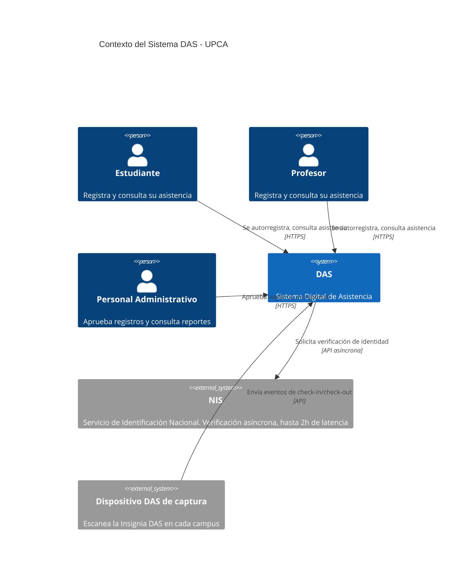
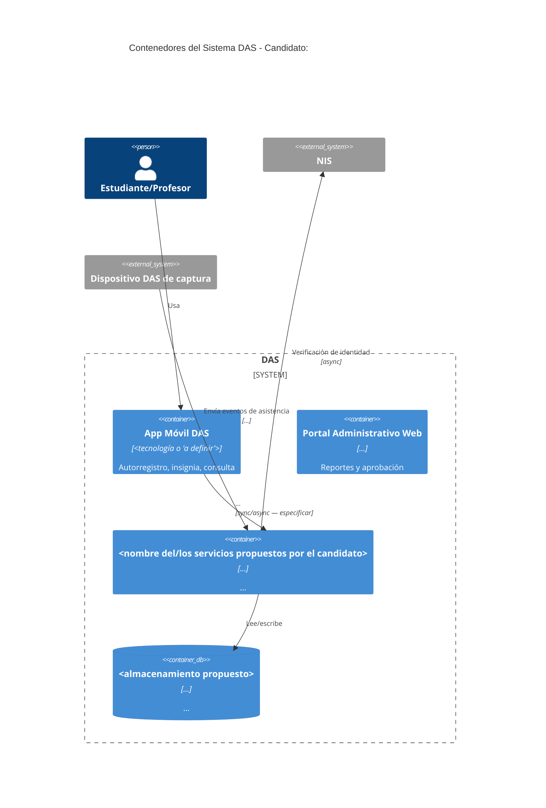
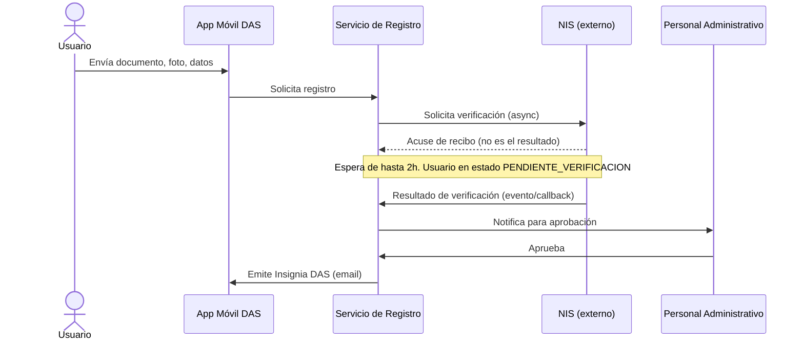

# Convenciones de diagramación C4 + Mermaid para este capstone

Esta skill fija las convenciones que **todo** diagrama del proyecto debe
seguir, para que sean legibles por `architecture-reviewer`,
`architecture-defender`, `report-writer` y por quien los lea después.

## Formato general

- Un archivo `.mmd` por diagrama, ubicado en `design/diagrams/`.
- Un concepto por diagrama. No mezcles Context y Container en el mismo archivo.
- Nombrá los archivos según su nivel: `c4-context.mmd`, `c4-container.mmd`,
  `c4-component.mmd`, `sequence-<flujo>.mmd`.
- No inventes componentes que no estén en
  `design/milestone-2/architecture-decision.md` — si algo no está decidido,
  no lo dibujes; dejá una nota en `NOTES.md` en su lugar.

## Nivel 1 — Contexto (`c4-context.mmd`)

Usá el diagrama C4 nativo de Mermaid:

Actores fijos del capstone (no los cambies sin que `context/capstone.pdf` lo
respalde): Estudiante, Profesor, Personal Administrativo, NIS, Dispositivo DAS
de captura. Marcá siempre la relación con el NIS como asíncrona/alta latencia
en la etiqueta — es un driver arquitectónico central, no un detalle.

## Nivel 2 — Contenedores (`c4-container.mmd`)

Los containers que aparezcan acá deben ser exactamente los que
`design/milestone-2/architecture-decision.md` describe — ni más, ni menos.

## Nivel 3 — Componentes (`c4-component.mmd`)

Solo para el container más crítico/complejo de la arquitectura elegida
(normalmente el que maneja registro+verificación NIS, o el de captura de
asistencia). Mismo principio: `C4Component`, componentes internos con
`Component(...)`, relaciones con `Rel(...)`. Si la arquitectura elegida es
monolito modular, este nivel muestra los módulos internos del monolito.

## Diagramas de secuencia

Usá `sequenceDiagram` estándar de Mermaid. Reglas específicas para este dominio:

- Marcá explícitamente síncrono vs. asíncrono: una llamada async se representa
  con `->>` seguido de una respuesta inmediata de "aceptado/en proceso", y el
  resultado real llega después via otro mensaje o evento — nunca dibujes la
  espera de 2h del NIS como una flecha bloqueante síncrona.
- Usá `Note over` para marcar estados de espera prolongados (ej. "Usuario en
  estado PENDIENTE_VERIFICACION durante hasta 2h").
- Usá `alt`/`opt` para caminos de error: timeout del NIS, dispositivo offline,
  respuesta duplicada.
- Dos secuencias mínimas obligatorias:
  - `sequence-registro-nis.mmd`: autorregistro → verificación NIS (async) →
    aprobación administrativa → emisión de Insignia DAS.
  - `sequence-checkin.mmd`: escaneo en dispositivo → registro de
    entrada/salida → camino feliz y, si la arquitectura elegida lo define,
    manejo de pérdida de conectividad.

Ejemplo de esqueleto:

## Checklist antes de dar por terminado un diagrama

- [ ] ¿Todos los componentes dibujados existen en
      `design/milestone-2/architecture-decision.md`?
- [ ] ¿La relación con el NIS está marcada como asíncrona en todos los
      diagramas donde aparece?
- [ ] ¿El nombre del archivo sigue la convención (`c4-*.mmd`, `sequence-*.mmd`)?
- [ ] ¿Quedó alguna ambigüedad que tuviste que resolver para poder dibujar?
      Si sí, está anotada en `design/diagrams/NOTES.md`.
