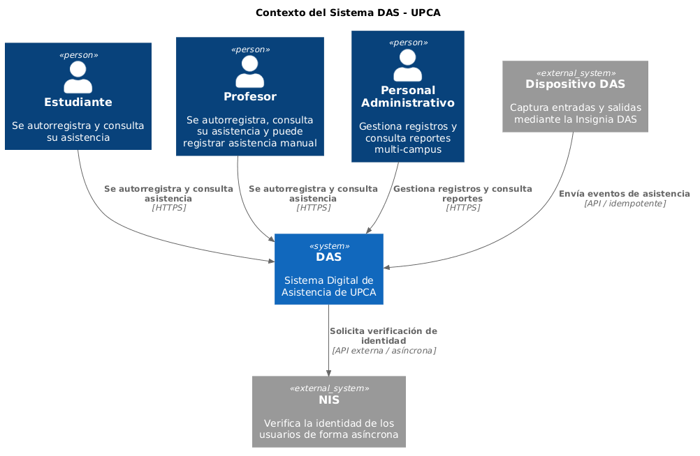
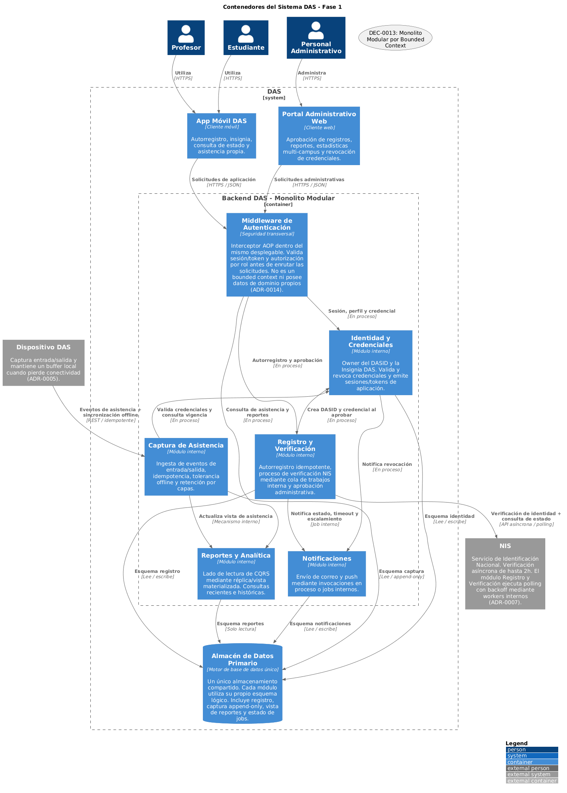
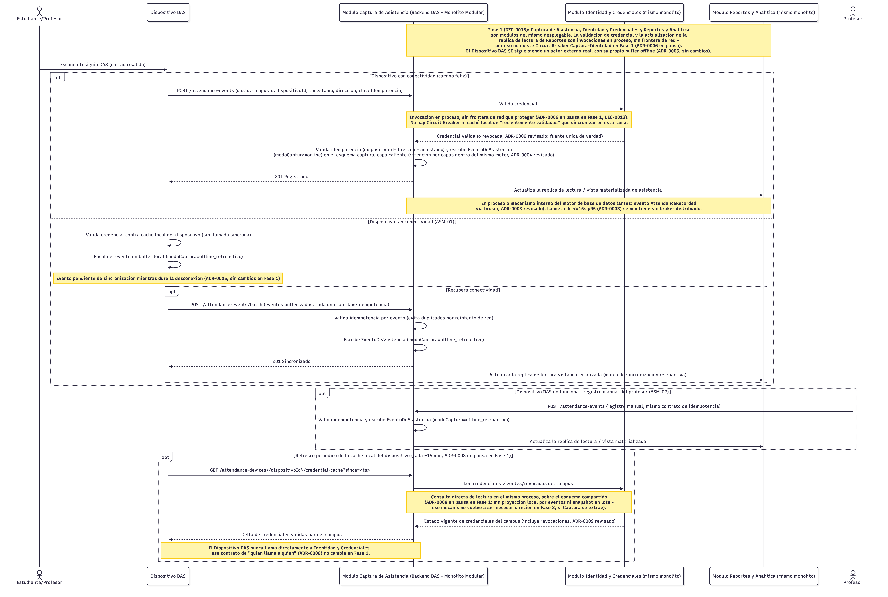
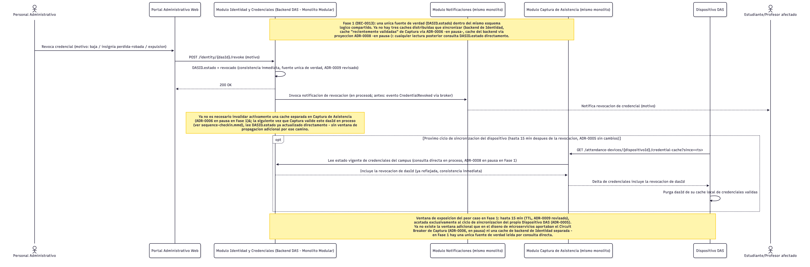

# Sistema Digital de Asistencia (DAS) para UPCA

## Informe final de arquitectura

## 1. Introducción

La Universidad Panamericana de Ciencias Aplicadas (UPCA) opera en 10 ciudades, 20 campus y atiende aproximadamente a 5.000 estudiantes y 400 profesores. DAS moderniza el ciclo de identificación y asistencia: permite el autorregistro, verifica la identidad frente al Servicio de Identificación Nacional (NIS), emite una insignia DAS, registra entradas y salidas, y habilita consultas personales, reportes y estadísticas administrativas.

La arquitectura debe resolver tensiones reales: NIS puede tardar hasta dos horas, los dispositivos DAS pueden perder conectividad, los reportes no deben perjudicar la captura de asistencia y los registros deben preservarse por cinco años sin comprometer los datos personales.

La decisión central es evolutiva. DAS inicia como un **monolito modular** con límites de dominio claros y solo extrae un bounded context hacia un servicio independiente cuando la operación y las métricas lo justifiquen. Para evaluar el costo operativo se asume un equipo pequeño de **3 a 5 desarrolladores**. Esta es una hipótesis de diseño, no un dato proporcionado por UPCA ni una consecuencia de que el capstone sea individual.

El diagrama de contexto sitúa DAS entre sus usuarios, dispositivos y NIS. Muestra las fronteras externas que condicionan el diseño, sin prescribir una topología de microservicios.



## 2. Drivers arquitectónicos

Los drivers son condiciones que cambian la estructura del sistema, no simplemente una lista de características.

| Driver | Exigencia del problema | Consecuencia arquitectónica |
|---|---|---|
| Integración asíncrona con NIS | La verificación no ocurre en tiempo real y puede tardar hasta dos horas. | El registro se modela como proceso de larga duración, con estados y recuperación. |
| Asistencia near real-time | La entrada/salida debe estar disponible lo más cerca posible del tiempo real. | Captura debe ser una ruta liviana y no esperar reportes ni NIS. |
| Escalabilidad y rendimiento | UPCA espera aproximadamente 10.000 usuarios nuevos en dos años. | Se mide capacidad, se separa lectura/escritura y se prepara extracción selectiva. |
| Retención | La asistencia se conserva un mínimo de cinco años. | Se aplican políticas distintas para datos recientes e históricos. |
| Seguridad y confidencialidad | DAS administra identidad, foto y asistencia. | Autorización, cifrado, auditoría y minimización de datos son transversales. |

Los requisitos funcionales y no funcionales se mantienen trazables para que las decisiones no parezcan arbitrarias.

| ID | Requisito | Tipo |
|---|---|---|
| REQ-01 | DAS ID único, verificable desde la app, con datos personales y asistencia. | Funcional |
| REQ-02 | Autorregistro con documento, fotografía y datos personales. | Funcional |
| REQ-03 | Verificación remota de identidad mediante NIS. | Funcional |
| REQ-04 | Verificación de hasta dos horas y aprobación administrativa. | Funcional / restricción de flujo |
| REQ-05 | Emisión de insignia luego del registro y la verificación. | Funcional |
| REQ-06 | Captura de entrada/salida por usuario, día y ubicación desde dispositivos DAS. | Funcional |
| REQ-07 | Portal con cursos/eventos, reportes y estadísticas. | Funcional |
| REQ-08 | Consulta de asistencia propia desde la aplicación móvil. | Funcional |
| REQ-09 | Confidencialidad y seguridad de los datos DAS. | No funcional |
| REQ-10 | Crecimiento a aproximadamente 15.000 usuarios en dos años. | No funcional |
| REQ-11 | Registro de asistencia lo más cercano posible al tiempo real. | No funcional |
| REQ-12 | Retención mínima de cinco años de registros de asistencia. | No funcional / legal |

No todos los datos de diseño tienen el mismo nivel de certeza. El objetivo de <=15 s p95 desde que el servidor recibe un escaneo hasta que queda disponible para consulta, el pico de referencia de 50-55 eventos por segundo, la capacidad de los buffers y la retención de documentos/fotos son metas, estimaciones o decisiones pendientes de validación. El enunciado tampoco define cómo NIS entrega el resultado al backend: webhook, consulta de estado, correo procesable u otro mecanismo. DAS debe soportar un resultado diferido sin asumir un contrato que todavía no existe.

## 3. Priorización y escenarios

La priorización se hizo por impacto arquitectónico y riesgo técnico, no con una escala arbitraria de importancia de negocio.

| Requisito priorizado | Riesgo o presión principal |
|---|---|
| REQ-03 y REQ-04: NIS y aprobación | Proceso largo, dependencia externa y estados intermedios. |
| REQ-06: captura de asistencia | Mayor volumen de escritura y operación distribuida en campus. |
| REQ-09: seguridad | Datos sensibles presentes en todos los módulos. |
| REQ-10: crecimiento | Capacidad futura sin datos exactos de concurrencia. |
| REQ-11: near real-time | Tensión entre baja latencia y carga. |
| REQ-12: retención | Datos históricos por un plazo legalmente obligatorio. |
| REQ-07: reportes | Posible competencia de lectura agregada con la captura. |

Los escenarios críticos convierten esos requisitos en comportamientos observables.

| Escenario | Criterio de éxito |
|---|---|
| Autorregistro y verificación | El usuario recibe un identificador de solicitud, consulta el estado y no crea duplicados. |
| NIS lento o no disponible | La solicitud queda pendiente y recuperable; no bloquea otros flujos. |
| Escaneo online | El evento se persiste de forma trazable y llega a reportes dentro de la meta de diseño. |
| Dispositivo offline | Los eventos se conservan localmente y se sincronizan sin duplicarlos. |
| Reconexión masiva | La sincronización por lotes no desplaza el escaneo en vivo. |
| Revocación | La credencial se revoca de inmediato dentro de DAS y el dispositivo se actualiza en su siguiente sincronización. |

## 4. Decisión arquitectónica

Se evaluaron dos niveles de inversión. Un monolito sin límites internos se descartó porque mezclaría dominios con reglas y cargas distintas; no sería una simplificación responsable.

| Alternativa | Qué se gana | Qué se sacrifica |
|---|---|---|
| Monolito modular | Un despliegue, operación manejable para un equipo pequeño, límites de dominio claros y evolución gradual. | Escala como unidad y concentra riesgo en proceso y base de datos. |
| Microservicios desde el día uno | Despliegue, datos y escalabilidad independientes. | Broker, red interna, observabilidad distribuida y varias piezas operables antes de que la carga lo justifique. |

Elegí el monolito modular porque resuelve los drivers actuales con un costo operacional proporcional. Los microservicios siguen siendo una alternativa válida cuando aparezca evidencia de necesidad; no son la arquitectura inicial porque pagar su complejidad desde el primer día no aporta un beneficio comprobado para el escenario proyectado.

Las decisiones quedan registradas en los ADRs para rastrear una necesidad hasta su consecuencia técnica.

| ADR | Decisión | Estado en la propuesta final |
|---|---|---|
| ADR-0001 | Microservicios y EDA como alternativa inicial. | Sustituido para Fase 1 por ADR-0013; sirve como referencia de evolución. |
| ADR-0002 | Saga orquestada para registro/NIS. | Vigente como máquina de estados y trabajo persistente interno. |
| ADR-0003 | CQRS para separar captura y reportes. | Vigente mediante proyección o vista materializada interna. |
| ADR-0004 | Retención caliente/tibia/fría de asistencia. | Vigente dentro del motor compartido. |
| ADR-0005 | Captura offline y consumidor idempotente. | Vigente. |
| ADR-0006 | Circuit Breaker entre Captura e Identidad. | En pausa hasta que exista frontera de red en Fase 2. |
| ADR-0007 | Integración NIS, duplicados y tope de reintentos. | Vigente; el mecanismo concreto de entrega NIS se valida. |
| ADR-0008 | Refresco de credenciales de dispositivo a través de Captura. | En pausa hasta extraer los contextos implicados. |
| ADR-0009 | Revocación de credencial. | Vigente. |
| ADR-0010 | Clave de idempotencia y timestamps de asistencia. | Vigente. |
| ADR-0011 | Retención provisional de documentos y fotos. | Placeholder que requiere validación legal. |
| ADR-0012 | Idempotencia de `POST /registrations`. | Vigente. |
| ADR-0013 | Monolito modular y extracción selectiva. | Decisión central vigente. |
| ADR-0014 | Middleware de autenticación dentro del monolito. | Vigente, con excepción del autorregistro público. |

## 5. Modelo arquitectónico

Fase 1 separa DAS en cinco bounded contexts. No son capas técnicas: cada uno tiene responsabilidades, reglas y ownership de datos propios.

| Bounded context | Responsabilidad | Datos de origen |
|---|---|---|
| Registro y Verificación | Autorregistro, interacción con NIS, estados y aprobación administrativa. | Solicitud de Registro, estado, intentos y referencias de documentos. |
| Identidad y Credenciales | DAS ID, insignia, sesión, autorización y revocación. | DAS ID, Credencial y estado de revocación. |
| Captura de Asistencia | Escaneos, sincronización offline e idempotencia. | Evento de Asistencia y claves de deduplicación. |
| Reportes y Analítica | Consultas personales, reportes, estadísticas e histórico. | Proyecciones de lectura, no el evento original. |
| Notificaciones | Entrega y seguimiento de correos o push. | Registro de Notificación y estado de entrega. |

En Fase 1 todos los módulos están en un mismo proceso y comparten un motor de datos con esquemas lógicos separados. Esto representa **data ownership lógico**, no Database per Service. Ningún módulo debe escribir directamente datos de otro. Esa disciplina permite migrar el esquema de un módulo si posteriormente se extrae.

El middleware de autenticación es un componente transversal del mismo desplegable. En esta fase no se usa API Gateway ni BFF porque no hay servicios de red que enrutar o agregar. El middleware concentra autenticación y autorización sin introducir otra unidad de despliegue.

**Validación de diagrama.** `c4-container.png` representa los módulos correctos de Fase 1, pero necesita actualización antes de insertarse como figura final: hoy hace pasar `POST /registrations` por validación de sesión, aunque quien se autorregistra todavía no tiene credencial. El diagrama definitivo debe mostrar este endpoint público protegido por validación, límites de tasa e idempotencia, y mantener autenticación/rol para las rutas de consulta, administración y revocación.



## 6. Cómo funciona DAS

El flujo de registro inicia cuando el usuario envía sus datos y recibe `202 Accepted` con un `registroId`. DAS no mantiene una petición HTTP abierta durante la verificación. Crea una Solicitud de Registro con estado `pendiente_nis`, persiste el trabajo asociado y permite consultar su estado en todo momento.

```text
Usuario -> autorregistro -> Solicitud pendiente
                                |
                                v
                    job persistido de verificación
                                |
                                v
                         ACL <-> NIS externo
                                |
                                v
       verificado / rechazado / escalado manual
                                |
                                v
                   aprobación administrativa
                                |
                                v
                      DAS ID y credencial
```

Si la verificación concluye correctamente, la solicitud pasa a `pendiente_admin`. Una aprobación genera el DAS ID y la credencial; un rechazo conserva su motivo. Si se agotan los reintentos permitidos, la solicitud queda en `escalado_manual`, visible para el administrador y notificada al usuario. No se elimina ni queda esperando de forma indefinida.


La captura de asistencia sigue un camino distinto. Un escaneo online se acepta de forma síncrona: Captura valida la credencial dentro del mismo monolito, deduplica y persiste el evento antes de responder. Después actualiza la proyección de Reportes por un mecanismo interno durable; un reporte lento no bloquea la captura.



Cuando el dispositivo queda offline, valida contra la última caché disponible, conserva los eventos y los sincroniza por lotes al reconectar. Cada evento contiene clave de idempotencia, `timestampEscaneo` y `timestampRecibidoServidor`. La idempotencia evita duplicados; el tiempo de escaneo establece el orden lógico y los eventos atrasados quedan auditados para no reemplazar silenciosamente otros registros. El tamaño del buffer y el comportamiento al llenarse se validan antes de producción: no se debe descartar automáticamente asistencia mientras se promete preservarla.

La revocación es un flujo administrativo separado. El cambio de estado se ve de inmediato dentro del monolito; el dispositivo recibe la revocación en su siguiente sincronización. La ventana de caché es un trade-off explícito entre disponibilidad offline y revocación inmediata sobre un dispositivo desconectado.



## 7. Comunicación y procesamiento

La arquitectura usa comunicación síncrona para confirmar acciones inmediatas y asíncrona cuando el resultado tarda o no debe bloquear la ruta crítica.

| Flujo | Tipo | Motivo |
|---|---|---|
| App o portal -> DAS | Síncrono. | El cliente necesita aceptación, error o estado inmediato. |
| Dispositivo -> Captura | Síncrono para escaneo online. | Confirma recepción y persistencia del evento. |
| Registro -> NIS | Asíncrono a nivel de proceso. | El resultado puede tardar horas. |
| Captura -> Reportes | Asíncrono interno. | Las consultas no bloquean la escritura crítica. |
| Dispositivo offline -> Captura | Asíncrono por lote. | Los eventos se acumulan durante la desconexión. |
| Servicios extraídos | API o eventos, según el contrato. | Solo aplica al cruzar fronteras de Fase 2. |

El proceso NIS persiste la solicitud, el estado, el identificador externo, el próximo intento y el job pendiente. Si un worker falla o DAS se reinicia, el trabajo vuelve a estar disponible cuando vence su arrendamiento de ejecución. Esto permite recuperar procesos largos sin introducir Kafka ni un motor de workflow independiente en Fase 1.

La consistencia se elige por dato. Identidad y revocación requieren visibilidad inmediata dentro del monolito. El evento de asistencia debe persistirse antes de confirmar un escaneo online. Reportes, estadísticas y cachés de dispositivos aceptan consistencia eventual porque una demora limitada es preferible a detener la captura. El resultado NIS también es eventual porque el tercero define cuándo puede entregarlo.

## 8. Resiliencia y manejo de fallos

La resiliencia se aplica solo donde existe un escenario concreto de falla y una consecuencia que se necesita evitar.

| Fallo | Comportamiento | Protección y recuperación |
|---|---|---|
| NIS lento o no disponible | El registro queda pendiente; no bloquea asistencia. | Job persistido, timeout, retry, ACL y escalamiento manual. |
| DAS o worker reinicia | Se interrumpe un proceso en curso. | Estado y trabajo persistidos; otro ciclo lo retoma. |
| Dispositivo offline | Los escaneos aún no llegan al backend. | Buffer local, caché, lote e idempotencia. |
| Reconexión masiva | Lotes compiten con escaneos en vivo. | Batching, throttling, jitter y bulkhead lógico. |
| Proyección lenta | Reportes se retrasan. | Tarea durable, medición de lag y reproyección. |
| Email/push falla | El usuario no recibe notificación. | Retry y trabajos fallidos; el estado sigue consultable. |
| Base o proceso cae | Varios módulos se ven afectados en Fase 1. | Alta disponibilidad, backup/restauración y monitoreo. |

Los reintentos aplican solo a fallos transitorios: timeout, indisponibilidad, rate limit o 5xx. Datos inválidos, credenciales inválidas, rechazo definitivo y errores de negocio no se reintentan. Toda operación repetible con efectos persistentes usa idempotencia y backoff exponencial con jitter.

El Circuit Breaker protege una dependencia remota que podría producir fallos en cascada. En Fase 1 aplica al adaptador NIS: ante fallos repetidos, DAS falla rápido y conserva el trámite pendiente. No se aplica entre módulos internos. En Fase 2 también protege la llamada Captura -> Identidad si ambos módulos pasan a ser servicios separados.

El bulkhead no requiere un servicio nuevo: asigna capacidad separada a sincronización masiva y escaneo online mediante límites de concurrencia, tamaño máximo de lote, throttling por dispositivo/campus y prioridad para la ruta crítica. Los trabajos que no pueden procesarse se guardan en una tabla persistida de fallos, equivalente funcional a una DLQ sin afirmar que existe un broker. Incluye causa, correlación, intentos y responsable de revisión.

## 9. Manejo de carga y escalabilidad

En Fase 1 el monolito escala como una unidad: verticalmente y, cuando sea necesario, con varias instancias de toda la aplicación. No se afirma que cada bounded context escale por separado todavía. La referencia de 50-55 eventos por segundo se usa para pruebas; no representa una capacidad garantizada por el enunciado.

Throughput y latencia se miden juntos. Si entran más eventos de los que se procesan, crece la cola, aumenta la edad del trabajo más antiguo y finalmente aumenta la latencia. Por eso la operación observa eventos por segundo, p95, profundidad de cola, lag de proyecciones, tamaño de lotes y antigüedad del trabajo pendiente.

Los principales bottlenecks de Fase 1 son la contención de I/O entre Captura y Reportes, la base de datos compartida y una reconexión masiva de dispositivos. CQRS interno, retención por capas, bulkheads y observabilidad mitigan estos riesgos; la extracción de Captura los aísla si dejan de ser tolerables.

## 10. Datos y eventos

El modelo de datos separa fuentes de verdad y copias derivadas.

| Dato | Dueño | Uso |
|---|---|---|
| Solicitud de Registro | Registro y Verificación | Proceso, estado, intentos y aprobación. |
| DAS ID y Credencial | Identidad y Credenciales | Identidad, insignia, sesión y revocación. |
| Evento de Asistencia | Captura de Asistencia | Fuente inmutable de entrada/salida. |
| Resúmenes y estadísticas | Reportes y Analítica | Proyecciones derivadas y reconstruibles. |
| Registro de Notificación | Notificaciones | Estado operativo de correo o push. |

`EventoDeAsistencia` contiene persona, campus, curso/evento cuando corresponda, dispositivo, dirección, tiempo de escaneo, tiempo de recepción y clave de idempotencia. El evento se conserva como registro append-only; esto no convierte a DAS en un sistema de Event Sourcing. El estado de Registro e Identidad se guarda directamente porque requiere consulta inmediata y no necesita la complejidad de reconstruirse desde eventos.

La retención por capas mantiene eventos recientes en almacenamiento optimizado para operación y mueve el histórico a capas tibias/frías sin eliminarlo antes de cinco años. Los documentos y fotos de autorregistro no heredan automáticamente ese plazo: su política provisional es de 180 días tras estado terminal, ampliable a un año en caso de fraude, pendiente de validación legal.

En Fase 1, una tarea durable coordina la persistencia de asistencia y la actualización diferida de su proyección. Una Transactional Outbox formal solo se justifica al publicar eventos desde un servicio hacia un broker en Fase 2; en ese momento registra cambio de dominio y evento pendiente en la misma transacción. Los eventos que crucen servicios se versionan de forma compatible, por ejemplo `AttendanceRecorded.v1`, antes de introducir cambios incompatibles.

## 11. Integraciones externas

NIS es la principal dependencia externa. DAS no controla su disponibilidad, latencia ni contrato, por lo que Registro y Verificación lo aísla detrás de una Anti-Corruption Layer. La ACL traduce autenticación, formatos, estados y errores del proveedor al modelo de Solicitud de Registro; un cambio en NIS no debe propagarse por todo el dominio DAS.

El spike técnico previo a la implementación debe confirmar mecanismo de entrega de resultado, identificador de verificación, autenticación, límites de tasa, códigos de error, comportamiento ante timeout y posibles duplicados. Hasta entonces, webhook, consulta de estado y procesamiento de correo son opciones de integración, no hechos establecidos.

Los contratos de las APIs se documentan con autenticación, validación e idempotencia. En Fase 2, APIs y eventos deben evolucionar de manera compatible para evitar que una versión nueva de un productor rompa a un consumidor aún no migrado.

## 12. Observabilidad

La observabilidad permite operar DAS y decidir si debe evolucionar; no es únicamente una preocupación de infraestructura.

| Área | Señales |
|---|---|
| APIs | Solicitudes, errores, latencia p95 y rechazos de autorización. |
| Registro/NIS | Solicitudes pendientes, duración, timeouts, reintentos y estado del Circuit Breaker. |
| Captura | Eventos recibidos, aceptados, duplicados, offline pendientes y tamaño de batch. |
| Reportes | Lag de proyección y antigüedad de las vistas. |
| Datos | Transiciones de retención, capacidad, backup y restauración. |
| Negocio | Registros completados/rechazados, campus sin actividad y asistencia procesada. |

Cada solicitud, job y evento lleva un identificador de correlación. Las alertas más importantes son solicitud NIS demasiado antigua, cola creciente, proyección fuera de la meta, buffer próximo a su límite, error elevado y Circuit Breaker abierto.

## 13. Riesgos y mitigaciones

| Riesgo | Mitigación | Riesgo residual |
|---|---|---|
| Complejidad distribuida para un equipo pequeño (3-5 desarrolladores) | Monolito modular hasta contar con evidencia y madurez operativa. | Una extracción futura exige capacidad real de operación. |
| NIS incierto o indisponible | ACL, trabajos persistidos, timeout, retry y escalamiento manual. | La intervención humana depende del tercero. |
| Buffer local lleno | Límites, alertas, estado degradado y asistencia manual. | Requiere procedimiento operativo de campus. |
| Contención entre Captura y Reportes | CQRS interno, medición de lag y posible extracción de Captura. | Fase 1 sigue compartiendo proceso y motor. |
| Proceso/base como punto único de falla | Alta disponibilidad, backup/restauración y monitoreo. | Mayor radio de falla que servicios aislados. |
| Privacidad y retención de documentos | Cifrado, RBAC, auditoría y validación legal. | La ingeniería no resuelve sola la obligación legal. |

## 14. Trade-offs arquitectónicos

Los trade-offs explican por qué el diseño es adecuado para este contexto, no solo qué ventajas tiene.

| Decisión | Ganancia | Sacrificio aceptado y razón |
|---|---|---|
| Monolito modular en lugar de microservicios | Menos costo y complejidad operativa; límites de dominio claros. | Menor aislamiento físico y escalado fino; aceptable hasta que la carga pruebe lo contrario. |
| Síncrono para captura, asíncrono para NIS/reportes | Respuesta inmediata donde importa; no bloquear por tareas lentas. | Estados, trabajos y monitoreo adicionales. |
| Consistencia fuerte para identidad/evento, eventual para vistas | Corrección en operaciones críticas y disponibilidad en la ruta de captura. | Reportes y cachés pueden tener retraso acotado. |
| Buffer offline | Preservar asistencia durante cortes de conectividad. | Requiere control de capacidad, orden y reconciliación. |
| Extracción selectiva | Pagar complejidad distribuida solo cuando aporte valor. | Disciplina de contratos, métricas y migración gradual. |

No se adoptan Event Sourcing, service mesh, Kubernetes, múltiples brokers, transacciones distribuidas o bases por servicio en Fase 1. No resuelven un driver actual de DAS con un beneficio que compense su costo.

## 15. Evolución arquitectónica: Fase 1 -> Fase 2

Fase 2 no es una migración big bang. Puede existir una arquitectura híbrida, por ejemplo monolito + Servicio de Captura de Asistencia. Captura es el primer candidato porque concentra el mayor volumen de escritura, opera con dispositivos distribuidos y puede competir por recursos con Reportes. Registro y Verificación solo se extrae si la volatilidad de NIS empieza a afectar el resto; los otros contextos pueden permanecer dentro del monolito indefinidamente.

| Aspecto | Fase 1 | Fase 2 cuando haya evidencia |
|---|---|---|
| Despliegue | Una unidad. | Monolito más servicios extraídos. |
| Comunicación | En proceso y tareas persistentes internas. | APIs o eventos entre fronteras reales. |
| Datos | Motor compartido con ownership lógico. | Database per Service del módulo extraído. |
| Escalabilidad | Toda la aplicación. | Servicio extraído de forma independiente. |
| Broker | No existe. | Solo si una integración distribuida necesita pub/sub. |

La extracción se evalúa si ocurre al menos una de estas señales y el equipo ya puede sostener un segundo despliegue: más de 10 campus activos con carga próxima al escenario de prueba; degradación atribuible a contención entre Captura y Reportes en dos ventanas pico consecutivas; necesidad repetida de desplegar o escalar Captura sin los demás módulos; o pipeline e infraestructura reproducible probados en producción durante un ciclo estable.

La secuencia es medir presión, validar causa, estabilizar contrato, extraer módulo, migrar datos, introducir comunicación distribuida únicamente donde sea necesaria y observar. Cada contexto se decide por separado; Fase 2 no presupone cinco servicios obligatorios.

## 16. Cronograma / Roadmap

| Hito | Resultado verificable | Riesgo que reduce |
|---|---|---|
| Descubrimiento y requisitos | Drivers, restricciones, supuestos y escenarios priorizados. | Diseñar sobre información inventada. |
| Spike NIS | Contrato, entrega de resultado, errores y límites confirmados. | Integración externa incorrecta. |
| Diseño y ADRs validados | Límites, ownership, consistencia y responsabilidades acordados. | Contradicciones entre decisiones. |
| Modelo de datos estable | Estados de registro, buffer y retención definidos. | Pérdida o tratamiento ambiguo de datos. |
| Prototipo de captura | Offline, idempotencia, orden y reconexión masiva probados. | Duplicación o saturación de asistencia. |
| Prueba de carga y seguridad | Meta near real-time, recuperación y controles medidos. | Capacidad y privacidad no comprobadas. |
| Operación Fase 1 | Métricas, alertas y criterios de extracción activos. | Migrar por intuición y no por evidencia. |

Fase 2 no tiene fechas fijas: empieza solo cuando se cumplan los criterios de la sección 15. Antes de producción se deben estimar por separado infraestructura, almacenamiento de cinco años, notificaciones, soporte, desarrollo y operación.

## 17. Evidencia del uso de IA

El siguiente contenido se reproduce desde [`prompts/reflexion-critica-ia.md`](../prompts/reflexion-critica-ia.md).

### Reflexión crítica sobre el uso de Inteligencia Artificial

Durante el desarrollo del Capstone utilicé Inteligencia Artificial como una herramienta de apoyo para analizar el problema, estructurar las decisiones arquitectónicas, cuestionar la propuesta y preparar la documentación final. Para esto definí diferentes agentes especializados y posteriormente utilicé cuatro prompts principales, correspondientes a las cuatro etapas del proceso arquitectónico.

El objetivo no fue delegar completamente el diseño en la IA, sino utilizarla para **organizar el razonamiento, identificar posibles omisiones y generar diferentes perspectivas sobre el mismo problema**. La separación de responsabilidades permitió que un agente propusiera decisiones mientras otro pudiera cuestionarlas, evitando depender únicamente de una única respuesta generada por IA.

### Uso de los prompts

| Prompt                               | Propósito                                                                                                       | Valor generado                                                                                                                                                                                                     | Principal limitación                                                                                                                                                           |
| ------------------------------------ | --------------------------------------------------------------------------------------------------------------- | ------------------------------------------------------------------------------------------------------------------------------------------------------------------------------------------------------------------ | ------------------------------------------------------------------------------------------------------------------------------------------------------------------------------ |
| **Prompt 1 — Descubrimiento**        | Analizar el problema y separar drivers, requisitos, supuestos, restricciones y ambigüedades.                    | Ayudó a transformar un enunciado amplio en elementos concretos que podían utilizarse posteriormente para tomar decisiones. También permitió identificar preguntas que necesitaban validación.                      | Inicialmente existía el riesgo de que la IA interpretara ambigüedades como requisitos o intentara responder preguntas que correspondían a los stakeholders.                    |
| **Prompt 2 — Diseño arquitectónico** | Generar y cuestionar alternativas, decisiones arquitectónicas, bounded contexts, modelo conceptual y diagramas. | Fue fundamental para estructurar el diseño y, especialmente, para obligar a justificar las decisiones en función de los drivers. El reviewer agregó una perspectiva crítica que permitió detectar inconsistencias. | Algunas propuestas podían introducir patrones o componentes porque parecían buenas prácticas, aunque no fueran estrictamente necesarios para el problema.                      |
| **Prompt 3 — Trade-offs y riesgos**  | Evaluar la arquitectura seleccionada, sus costos, trade-offs, riesgos y mitigaciones.                           | Permitió pasar de "esta arquitectura parece adecuada" a explicar qué beneficios se obtienen y qué costos o riesgos se aceptan. También ayudó a preparar escenarios de falla.                                       | Fue necesario controlar que la IA no intentara solucionar todos los riesgos modificando la arquitectura o inventando alternativas que no habían sido consideradas.             |
| **Prompt 4 — Síntesis y defensa**    | Preparar las preguntas de defensa y convertir el trabajo anterior en un informe técnico comprensible.           | Ayudó a identificar debilidades antes de la defensa y a consolidar el trabajo en una narrativa coherente para stakeholders y usuarios técnicos.                                                                    | La IA podía producir respuestas demasiado convincentes incluso cuando la evidencia disponible no era suficiente, por lo que fue necesario revisar críticamente las respuestas. |

### ¿Qué prompt generó mayor valor?

Considero que el **Prompt 2 — Diseño arquitectónico** fue el que generó mayor valor.

La razón principal es que no se limitó a producir una solución, sino que estableció un proceso en el que una propuesta podía ser **planteada, representada y posteriormente cuestionada**. La separación entre `architecture-strategist`, `architecture-modeler` y `architecture-reviewer` fue especialmente útil porque cada uno tenía una responsabilidad diferente: el strategist tomaba las decisiones, el modeler las representaba y el reviewer intentaba encontrar problemas en ellas. El reviewer, además, estaba definido como una voz adversarial que debía buscar contradicciones, sobreingeniería, puntos únicos de falla y decisiones sin trazabilidad.

Esto cambió la forma en la que evalué la arquitectura. En lugar de preguntarme solamente:

> "¿Qué arquitectura podría funcionar?"

también pude preguntarme:

> "¿Por qué esta arquitectura y no otra?"

y posteriormente:

> "¿Qué podría estar mal con esta decisión?"

Considero que esta segunda perspectiva fue una de las mayores contribuciones de la IA al proceso.

### ¿Qué prompt generó más ruido?

El **Prompt 3 — Trade-offs, calidad y riesgos** fue el que requirió mayor control.

El análisis de riesgos puede llevar fácilmente a que una IA intente cubrir todos los escenarios posibles y termine agregando mecanismos, componentes o patrones que aumentan innecesariamente la complejidad. Por esta razón fue necesario establecer límites claros: el agente de riesgos debía identificar y mitigar riesgos, pero no rediseñar unilateralmente la arquitectura; de igual forma, el agente de trade-offs debía utilizar alternativas reales y no inventar nuevas.

Este comportamiento me permitió identificar una característica importante del uso de IA: **una respuesta más completa no necesariamente es una respuesta mejor**. En arquitectura, agregar más mecanismos puede hacer que una solución parezca más robusta, pero también puede introducir complejidad que no está justificada por los requisitos.

Por eso, parte del trabajo consistió en distinguir entre:

* una mejora realmente necesaria;
* una recomendación razonable pero no requerida;
* una sobreingeniería;
* y una propuesta que simplemente sonaba técnicamente bien.

### ¿Qué tuve que corregir manualmente?

La revisión manual fue necesaria principalmente en cuatro aspectos:

| Aspecto                        | Corrección realizada                                                                                                                             |
| ------------------------------ | ------------------------------------------------------------------------------------------------------------------------------------------------ |
| **Supuestos**                  | Revisé que una interpretación de la IA no terminara convirtiéndose automáticamente en un requisito del sistema.                                  |
| **Decisiones arquitectónicas** | Verifiqué que los patrones y componentes propuestos estuvieran relacionados con un driver, requisito o problema real.                            |
| **Riesgos y alternativas**     | Eliminé o cuestioné propuestas que introducían mecanismos innecesarios o alternativas que no estaban realmente justificadas.                     |
| **Informe y defensa**          | Revisé que las respuestas fueran defendibles y que no presentaran como hechos decisiones o información que no estaba suficientemente sustentada. |

Un ejemplo importante fue el tratamiento de las preguntas de stakeholders. El agente de descubrimiento debía identificar las preguntas abiertas, pero **no responderlas por sí mismo**. Esto fue importante porque una IA puede llenar fácilmente un vacío de información con una respuesta que parece razonable. Sin embargo, en un problema real, una suposición razonable no necesariamente representa lo que el stakeholder necesita. 

Algo similar ocurrió durante la preparación de la defensa. El agente `architecture-defender` fue diseñado para dejar una pregunta como débil o sin resolver cuando no existiera evidencia suficiente, en lugar de inventar una respuesta. 

### ¿Qué aprendí del uso de IA?

Uno de los principales aprendizajes fue que **la calidad del resultado depende considerablemente de la calidad de las restricciones dadas a la IA**.

Un prompt genérico como:

> "Diseña una arquitectura para este sistema"

puede generar una respuesta técnicamente atractiva, pero no necesariamente una arquitectura adecuada para el problema.

En cambio, dividir el proceso permitió establecer límites:

```text
Problema
   ↓
Drivers y requisitos
   ↓
Alternativas
   ↓
Decisión
   ↓
Revisión crítica
   ↓
Trade-offs y riesgos
   ↓
Defensa
   ↓
Informe
```

Esto hizo que la IA funcionara más como un **equipo de apoyo al razonamiento arquitectónico** que como un generador automático de una solución.

También aprendí que es importante introducir mecanismos de crítica dentro del propio proceso. El hecho de contar con un agente cuyo objetivo era cuestionar la arquitectura resultó más valioso que utilizar únicamente agentes orientados a generar contenido.

### Valor generado por la IA

De manera general, considero que la IA aportó valor principalmente en cuatro áreas:

**1. Organización del razonamiento**

Permitió convertir una problemática extensa en elementos más manejables y relacionados entre sí.

**2. Exploración**

Ayudó a considerar diferentes alternativas y consecuencias antes de seleccionar una solución.

**3. Crítica**

La revisión adversarial permitió encontrar inconsistencias y decisiones que necesitaban mayor justificación.

**4. Comunicación**

Facilitó transformar el razonamiento arquitectónico en diagramas, tablas, respuestas de defensa y documentación comprensible para diferentes tipos de lectores.

La IA fue especialmente útil para mantener la continuidad entre estas etapas. Por ejemplo, los trade-offs podían utilizar las decisiones tomadas durante el diseño, mientras que la preparación de la defensa podía utilizar los riesgos y decisiones identificados anteriormente. El diseño de los agentes buscaba precisamente mantener esa separación y trazabilidad.

### Conclusión

El uso de Inteligencia Artificial fue útil para acelerar y estructurar el proceso de diseño arquitectónico, pero no sustituyó el criterio necesario para tomar las decisiones finales.

La principal ventaja no estuvo en que la IA pudiera "diseñar la arquitectura", sino en que permitió **obtener diferentes perspectivas sobre el mismo problema**: una perspectiva para descubrir requisitos, otra para proponer decisiones, otra para cuestionarlas, otra para analizar sus riesgos y finalmente otra para preparar su defensa.

Al mismo tiempo, el proceso mostró una limitación importante: la IA puede generar respuestas técnicamente plausibles que no necesariamente están justificadas por el problema. Por esta razón, tuve que revisar manualmente los supuestos, las alternativas, los riesgos y las justificaciones antes de aceptarlos.

En conclusión, considero que la IA generó mayor valor cuando fue utilizada como **herramienta de razonamiento y revisión**, y no simplemente como generador de contenido. El criterio humano siguió siendo necesario para decidir qué propuestas tenían sentido, cuáles introducían complejidad innecesaria y cuáles podían realmente defenderse con la información disponible.

**La IA aceleró el análisis, amplió las perspectivas y ayudó a encontrar problemas, pero la responsabilidad de las decisiones arquitectónicas finales permaneció en mí.**

## 18. Conclusiones

La propuesta de monolito modular responde al problema actual de UPCA con un costo operacional proporcional: separa los dominios que importan, vuelve persistente el proceso lento de NIS, protege la captura ante desconexiones y evita que los reportes bloqueen la asistencia. También hace visibles sus límites: proceso y base de datos son puntos de concentración, NIS sigue siendo externo y varios parámetros operativos deben validarse antes de producción.

La evolución no es una promesa genérica de migrar a microservicios. Fase 2 empieza solamente si las métricas muestran presión real y si el equipo puede operar las piezas adicionales. La arquitectura preserva límites, ownership y contratos para hacer esa transición por partes, sin rediseñar el sistema completo.

