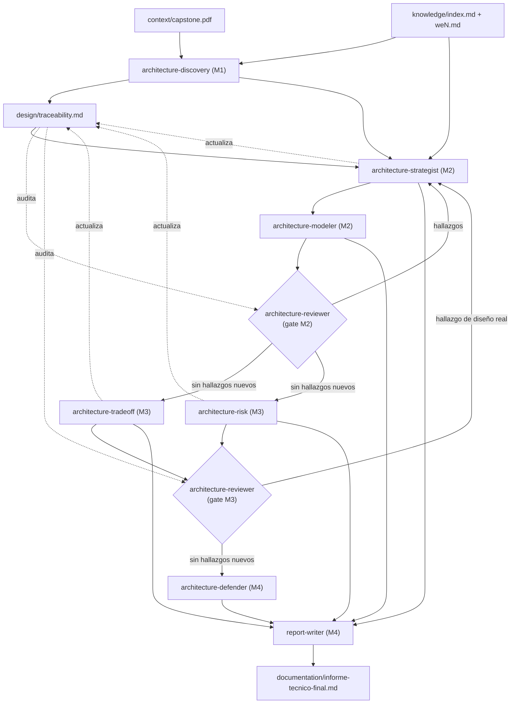
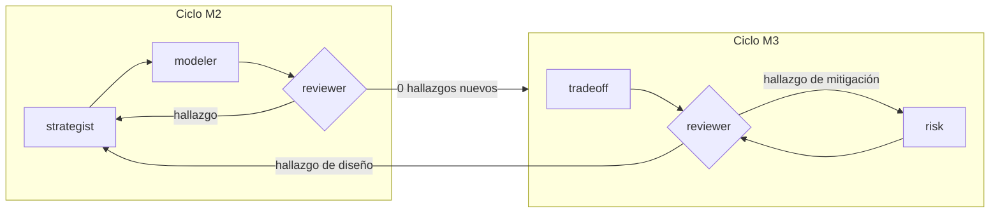

# Estrategia del equipo de agentes — Fase de diseño arquitectónico (Milestones 1-4)

> Este documento **no es el informe del capstone**. Es el diseño del *proceso* de
> agentes que se va a usar para llegar a él, alineado a los 4 Milestones oficiales
> de `plan/milestones.pdf`. El siguiente paso (fuera de este documento) es
> convertir cada agente descrito acá en su archivo `.claude/agents/*.md`, y cada
> flujo en su `.claude/commands/*.md`.
>
> Esta fase es **posterior e independiente** de la fase de extracción de
> conocimiento (`material-curator-final` + `synthesizer` + `/extract-material`),
> que ya está completa. Los agentes de esta fase **consumen** `knowledge/index.md`
> y `knowledge/weN.md` como fuente de patrones/tácticas — no vuelven a generarlos.

---

## 0. Resumen ejecutivo

De tu propuesta de 9 agentes, recomiendo **8**, con dos fusiones, una eliminación
de responsabilidad (absorbida por otros dos agentes) y un cambio de alcance
temporal en dos de ellos:

| Tu propuesta | Recomendación | Motivo corto |
|---|---|---|
| `architecture-discovery` | ✅ Se mantiene igual | Cobertura clara, sin solapamiento |
| `architecture-strategist` | ✅ Se mantiene, **absorbe** a `architecture-patterns` | Elegir un estilo *es* elegir sus patrones — separarlos crea un hand-off artificial |
| `architecture-patterns` | ❌ Se fusiona dentro de `architecture-strategist` | Mismas entradas, misma salida (ADR), mismo momento del proceso |
| `architecture-modeler` | ✅ Se mantiene (reutiliza `diagram-designer` existente) | Traducir decisión → diagrama es una habilidad genuinamente distinta |
| `architecture-reviewer` | ✅ Se mantiene (reutiliza `skeptic-reviewer` existente) | Crítica adversarial, voz independiente — no debe fusionarse con nadie |
| `architecture-tradeoff` | ✅ Se mantiene, **acotado a Milestone 3** | En M2 el trade-off es informal (va dentro del ADR); la matriz formal es un entregable propio de M3 |
| `architecture-risk` | ✅ Se mantiene, distinto de `reviewer` | Reviewer *encuentra* fallas de diseño; risk *cuantifica escenarios* y *mitiga* — son secuenciales, no duplicados |
| `architecture-defender` | ✅ Se mantiene, acotado a M4 | Único agente que no debe generar arquitectura nueva, solo argumentarla con evidencia ya existente |
| `architecture-synthesizer` | ✅ Se mantiene, **renombrado a `report-writer`** (reutiliza el agente existente) | Evita confusión con el `synthesizer` de la fase de conocimiento; el agente ya existe y ya sabe no filtrar proceso interno |
| *(nuevo)* | — | No detecté ninguna responsabilidad de M1-M4 sin cubrir. El único hueco real no es de agente sino de **datos**: las respuestas de stakeholders simulados y la reflexión sobre uso de IA — ver §8 |

También recomiendo **retirar** el antiguo `judge`: su función (comparar y rankear
candidatos) queda absorbida por `architecture-strategist` (elige un estilo entre
alternativas, dentro de M2) y por `architecture-tradeoff` (formaliza la
comparación en M3). El viejo flujo de 3 pasos (`pattern-expert` →
`diagram-designer` → `judge`) generaba más candidatos de los que el rubric de
M2 pide (una decisión justificada, no un ranking de sobrevivientes).

---

## 1. Evaluación crítica de la propuesta inicial

### A. Cobertura

Las 4 preguntas de milestone (§4 de tu mensaje) están cubiertas. No encontré una
responsabilidad de `plan/milestones.pdf` sin dueño, con dos matices:

- El **modelo de datos conceptual** que pide M2 no tenía dueño explícito en tu
  propuesta (¿strategist? ¿modeler?). Se lo asigno a `architecture-strategist`
  (es una decisión de diseño, no una representación visual) y `modeler` lo
  dibuja si aporta claridad.
- El **cronograma con hitos arquitectónicos** de M3 (spike técnico NIS, diseño
  validado, modelo de datos estable, prototipo de captura) tampoco tenía dueño.
  Ya existe la skill `capstone-planning`, construida explícitamente para esto —
  se la asigno a `architecture-risk` (el cronograma de M3 está ligado a
  mitigación de riesgo, no es un artefacto nuevo de gestión de proyecto suelto).

### B. Solapamiento

| Par que señalaste | ¿Hay solapamiento real? | Resolución |
|---|---|---|
| `strategist` vs `patterns` | **Sí, alto.** Mismas entradas (`knowledge/index.md`, drivers de M1), misma salida (ADR justificando una elección), mismo momento (M2). La única diferencia era de "nivel" (estilo vs. patrón interno) pero un estilo arquitectónico *es* una composición de patrones — separarlos obliga a `patterns` a re-justificar decisiones que `strategist` ya tomó. | **Fusionar** en `architecture-strategist`. |
| `reviewer` vs `defender` | **No, bajo.** Reviewer es adversarial *durante* el diseño para forzar cambios (voz activa que puede tumbar una decisión). Defender es post-hoc, *después* de que el diseño ya está cerrado, y no cambia nada — solo organiza evidencia para argumentarlo ante un tercero. Si se fusionan, se pierde la garantía de que el "abogado defensor" no sea también el "fiscal" que ya aprobó el diseño. | **Mantener separados.** |
| `tradeoff` vs `risk` | **Parcial.** Ambos "comparan consecuencias", pero tradeoff compara *alternativas de diseño* (monolito vs microservicios) contra criterios de calidad: es comparativo y retrospectivo a la decisión de M2. Risk analiza *escenarios operacionales* (NIS caído, dispositivo offline) y produce mitigaciones: es prospectivo y no compara alternativas, evalúa una sola arquitectura ya elegida. Entregables de M3 los pide como dos documentos distintos. | **Mantener separados**, pero acotar `tradeoff` a M3 (ver más abajo). |
| `modeler` vs `synthesizer` | **No, ninguno.** Modeler traduce decisiones a diagramas (M2/M3); synthesizer/`report-writer` ensambla el informe final (M4) usando esos diagramas entre otras cosas. No compiten por la misma responsabilidad — uno es fuente, el otro es consumidor. | **Falso positivo, mantener separados.** |

Un solapamiento que **no** preguntaste pero encontré: el viejo `judge` vs.
`architecture-strategist` + `architecture-tradeoff`. Ranking de candidatos y
justificación de una elección son, funcionalmente, la misma tarea partida en
dos momentos distintos del pipeline viejo. Se resuelve retirando `judge` (ver
§0 y §9).

### C. Dependencias (flujo de datos, no todavía el flujo de comandos)



### D. Responsabilidad por Milestone

| Milestone | Pregunta arquitectónica | Agente(s) protagonista(s) | Agente(s) de apoyo |
|---|---|---|---|
| M1 — Descubrimiento | ¿Qué problema tenemos y qué lo condiciona? | `architecture-discovery` (único) | — |
| M2 — Diseño base | ¿Qué arquitectura lo resuelve? | `architecture-strategist` + `architecture-modeler` (co-protagonistas, en loop) | `architecture-reviewer` (gate de salida) |
| M3 — Trade-offs, calidad y riesgo | ¿Podemos defenderla? | `architecture-tradeoff` + `architecture-risk` (en paralelo, mismo insumo) | `architecture-reviewer` (gate de salida), puede reabrir M2 |
| M4 — Síntesis y comunicación | ¿Cómo la comunicamos? | `architecture-defender` → `report-writer` (secuencial) | — |

No forcé "un milestone = un agente": M2 y M3 necesitan más de uno porque cada
milestone real, leído en `plan/milestones.pdf`, ya pide más de un tipo de
artefacto (decisión + diagramas en M2; trade-offs + riesgos + cronograma en M3).

---

## 2. Propuesta final de agentes

Convención de carpetas propuesta (a crear cuando se implemente, no ahora):

```
design/
  traceability.md              # registro canónico de IDs — dueño: discovery, auditor: reviewer
  milestone-1/
    discovery.md                # problema, brechas, preguntas a stakeholders, supuestos, drivers
    priorizacion.md             # tabla Requerimiento | Impacto | Riesgo | Justificación
  milestone-2/
    architecture-decision.md    # estilo elegido + alternativas descartadas (liviano)
    bounded-contexts.md
    data-model-conceptual.md
    review-log.md                # hallazgos de reviewer, iteración a iteración
  adr/adr-NNNN-*.md
  diagrams/*.mmd                 # C4 L1/L2/L3 + secuencias
  milestone-3/
    tradeoff-matrix.md
    risk-register.md
    mitigation-plan.md
  cronograma.md
  milestone-4/
    defense-brief.md
documentation/
  informe-tecnico-final.md       # único entregable final
```

---

### 1. `architecture-discovery`

**Propósito.** Convertir el enunciado ambiguo del capstone en un conjunto
priorizado y trazable de requisitos, supuestos y drivers arquitectónicos.

**Responsabilidad.**
- Leer `context/capstone.pdf` íntegro y `knowledge/index.md` (para saber qué
  conceptos del curso están realmente disponibles para razonar el problema).
- Separar explícitamente, con etiqueta visible: **Requisito** (viene del
  enunciado) vs. **Supuesto** (lo inventamos porque el enunciado no lo dice) vs.
  **Restricción** (límite no negociable) vs. **Ambigüedad/pregunta abierta**
  (no se puede resolver sin más información).
- Formular preguntas concretas para "stakeholders simulados" — **sin
  responderlas él mismo**. Son preguntas para que el usuario (o el instructor,
  vía `documentation/`) las conteste.
- Identificar y justificar los Architectural Drivers (los 5 sugeridos —
  Escalabilidad, Integración asíncrona con NIS, Seguridad y confidencialidad,
  Retención 5 años, Near real-time — u otros si el enunciado los sostiene mejor)
  citando el pasaje concreto de `capstone.pdf` que los origina.
- Producir la tabla de priorización (Requerimiento | Impacto arquitectónico |
  Riesgo técnico | Justificación).
- Sembrar `design/traceability.md` con los primeros IDs: `DRV-NN` (driver),
  `REQ-NN` (requisito), `ASM-NN` (supuesto), `AMB-NN` (ambigüedad abierta).

**Qué NO debe hacer.**
- No debe inventar respuestas de stakeholders simulados — eso es el rol del
  usuario/instructor, no del agente (ver §8, riesgo de fabricación).
- No debe proponer ya un estilo arquitectónico, patrón o tecnología — eso es
  M2. Su output son *condiciones*, no *soluciones*.
- No debe convertir un supuesto en requisito solo porque simplifica el
  problema.

**Entradas.** `context/capstone.pdf`, `knowledge/index.md`, `knowledge/we*.md`
(para profundizar un concepto puntual si hace falta).

**Salidas.** `design/milestone-1/discovery.md`,
`design/milestone-1/priorizacion.md`, siembra inicial de
`design/traceability.md`.

**Milestone(s).** M1 (único responsable).

**Interactúa con.** `architecture-strategist` (consume sus drivers/requisitos),
`architecture-reviewer` (audita en M2/M3 que toda decisión trace a un
`DRV`/`REQ` de este agente).

---

### 2. `architecture-strategist`

*(fusiona tu `architecture-strategist` + `architecture-patterns`)*

**Propósito.** Transformar los drivers de M1 en una estructura arquitectónica
concreta: un estilo elegido y justificado, sus bounded contexts, componentes y
los patrones/tácticas que lo componen.

**Responsabilidad.**
- Proponer **al menos dos alternativas de estilo** (p. ej. monolito modular vs.
  híbrido event-driven) — no solo para elegir, sino porque `report-writer` en
  M4 necesita una alternativa real y no un hombre de paja (ver §7).
- Para cada alternativa considerada: qué patrones/tácticas de
  `knowledge/index.md` la componen, qué driver de M1 optimiza, qué driver
  sacrifica. Todo patrón citado debe apuntar a una semana concreta
  (`we3.md`, `we6.md`, etc.) — si no hay respaldo en `knowledge/`, debe
  declararlo como supuesto fuera del curso, nunca insertarlo en silencio.
- Elegir **una** alternativa como recomendación principal y documentarla en
  ADR (usar la skill `architecture-decision-records`).
- Definir bounded contexts, componentes principales, APIs/eventos principales
  y el modelo de datos conceptual (no físico).
- Actualizar `design/traceability.md`: cada decisión nueva recibe un `DEC-NNNN`
  enlazado a los `DRV`/`REQ` que la motivan.
- Revisar y ajustar su propia propuesta cuando `architecture-reviewer`,
  `architecture-tradeoff` o `architecture-risk` levanten un hallazgo que
  implique cambiar el diseño (no solo mitigarlo).

**Qué NO debe hacer.**
- No debe dibujar diagramas — eso es `architecture-modeler`.
- No debe construir la matriz formal de trade-offs — eso es
  `architecture-tradeoff` en M3 (acá solo justifica su elección de forma
  liviana, dentro del ADR).
- No debe asumir tecnología antes de justificar la necesidad (principio 2).
- No debe introducir un patrón "porque es buena práctica" sin conectarlo a un
  driver, requisito o riesgo concreto (principio 3).

**Entradas.** `design/milestone-1/discovery.md`,
`design/milestone-1/priorizacion.md`, `knowledge/index.md`,
`design/traceability.md`, `design/milestone-2/review-log.md` (en iteraciones
posteriores a la primera).

**Salidas.** `design/milestone-2/architecture-decision.md`,
`design/adr/adr-NNNN-*.md`, `design/milestone-2/bounded-contexts.md`,
`design/milestone-2/data-model-conceptual.md`, actualizaciones a
`design/traceability.md`.

**Milestone(s).** M2 (protagonista), M3/M4 (revisión reactiva si un hallazgo lo
obliga a cambiar el diseño).

**Interactúa con.** `architecture-discovery` (consume), `architecture-modeler`
(le entrega qué dibujar), `architecture-reviewer` (recibe críticas),
`architecture-tradeoff` y `architecture-risk` (pueden devolverle trabajo).

---

### 3. `architecture-modeler`

*(reutiliza y adapta el `diagram-designer` existente)*

**Propósito.** Representar visualmente las decisiones ya tomadas por
`architecture-strategist` — nunca decidir por su cuenta.

**Responsabilidad.**
- C4 Nivel 1 (Context), Nivel 2 (Containers), Nivel 3 (Componentes) o UML
  equivalente, según lo que `architecture-strategist` haya decidido.
- Diagramas de secuencia para los flujos críticos que el propio enunciado
  señala como ambiguos (ver `documentation/recomendation-informe-final.md`):
  registro NIS asíncrono, registro de asistencia, generación de insignia.
- Seguir la skill `mermaid-c4` para convención de sintaxis.
- Si un diagrama intenta explicar demasiado, dividirlo en vistas
  complementarias en vez de sobrecargar uno solo.
- Re-dibujar cuando `architecture-strategist` cambie una decisión estructural
  (no cuando solo cambie texto de justificación).

**Qué NO debe hacer.**
- No debe inventar componentes, flujos o relaciones que `strategist` no haya
  decidido — si algo no está definido, lo deja marcado como pendiente en vez
  de rellenarlo con una suposición visual.
- No debe evaluar si la arquitectura es buena o mala — eso es `reviewer`.

**Entradas.** `design/milestone-2/architecture-decision.md`,
`design/milestone-2/bounded-contexts.md`,
`design/milestone-2/data-model-conceptual.md`, ADRs.

**Salidas.** `design/diagrams/*.mmd` + notas de ambigüedad (igual patrón que ya
usa hoy el `diagram-designer` con `NOTES.md`).

**Milestone(s).** M2 (protagonista), M3 (solo si la estructura cambió).

**Interactúa con.** `architecture-strategist` (fuente), `architecture-reviewer`
(audita consistencia diagrama↔decisión), `report-writer` (consumidor final).

---

### 4. `architecture-reviewer`

*(reutiliza y adapta el `skeptic-reviewer` existente)*

**Propósito.** Ser la voz adversarial independiente del pipeline: intentar
romper la arquitectura, no defenderla.

**Responsabilidad.**
- Auditar `design/milestone-2/*` y luego `design/milestone-3/*` buscando:
  contradicciones entre ADR y diagrama, sobreingeniería (patrón sin driver que
  lo justifique), puntos únicos de falla, decisiones débiles, supuestos no
  declarados como tales.
- Auditar `design/traceability.md`: cualquier `DEC-NNNN` sin `DRV`/`REQ` de
  origen es un hallazgo de "decisión huérfana".
- Producir una lista de hallazgos con severidad, sin proponer la solución
  (proponer la solución es trabajo de `strategist`, `tradeoff` o `risk` según
  corresponda).
- Repetir la auditoría después de cada revisión hasta que una corrida no
  produzca hallazgos nuevos — reutilizando el mecanismo que ya probó el viejo
  `/close-gaps` (ver §5, con límite de iteraciones explícito).

**Qué NO debe hacer.**
- No debe justificar automáticamente las decisiones de los demás agentes.
- No debe leer las justificaciones del ADR *antes* de formarse una opinión
  propia sobre el diagrama/decisión — evita el sesgo de "ya me convencieron".
  Debe auditar la estructura primero, y solo después contrastar contra la
  justificación dada.
- No debe proponer mitigaciones de riesgo detalladas (eso es `risk`) ni matrices
  de trade-off (eso es `tradeoff`) — solo señalar que faltan o son débiles.

**Entradas.** Todo `design/milestone-2/*` o `design/milestone-3/*` según la
corrida, `design/traceability.md`, `knowledge/rubric-questions.md` (checklist
de referencia, no fuente de verdad de arquitectura).

**Salidas.** `design/milestone-2/review-log.md` o
`design/milestone-3/review-log.md` (append-only, una entrada por iteración).

**Milestone(s).** M2 (gate de salida), M3 (gate de salida, puede reabrir M2).

**Interactúa con.** Todos los agentes de M2/M3 — es el único agente que puede
"devolver" trabajo a `strategist`, `tradeoff` o `risk`.

---

### 5. `architecture-tradeoff`

**Propósito.** Formalizar, en M3, la comparación explícita que M2 solo
justificó de forma liviana.

**Responsabilidad.**
- Construir la matriz de trade-offs sobre los ejes exactos que pide M3:
  Monolito vs. Microservicios, REST vs. Event-driven, relacional vs. híbrida,
  síncrono vs. asíncrono para attendance — usando la decisión real de M2 como
  un polo y la(s) alternativa(s) descartada(s) por `strategist` como el otro.
- Evaluar cada eje contra los 5 criterios que pide M3: escalabilidad,
  complejidad operativa, costo, rendimiento, seguridad — cada valoración debe
  citar el concepto de `knowledge/index.md` que la sostiene (p. ej. por qué
  event-driven ayuda a escalabilidad: "we3 — dimensiones arquitectónicas del
  rendimiento").
- No inventar cifras de costo exactas; si se necesita un orden de magnitud,
  marcarlo explícitamente como estimación, nunca como dato duro.
- Actualizar `design/traceability.md` con `TO-NN` enlazado al `DEC-NNNN`
  correspondiente.

**Qué NO debe hacer.**
- No debe generar alternativas nuevas — usa las que `strategist` ya
  consideró y descartó en M2. Si M2 no dejó una alternativa real, debe
  señalarlo como un vacío en vez de inventar una alternativa de paja.
- No debe evaluar riesgos operacionales (NIS caído, dispositivo offline) —
  eso es `architecture-risk`.
- No debe recomendar cambiar la arquitectura — solo hace visible el costo de
  lo ya decidido; si el costo es inaceptable, es `reviewer` quien decide
  reabrir M2.

**Entradas.** `design/milestone-2/architecture-decision.md`, ADRs,
`knowledge/index.md`.

**Salidas.** `design/milestone-3/tradeoff-matrix.md`.

**Milestone(s).** M3 (único).

**Interactúa con.** `architecture-strategist` (consume su decisión y
alternativas), `architecture-reviewer` (audita su matriz),
`report-writer` (consumidor final).

---

### 6. `architecture-risk`

**Propósito.** Identificar qué puede fallar en la arquitectura ya elegida y
cómo se mitiga, antes de implementarla.

**Responsabilidad.**
- Recorrer explícitamente los escenarios que el propio material nombra (M3 +
  `documentation/recomendation-informe-final.md`): caída/retraso del NIS,
  verificación rechazada, correo no entregado, admin no aprueba, respuesta
  duplicada del NIS, usuario reintenta registro, dispositivo DAS offline,
  pérdida de conectividad entre campus, escalamiento a 10k usuarios nuevos.
- Para cada riesgo: probabilidad/impacto cualitativo (nunca inventar
  porcentajes), y mitigación concreta anclada en un patrón de
  `knowledge/index.md` (retry con backoff exponencial — we4/we7; circuit
  breaker — we3/we7; idempotencia — we3/we4/we7; DLQ — we3/we4).
- Construir el cronograma de hitos técnicos de M3 (spike NIS, diseño
  validado, modelo de datos estable, prototipo de captura) usando la skill
  `capstone-planning`, ligando cada hito a los riesgos que resuelve.
- Actualizar `design/traceability.md` con `RISK-NN`.

**Qué NO debe hacer.**
- No debe comparar alternativas de diseño (eso es `tradeoff`).
- No debe inventar SLAs, cifras de disponibilidad o probabilidades numéricas
  sin fuente.
- No debe re-diseñar la arquitectura para eliminar un riesgo — si un riesgo
  es tan grave que exige cambiar el diseño, lo escala como hallazgo hacia
  `architecture-reviewer`, no lo resuelve unilateralmente.

**Entradas.** `design/milestone-2/architecture-decision.md`, ADRs,
`context/capstone.pdf` (para los escenarios operacionales explícitos del
enunciado), `knowledge/index.md`.

**Salidas.** `design/milestone-3/risk-register.md`,
`design/milestone-3/mitigation-plan.md`, `design/cronograma.md`.

**Milestone(s).** M3 (único).

**Interactúa con.** `architecture-strategist` (consume), `architecture-reviewer`
(audita), `report-writer` (consumidor final).

---

### 7. `architecture-defender`

**Propósito.** Preparar la defensa oral/escrita de la arquitectura frente a
preguntas difíciles, usando solo evidencia que ya existe. **Es también el
único dueño de `knowledge/rubric-questions.md`** — nadie más lo edita, y es el
lugar donde ese checklist de 30 preguntas queda efectivamente resuelto, no
solo referenciado.

**Responsabilidad.**
- Resolver `knowledge/rubric-questions.md` **in situ**: para cada una de las
  30 preguntas, tildar la casilla y agregar la respuesta con su cita
  (`DEC-NNNN`/`RISK-NN`/`TO-NN`/diagrama) directamente debajo, o dejarla sin
  tildar con `**Sin resolver**: <qué falta>` si no hay evidencia. Ningún otro
  agente edita este archivo — `architecture-reviewer` lo usa como checklist
  de referencia durante M2/M3, pero no lo modifica.
- Recopilar preguntas difíciles adicionales — las 9 que listaste y cualquier
  otra que surja de auditar `design/milestone-2/review-log.md` y
  `design/milestone-3/*` — y responder cada una citando el artefacto exacto
  que la sostiene, en `design/milestone-4/defense-brief.md`.
- Marcar explícitamente cualquier pregunta que **no** se pueda responder con
  evidencia existente como "respuesta débil / pendiente" — nunca fabricar una
  respuesta plausible para cerrar el hueco.
- Alimentar la sección de M4 "qué haría diferente en versión 2" con esos
  huecos identificados.

**Qué NO debe hacer.**
- No debe generar arquitectura nueva ni cambiar ninguna decisión — si detecta
  que la única defensa posible es cambiar el diseño, lo reporta como hallazgo
  para `architecture-strategist`, no lo resuelve él mismo.
- No debe inventar la "reflexión crítica sobre uso de IA" que pide M4 — esa
  reflexión es del usuario, no del agente (ver §8).

**Entradas.** Todo `design/milestone-1/*` a `design/milestone-3/*`,
`design/traceability.md`, `knowledge/rubric-questions.md`.

**Salidas.** `knowledge/rubric-questions.md` (resuelto in situ, único agente
que lo edita), `design/milestone-4/defense-brief.md` (preguntas, respuestas,
evidencia citada, huecos marcados).

**Milestone(s).** M4 (único).

**Interactúa con.** Lee de todos los agentes anteriores; entrega a
`report-writer`.

---

### 8. `report-writer`

*(agente ya existente — se reutiliza, se amplía su fuente de entrada)*

**Propósito.** Ensamblar el único informe final, con lectura progresiva para
stakeholder y para perfil técnico.

**Responsabilidad.**
- Igual que hoy: nunca menciona el proceso interno de agentes/comandos/skills.
- Nueva fuente de entrada: en vez de `design/candidates.md` +
  `design/ranking.md` del flujo viejo, ahora lee
  `design/milestone-1/*` → `design/milestone-4/defense-brief.md` completos.
- Sigue la estructura narrativa de
  `documentation/recomendation-informe-final.md` (problema → necesidades →
  requisitos → alternativas → decisión → solución → costos → riesgos →
  implementación → recomendación) y el estilo de la skill
  `technical-report-writing`.
- Presenta **ambas** alternativas que `architecture-strategist` desarrolló en
  M2 (menor inversión / mayor inversión) usando la matriz real de
  `architecture-tradeoff` — no inventa una segunda alternativa a último
  momento.
- Antes de cerrar, corre un self-check: ¿algo se explica en texto lo que ya
  quedó claro en una tabla/diagrama? Si sí, recortar el texto.

**Qué NO debe hacer.**
- No decide cuál alternativa recomendar — esa decisión ya la tomó
  `architecture-strategist` (M2) y la sostiene `architecture-tradeoff` (M3);
  `report-writer` la comunica, no la origina.
- No inventa la sección de reflexión sobre IA de M4.

**Entradas.** Todos los artefactos `design/milestone-1/*` a
`design/milestone-4/*`, `context/capstone.pdf`,
`documentation/recomendation-informe-final.md`.

**Salidas.** `documentation/informe-tecnico-final.md`.

**Milestone(s).** M4 (único).

**Interactúa con.** Consume de todos; no tiene consumidores aguas abajo (es el
final del pipeline).

---

## 3. Artefactos por Milestone (qué produce / qué consume el siguiente)

| Milestone | Produce | Consumido por |
|---|---|---|
| M1 | `discovery.md`, `priorizacion.md`, siembra de `traceability.md` | `architecture-strategist` (M2); toda la cadena vía `traceability.md` |
| M2 | `architecture-decision.md`, ADRs, `bounded-contexts.md`, `data-model-conceptual.md`, `diagrams/*.mmd`, `review-log.md` | `architecture-tradeoff` y `architecture-risk` (M3); `architecture-defender` y `report-writer` (M4) |
| M3 | `tradeoff-matrix.md`, `risk-register.md`, `mitigation-plan.md`, `cronograma.md`, `review-log.md` | `architecture-defender` y `report-writer` (M4) |
| M4 | `defense-brief.md`, `informe-tecnico-final.md` | Nadie (fin del pipeline) |

No agregué artefactos que el milestone oficial no pide explícitamente (p. ej.
no hay un "modelo de despliegue" propio porque `plan/milestones.pdf` no lo pide
como entregable separado — si `architecture-risk` o `architecture-modeler` lo
necesitan para explicar un riesgo o flujo puntual, lo incluyen inline, no como
artefacto nuevo).

---

## 4. Ciclos de revisión

Dos gates, mismo mecanismo, dos alcances:



- **Gate M2**: `strategist` ↔ `modeler` ↔ `reviewer`, hasta que una corrida de
  `reviewer` no arroje hallazgos nuevos.
- **Gate M3**: `tradeoff`/`risk` ↔ `reviewer`, con dos salidas posibles del
  hallazgo: si es "falta mitigación" vuelve a `risk`; si es "la arquitectura
  en sí es la falla" vuelve a `strategist` y reabre parcialmente M2 (solo lo
  que cambió, no todo el milestone).
- **Criterio de corte explícito, no infinito**: igual que ya se observó en la
  corrida real de `/close-gaps` de este mismo proyecto (3 iteraciones, seguían
  apareciendo hallazgos nuevos), el loop necesita un **límite duro de
  iteraciones** (recomendado: 3) y, al llegar al límite, un punto de decisión
  humano explícito — el agente reporta los hallazgos abiertos como "riesgo
  conocido, no resuelto" en vez de iterar indefinidamente.

---

## 5. Flujo de comandos propuesto

Reemplazar `explore-architectures` / `select-architecture` / `verify` /
`close-gaps` / `write-report` por 4 comandos alineados 1:1 a los milestones
oficiales (los milestones sí son un punto de entrega fijo, a diferencia de los
agentes):

- **`/milestone-1-discovery`** → invoca `architecture-discovery` una vez.
- **`/milestone-2-design`** → orquesta el ciclo `strategist ↔ modeler ↔
  reviewer` hasta cero hallazgos nuevos o límite de iteraciones.
- **`/milestone-3-tradeoffs`** → invoca `tradeoff` y `risk` en paralelo (son
  independientes entre sí), luego `reviewer`; si `reviewer` reabre M2, vuelve
  a llamar internamente a `/milestone-2-design` en modo parcial.
- **`/milestone-4-synthesis`** → invoca `defender`, luego `report-writer`.

Cada comando termina con un resumen corto (igual estilo que ya usa
`/extract-material`) y, explícitamente, con un recordatorio al usuario de que
debe completar a mano la "evidencia de prompting IA" de ese milestone — no lo
genera el agente (ver §8).

La skill `capstone-planning` y `architecture-decision-records` se mantienen
sin cambios, ya están alineadas a esta estructura. `mermaid-c4` y
`technical-report-writing` también se mantienen sin cambios.

---

## 6. Autoridad de trazabilidad

No es un único agente todo el tiempo — es una **separación entre dueño del
esquema y auditor del cumplimiento**, para no depender de que un solo agente
recuerde todo el pipeline:

- **`architecture-discovery` es el dueño del esquema**: crea
  `design/traceability.md` con las columnas `DRV → REQ → DEC → Componente/patrón
  → TO → RISK`, y es el único que puede crear filas `DRV`/`REQ`/`ASM`/`AMB`
  nuevas. Los demás agentes solo *agregan* a filas existentes (nunca inventan
  un driver nuevo a mitad de camino).
- **`architecture-reviewer` es el auditor de cumplimiento**: en cada gate,
  verifica que no haya `DEC-NNNN` sin `DRV`/`REQ` de origen ("decisión
  huérfana") y que no haya `DRV`/`REQ` de M1 sin ninguna `DEC` que lo atienda
  ("driver abandonado"). Reporta ambos como hallazgo de severidad alta.

---

## 7. De los 4 Milestones al informe final

`report-writer` no vuelve a decidir nada — solo lee, selecciona y narra. El
salto de "4 documentos técnicos por milestone" a "un solo informe legible" se
resuelve así:

1. Lee `design/milestone-1/*` → extrae la introducción del problema y los
   drivers (sección "problema" del informe).
2. Lee `design/milestone-2/*` → extrae la arquitectura recomendada **y** la(s)
   alternativa(s) descartada(s) (sección "alternativas y decisión").
3. Lee `design/milestone-3/*` → extrae trade-offs, riesgos y cronograma
   (secciones "costos/beneficios", "riesgos", "implementación").
4. Lee `design/milestone-4/defense-brief.md` → usa los huecos marcados como
   "qué haría diferente en versión 2", nunca los oculta.
5. Aplica la skill `technical-report-writing` + las reglas de
   `documentation/recomendation-informe-final.md` para la narrativa y el
   balance visual/texto.

Si en algún punto `report-writer` necesita un dato que ningún milestone
produjo, **no lo inventa**: lo deja como "punto abierto" en el informe, igual
que cualquier otro agente.

---

## 8. Modificaciones a las recomendaciones de presentación

`documentation/recomendation-informe-final.md` ya es más detallado y estricto
que la sección 8 de tu mensaje (que es, en esencia, un subconjunto de ese
documento). Los ajustes que propongo son de **consistencia con el nuevo
pipeline**, no de contenido:

1. **Dos alternativas reales, no una de paja.** El documento de
   recomendaciones pide explícitamente "alternativa de menor inversión" y
   "alternativa de mayor inversión" comparadas. Para que `report-writer` pueda
   cumplir esto sin inventar nada, `architecture-strategist` tiene que
   **desarrollar ambas** en M2 (una con más profundidad, la elegida; otra
   descrita a nivel ADR, sin diagramas completos) — lo agregué explícitamente
   en la responsabilidad de `strategist` en §2. Sin este ajuste, la sección de
   alternativas del informe quedaría desbalanceada o inventada.
2. **La recomendación final no se redacta en M4, se hereda.** Agregué
   explícitamente en `report-writer`: "no decide cuál alternativa recomendar".
   La recomendación final ya la sostienen `strategist` (M2) + `tradeoff` (M3);
   `report-writer` solo la comunica. Esto evita que el paso de síntesis
   introduzca una opinión no trazable.
3. **Auto-chequeo de no-repetición como paso explícito.** Lo agregué como
   última responsabilidad de `report-writer`: antes de cerrar, revisar que
   ningún párrafo repita lo que ya quedó claro en una tabla o diagrama — la
   recomendación ya lo pide, pero como regla general difusa; conviene que sea
   un paso de control explícito y verificable al final del proceso.
4. **Ningún cambio a las reglas de tablas/diagramas/densidad** — ese contenido
   ya está completo y correctamente priorizado en
   `documentation/recomendation-informe-final.md`, no encontré nada que
   contradiga el diseño de agentes propuesto.

---

## 9. Riesgos de la propuesta multi-agente (incluyendo los que agregué)

| Riesgo | Por qué importa | Mitigación |
|---|---|---|
| **Fabricación de respuestas de "stakeholders simulados"** | M1 pide entrevistas simuladas "proporcionadas por el instructor" — si `architecture-discovery` las inventa, se viola el principio 11 (no inventar información) de forma silenciosa y grave, porque parecería una fuente legítima. | `discovery` solo *formula* las preguntas; las respuestas deben venir del usuario o de material del instructor, nunca del agente. |
| **Fabricación de "evidencia de uso de IA" y de la "reflexión crítica" de M4** | Es una reflexión en primera persona del estudiante sobre su propio proceso — un agente no puede generarla honestamente sin inventar una experiencia que no tuvo. | Ningún agente redacta estas secciones; los comandos terminan recordándole al usuario que las complete a mano. |
| **Reviewer se vuelve un rubber stamp** | Si lee la justificación del ADR antes de auditar la estructura, tiende a validar en vez de cuestionar. | Ya lo hereda del `skeptic-reviewer` actual, pero lo hice explícito: auditar estructura primero, contrastar justificación después. |
| **Loop M2↔M3 no converge** | Ya pasó en este mismo proyecto: `/close-gaps` llegó a 3 iteraciones sin llegar a cero hallazgos nuevos. | Límite duro de iteraciones + reporte de "riesgo conocido, no resuelto" en vez de iterar indefinidamente (§4). |
| **Trade-off matrix sin anclaje** | Si `tradeoff` no cita `knowledge/index.md` por cada celda, se vuelve una tabla de opiniones no defendible — justo lo que el capstone busca evitar. | Obligación explícita de citar semana/concepto por cada valoración, igual que ya exige la "regla de oro" del proyecto. |
| **Fragmentación excesiva → alto costo de contexto** | 8 agentes + loops implican muchas invocaciones; cada handoff solo comparte lo que hay en archivo, no memoria compartida. | Los archivos de `design/` + `traceability.md` son el único canal de estado compartido — mantenerlos concisos y con IDs, no prosa larga, para que cada agente lea solo lo que necesita. |
| **Inconsistencia NIS vs. SNI** | `plan/milestones.pdf` usa "SNI" en el driver de M1; `context/capstone.pdf`, `knowledge/index.md` y todo el resto del proyecto usan "NIS". Si cada agente lo copia tal cual de su fuente, el informe final queda con dos siglas para lo mismo. | `architecture-discovery` debe detectar y resolver esto explícitamente en M1 (documentar que es la misma entidad, fijar "NIS" como término canónico porque es el que usa el enunciado oficial y el 100% del resto del material), y todos los agentes posteriores heredan esa normalización vía `traceability.md`. |
| **Defender inventa respuestas plausibles para preguntas sin evidencia** | Rompería el principio 10 (no ocultar incertidumbre) de la forma más peligrosa: ante un tercero que cuestiona en vivo. | Regla dura explícita: marcar como "pendiente" en vez de responder sin evidencia citable. |

---

## 10. Recomendación final de arquitectura del propio sistema de agentes

| Agente final | Origen | Acción |
|---|---|---|
| `architecture-discovery` | Nuevo | Crear |
| `architecture-strategist` | Fusión de `strategist` + `patterns` | Crear (fusionado) |
| `architecture-modeler` | Adaptación de `diagram-designer` | Reutilizar y renombrar |
| `architecture-reviewer` | Adaptación de `skeptic-reviewer` | Reutilizar y renombrar |
| `architecture-tradeoff` | Nuevo, acotado a M3 | Crear |
| `architecture-risk` | Nuevo | Crear |
| `architecture-defender` | Nuevo | Crear |
| `report-writer` | Existente | Mantener nombre, ampliar fuentes de entrada |
| `judge` | Viejo agente del flujo `explore-architectures`/`select-architecture` | **Retirar** — su función queda repartida entre `strategist` (elige) y `tradeoff` (formaliza la comparación) |
| `pattern-expert` | Viejo agente | **Retirar** — reemplazado conceptualmente por `architecture-strategist` |

Comandos: retirar `explore-architectures`, `select-architecture`, `verify`,
`close-gaps`, `write-report`; crear `milestone-1-discovery`,
`milestone-2-design`, `milestone-3-tradeoffs`, `milestone-4-synthesis`.

Skills: sin cambios — `architecture-decision-records`, `capstone-planning`,
`mermaid-c4`, `technical-report-writing` siguen siendo válidas para este
diseño tal como están.

**Este documento es la especificación; la creación efectiva de los archivos
`.claude/agents/*.md` y `.claude/commands/*.md` (y el retiro de los viejos)
queda pendiente de tu revisión antes de implementarse.**
