# Hito 1: Identificación de actores, entidades externas y capacidades de negocio

## 1. Actores y entidades externas

---

## 2. Capacidades de negocio

- **Gestión de Inventario:** Mantiene actualizado el inventario de las tiendas y del almacén para conocer la disponibilidad real de los productos.
- **Procesamiento de Órdenes:** Recibe, valida y asigna los pedidos realizados por los clientes a la tienda correspondiente.
- **Recogida en Tienda:** Coordina la preparación, verificación y entrega de los pedidos cuando el cliente llega a recogerlos.
- **Comunicación con el Cliente:** Envía notificaciones sobre la confirmación de la compra, el estado del pedido y cuándo está listo para ser retirado.
