# Hito 2: Arquitectura conceptual y planificación del equipo

## 1. Relación entre capacidades y sistemas

| Capacidad de negocio        | Sistema que la soporta                                      |
| --------------------------- | ----------------------------------------------------------- |
| Gestión de Inventario       | Servicio Central de Inventario                              |
| Procesamiento de Órdenes    | Backend de E-commerce y Sistema de Gestión de Órdenes (OMS) |
| Recogida en Tienda          | POS o aplicación para empleados de la tienda                |
| Comunicación con el Cliente | Servicio de Notificaciones                                  |

---

## 2. Diagrama conceptual de la arquitectura

---

## 3. Flujo conceptual del proceso BOPIS

1. **Cliente → Compra:** El cliente selecciona los productos, elige la tienda donde desea recogerlos y confirma la compra.
2. **Compra → Pago:** El sistema envía la información del pago a la pasarela para validar la transacción.
3. **Pago → Preparación:** Una vez aprobado el pago, la orden se envía a la tienda seleccionada para que el personal prepare los productos.
4. **Preparación → Aviso:** Cuando el pedido está listo, la tienda actualiza su estado y el sistema envía una notificación al cliente.
5. **Aviso → Retiro:** El cliente se presenta en la tienda, verifica su identidad o el número de pedido y recibe los productos.

---

## 4. Interfaces críticas

Considero que las interfaces más importantes son:

* **OMS ↔ Servicio Central de Inventario:** Permite consultar la disponibilidad real de los productos y evitar vender artículos sin existencias.
* **OMS ↔ POS o App del Empleado:** Permite que la tienda reciba inmediatamente las órdenes y pueda comenzar su preparación.
* **OMS ↔ Servicio de Notificaciones:** Garantiza que el cliente reciba información actualizada sobre el estado de su pedido.

---

## 5. Como Team/Tech Leader

Al estimar el esfuerzo del equipo no solo tendría en cuenta el desarrollo de cada funcionalidad, sino también la complejidad de las integraciones entre sistemas. Además, consideraría el manejo de errores, las pruebas de integración y el tiempo necesario para validar que todo el flujo BOPIS funcione correctamente de principio a fin antes de ponerlo en producción.