# Hito 3: Versión ejecutiva, uso estratégico de IA y defensa de la arquitectura

## 1. Diagrama ejecutivo

Este diagrama representa el proceso de negocio de forma sencilla. El cliente compra desde la tienda online, el sistema verifica la disponibilidad del inventario, procesa el pago, envía la orden a la tienda física y, cuando el pedido está listo, se notifica al cliente para que pueda recogerlo.

---

## 2. Elementos que no se muestran

Para esta versión ejecutiva decidí no incluir algunos detalles técnicos porque el objetivo es que el CEO comprenda el valor del proyecto y no su implementación.

* No se muestran protocolos de comunicación, APIs o formatos de datos, ya que son aspectos técnicos que no aportan a la toma de decisiones del negocio.
* No se mencionan herramientas o proveedores específicos, para mantener el enfoque en las capacidades que necesita la empresa y no en una tecnología en particular.
* Tampoco se incluyen procesos internos como manejo de errores, reintentos o monitoreo, porque hacen parte de la implementación técnica y no del funcionamiento general del modelo BOPIS.

---

## 3. Defensa de la arquitectura

Considero que esta arquitectura es adecuada para implementar BOPIS porque integra las operaciones de la tienda física y del canal digital mediante un proceso centralizado de gestión de pedidos e inventario. Esto permite ofrecer una experiencia de compra más rápida, mejorar la disponibilidad de la información y facilitar el crecimiento del negocio sin reemplazar por completo los sistemas actuales.

Además, esta arquitectura evita problemas como la venta de productos sin disponibilidad, la duplicidad de información entre sistemas y los retrasos en la preparación de los pedidos. Al mantener sincronizada la información y coordinar todo el proceso, se mejora la experiencia del cliente y se incrementa la eficiencia operativa.

---

## 4. Reflexión sobre el uso estratégico de IA

### Mejor prompt utilizado

> [text](../best_prompts.md#43)

### Proceso para construir el prompt

Para obtener mejores resultados, primero definí el rol que debía asumir la IA, en este caso un experto en arquitectura de software y análisis de negocio. Después agregué el contexto del caso de UrbanPlanet y finalmente especifiqué claramente qué debía entregar, junto con restricciones sobre el formato, el lenguaje y el nivel de detalle esperado.

### Número de iteraciones

Realicé al menos **5 iteraciones** hasta obtener el resultado esperado. Poco a poco iba ajustando algunos detalles de la estructura y del contenido para que la respuesta fuera más clara y se adaptara mejor a los requisitos.

### Interpretación del resultado

La estructura generada por la IA fue clara y organizada, ya que separó los actores, las capacidades de negocio y sus definiciones de forma independiente. Esto facilitó comprender el problema y sirvió como base para desarrollar los siguientes hitos de la arquitectura.