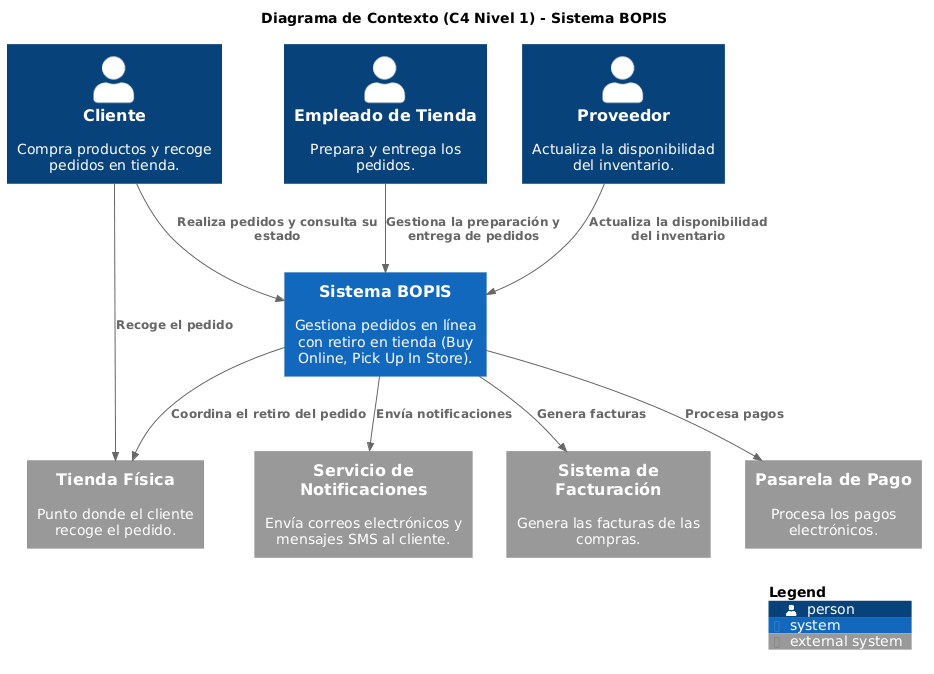
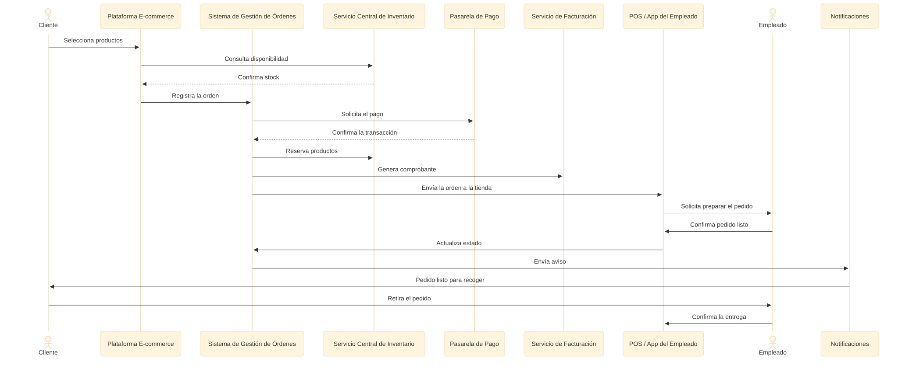

# Modernización Omnicanal de UrbanPlanet Retail

## Tabla de Contenidos

1. [Introducción](#introducción)
2. [Hito 0 — Comprender el Problema](#hito-0-comprender-el-problema)
3. [Hito 1 — Actores, Entidades Externas y Capacidades de Negocio](#hito-1-actores-entidades-externas-y-capacidades-de-negocio)
4. [Hito 2 — Arquitectura Funcional y Flujos Críticos del Sistema](#hito-2-arquitectura-funcional-y-flujos-críticos-del-sistema)
5. [Hito 3 — Versión Ejecutiva, Uso Estratégico de IA y Defensa de la Arquitectura](#hito-3-versión-ejecutiva-uso-estratégico-de-ia-y-defensa-de-la-arquitectura)
6. [Hallazgos generales y oportunidades de mejora](#hallazgos-generales-y-oportunidades-de-mejora)
7. [Conclusión](#conclusión)

## Introducción

UrbanPlanet Retail es una empresa con presencia en tiendas físicas que, hasta el momento, ha trabajado con sistemas independientes. El sistema de punto de venta (POS), la plataforma de comercio electrónico y el sistema de inventario del almacén no comparten información entre sí, lo que genera inconsistencias en el inventario, procesos poco eficientes y una experiencia de compra limitada para los clientes.

Para responder a este problema, el CEO ha definido como objetivo implementar el modelo **BOPIS (Buy Online, Pick Up In Store)** en un plazo de seis meses. Este modelo permitirá integrar las operaciones de la tienda física y el canal digital para que un cliente pueda comprar desde la página web, verificar la disponibilidad real de los productos y recoger su pedido en la tienda de su preferencia de forma rápida y sencilla.

En este informe presento el análisis realizado para apoyar esta transformación. A lo largo de los diferentes hitos identifico el problema de negocio, los actores involucrados, las capacidades necesarias, la arquitectura propuesta y la justificación de las decisiones tomadas para implementar el modelo BOPIS. Finalmente, incluyo una versión ejecutiva de la solución, una reflexión sobre el uso de inteligencia artificial durante el desarrollo del trabajo y las principales conclusiones obtenidas.

# Hito 0 — Comprender el problema

## 1. Misión y visión estratégica

Antes de plantear una solución tecnológica, es importante entender cuál es el objetivo del negocio. En este caso, UrbanPlanet busca integrar sus canales físicos y digitales para ofrecer una mejor experiencia a sus clientes.

**Misión**

> Brindar una experiencia de compra integrada, confiable y centrada en las necesidades del cliente, conectando de forma eficiente los canales físicos y digitales.

**Visión**

> Ser una empresa líder en comercio omnicanal, reconocida por ofrecer una experiencia de compra simple, un inventario unificado y un servicio de calidad en todos sus canales.

Estas declaraciones sirven como guía para las decisiones que se tomarán durante el diseño de la solución. Por ello, la arquitectura propuesta busca priorizar la integración, la confiabilidad y la facilidad de uso.

## 2. Pitch ejecutivo sobre BOPIS

Actualmente, UrbanPlanet tiene un problema importante: sus sistemas funcionan de manera independiente. La tienda en línea, las tiendas físicas y el inventario no comparten información, lo que provoca errores en la disponibilidad de productos y afecta la experiencia del cliente.

Con el modelo **BOPIS (Buy Online, Pick Up In Store)**, el cliente puede consultar la disponibilidad de los productos desde la página web, realizar la compra y seleccionar la tienda donde desea recoger su pedido. Una vez confirmado el pago, la tienda prepara la orden y notifica al cliente cuando está lista para ser retirada.

Este modelo mejora la experiencia de compra, elimina los tiempos de espera por envíos y aprovecha mejor las tiendas físicas, convirtiéndolas en un punto de entrega para las compras realizadas en línea.

## 3. Problema principal del negocio

El principal problema de UrbanPlanet es la falta de integración entre sus sistemas. El POS, la plataforma de comercio electrónico y el inventario funcionan de manera independiente, lo que genera información inconsistente, procesos manuales y una mala experiencia para el cliente.

Como consecuencia, la empresa pierde oportunidades de venta, reduce su competitividad y dificulta la toma de decisiones al no contar con información unificada.

## 4. Beneficios de la implementación

### Integración omnicanal

La implementación de BOPIS conecta las operaciones de la tienda física y del canal digital, permitiendo que ambos trabajen con la misma información de inventario y pedidos.

### Mejor experiencia para el cliente

El cliente puede comprar desde cualquier lugar y recoger su pedido en la tienda que prefiera, evitando costos de envío y reduciendo los tiempos de espera.

### Optimización de las operaciones

Las tiendas físicas también funcionan como puntos de preparación y entrega de pedidos, lo que mejora el uso del inventario disponible y reduce algunos costos logísticos.

# Hito 1 — Actores, entidades externas y capacidades de negocio

## 1. Actores y entidades externas

Para diseñar la solución, primero identifiqué los actores y sistemas que participan en el proceso BOPIS. Algunos interactúan directamente con el sistema, mientras que otros proporcionan servicios necesarios para completar el flujo de compra.

| Participante               | Tipo             | Función                                                     |
| -------------------------- | ---------------- | ----------------------------------------------------------- |
| Cliente                    | Actor            | Realiza la compra en línea y recoge el pedido en la tienda. |
| Empleado de tienda         | Actor            | Prepara y entrega los pedidos al cliente.                   |
| Proveedor                  | Actor externo    | Abastece el inventario de las tiendas y del almacén.        |
| Tienda física              | Entidad          | Lugar donde se preparan y entregan los pedidos.             |
| Pasarela de pago           | Servicio externo | Procesa los pagos realizados por el cliente.                |
| Servicio de notificaciones | Servicio externo | Envía las actualizaciones del estado del pedido.            |
| Servicio de facturación    | Servicio externo | Genera los comprobantes de la compra.                       |

### Diagrama C4 Nivel 1



---

## 2. Capacidades de negocio

Las capacidades de negocio describen las funciones que la empresa necesita para operar correctamente, sin depender de una tecnología específica.

### Gestión de Inventario

| Capacidad             | Descripción                                                                         |
| --------------------- | ----------------------------------------------------------------------------------- |
| Gestión de Inventario | Mantiene actualizada la disponibilidad de productos entre las tiendas y el almacén. |
| Reabastecimiento      | Coordina la reposición de productos cuando el inventario disminuye.                 |

### Gestión de Órdenes

| Capacidad                | Descripción                                                       |
| ------------------------ | ----------------------------------------------------------------- |
| Procesamiento de Órdenes | Recibe, valida y asigna los pedidos a la tienda seleccionada.     |
| Seguimiento del Pedido   | Controla el estado del pedido desde su creación hasta la entrega. |

### Recogida en Tienda

| Capacidad              | Descripción                                                          |
| ---------------------- | -------------------------------------------------------------------- |
| Preparación del Pedido | Organiza los productos para que puedan ser retirados por el cliente. |
| Entrega del Pedido     | Verifica la identidad del cliente y registra la entrega.             |

### Gestión Financiera

| Capacidad              | Descripción                                                               |
| ---------------------- | ------------------------------------------------------------------------- |
| Procesamiento de Pagos | Gestiona la autorización y confirmación de los pagos.                     |
| Facturación            | Genera los comprobantes de la compra de acuerdo con la normativa vigente. |

### Comunicación con el Cliente

| Capacidad                | Descripción                                                             |
| ------------------------ | ----------------------------------------------------------------------- |
| Notificaciones           | Informa al cliente sobre el estado de su pedido.                        |
| Preferencias de Contacto | Permite enviar las notificaciones por el medio que el cliente prefiera. |

# Hito 2 — Arquitectura funcional y flujos críticos del sistema

## 1. Relación entre capacidades y sistemas

Cada capacidad de negocio está respaldada por un sistema específico que cumple una función dentro del proceso BOPIS. Esta separación facilita el mantenimiento, reduce el acoplamiento entre componentes y permite que cada sistema evolucione de forma independiente.

| Capacidad de negocio        | Sistema que la soporta                             | Función principal                                         |
| --------------------------- | -------------------------------------------------- | --------------------------------------------------------- |
| Gestión de Inventario       | Servicio Central de Inventario                     | Mantiene la disponibilidad actualizada de los productos.  |
| Reabastecimiento            | Servicio Central de Inventario                     | Gestiona la reposición de inventario.                     |
| Procesamiento de Órdenes    | Sistema de Gestión de Órdenes (OMS)                | Coordina todo el ciclo de vida del pedido.                |
| Seguimiento del Pedido      | Sistema de Gestión de Órdenes (OMS)                | Actualiza y controla el estado de cada orden.             |
| Recogida en Tienda          | POS o App del Empleado                             | Permite preparar y entregar los pedidos.                  |
| Verificación y Entrega      | POS o App del Empleado                             | Confirma la identidad del cliente y registra la entrega.  |
| Procesamiento de Pagos      | Pasarela de Pago                                   | Autoriza y confirma las transacciones.                    |
| Facturación                 | Servicio de Facturación                            | Genera los comprobantes de compra.                        |
| Comunicación con el Cliente | Servicio de Notificaciones                         | Envía las actualizaciones del estado del pedido.          |
| Preferencias de Contacto    | Plataforma E-commerce y Servicio de Notificaciones | Gestiona el canal de comunicación elegido por el cliente. |

## 2. Flujo del proceso BOPIS

El proceso BOPIS está compuesto por seis etapas principales.

### Compra

El cliente consulta el catálogo, verifica la disponibilidad de los productos, selecciona la tienda donde desea recoger el pedido y confirma la compra.

**Información que se comparte:** datos del cliente, productos seleccionados y tienda de retiro.

### Pago

El sistema envía la información del pago a la pasarela correspondiente para validar la transacción.

**Información que se comparte:** monto de la compra, método de pago y resultado de la autorización.

### Creación de la orden

Una vez aprobado el pago, el sistema registra la orden, reserva el inventario y genera el comprobante de la compra.

**Información que se comparte:** número de pedido, productos reservados, tienda asignada y referencia de la factura.

### Preparación del pedido

La tienda recibe la orden y el personal prepara los productos para su entrega.

**Información que se comparte:** detalle del pedido, cantidades y datos del cliente.

### Notificación

Cuando el pedido está listo, la tienda actualiza su estado y el sistema envía una notificación al cliente.

**Información que se comparte:** estado del pedido, tienda de retiro y número de referencia.

### Retiro

El cliente se presenta en la tienda, valida su identidad y recibe el pedido.

**Información que se comparte:** código del pedido, confirmación de identidad y registro de la entrega.

### Diagrama conceptual del flujo BOPIS



## 3. Análisis desde la perspectiva del Tech Lead

### Interfaces críticas

Las interfaces más importantes del sistema son:

* **OMS ↔ Servicio Central de Inventario:** Permite validar y reservar el inventario para evitar vender productos que ya no están disponibles.

* **OMS ↔ POS o App del Empleado:** Envía las órdenes a la tienda y permite actualizar su estado durante la preparación y la entrega.

* **OMS ↔ Servicio de Notificaciones:** Mantiene informado al cliente durante todo el proceso de compra.

### Aspectos a considerar para la planificación

Como Tech Lead, al estimar el trabajo del equipo tendría en cuenta principalmente la complejidad de las integraciones entre sistemas, ya que representan el mayor riesgo del proyecto.

También consideraría:

* La integración con los sistemas actuales de la empresa.
* La definición de los contratos de comunicación entre los sistemas.
* El manejo de errores cuando falle un servicio externo.
* Las pruebas de integración para validar el flujo completo del proceso BOPIS.

Debido al tiempo disponible para el proyecto, implementaría la solución de forma incremental. Primero integraría el inventario y la gestión de órdenes, luego el POS y, por último, los servicios de notificaciones y facturación. De esta manera se reduce el riesgo y es posible entregar valor desde las primeras etapas del proyecto.

# Hito 3 — Versión ejecutiva, uso estratégico de IA y defensa de la arquitectura

## 1. Vista ejecutiva de la arquitectura

Para presentar la propuesta al CEO preparé una versión simplificada de la arquitectura, enfocada en el proceso de negocio y en el valor que aporta BOPIS, evitando detalles técnicos que no son relevantes para la toma de decisiones.

### Problema actual

```text
Cliente quiere comprar
        ↓
Sistemas independientes
        ↓
Errores de inventario y pérdida de ventas
```

### Solución propuesta


Este flujo muestra de forma sencilla cómo BOPIS conecta la tienda en línea con las tiendas físicas para ofrecer una mejor experiencia al cliente.

## 2. Elementos que no se muestran

Para mantener una presentación clara y orientada al negocio, decidí no incluir algunos aspectos técnicos como:

* APIs, protocolos de comunicación o formatos de datos.
* Nombres específicos de herramientas o tecnologías.
* Manejo de errores y procesos internos del sistema.
* Infraestructura de servidores o servicios en la nube.

Estos elementos son importantes durante el desarrollo, pero no aportan valor en una presentación ejecutiva.


## 3. Uso estratégico de la inteligencia artificial

### Mejor prompt utilizado

> Act as a software architecture and business analyst expert. Based on the previous context of UrbanPlanet, help me complete Milestone 1: Identification of Actors, External Entities, and Business Capabilities.
>
> Task:
> 1. Actors & External Entities Diagram: Create a clean Mermaid.js diagram showing who interacts with the system and from where. Include at minimum: Customer, Store Associate, Suppliers, Physical Stores, and external services (Payment Gateway, Monitoring, Invoicing/Billing).
> 2. Business Capabilities List: List the core business capabilities required (focus strictly on business capabilities, NOT technologies or applications). Include at minimum: Inventory Management, Order Processing, In-Store Pickup, and Customer Communication.
> 3. Definitions: Explain what each capability does in exactly ONE concise sentence.
>
> Constraints for the Content:
> - Respond entirely in English.
> - Keep statements brief, direct, and well-structured. Go straight to the point.
> - Avoid overly technical jargon.
> - Avoid repetitive phrasing.
> - Don't itemize

### Cómo construí el prompt

Primero definí el rol que debía asumir la IA y luego agregué el contexto del caso de UrbanPlanet. Después especifiqué claramente los entregables esperados y las restricciones sobre el formato, el nivel de detalle y el lenguaje que debía utilizar.

### Iteraciones realizadas

Realicé cinco iteraciones hasta obtener el resultado esperado. En cada una fui ajustando el contexto y las restricciones para que la respuesta estuviera alineada con los requisitos del laboratorio.

### Interpretación del resultado

La IA generó una estructura clara y organizada que sirvió como base para desarrollar el resto del trabajo. Sin embargo, fue necesario revisar y ajustar algunos detalles para adaptar el contenido al contexto del proyecto y asegurar que respondiera completamente a los requisitos del laboratorio.

## 4. Defensa de la arquitectura

Considero que esta arquitectura es adecuada para implementar BOPIS porque integra las operaciones de la tienda física y del canal digital sin reemplazar completamente los sistemas existentes. Además, centraliza la gestión de pedidos y del inventario, lo que mejora la disponibilidad de la información y facilita el crecimiento del sistema a futuro.

También ayuda a evitar problemas como la venta de productos sin existencias, la duplicidad de información entre sistemas y los retrasos en la preparación de los pedidos. Al mantener la información sincronizada y coordinar todo el proceso desde la compra hasta la entrega, se mejora la experiencia del cliente y la eficiencia de las operaciones.


# Hallazgos generales y oportunidades de mejora

## Hallazgos principales

Durante el desarrollo de este laboratorio identifiqué varios aspectos que considero importantes al diseñar una arquitectura de software.

* Comprender primero el problema de negocio facilita la definición de una solución adecuada.
* Separar las capacidades de negocio de los sistemas ayuda a mantener una arquitectura más clara y organizada.
* Identificar las integraciones críticas desde el inicio permite anticipar riesgos y planificar mejor el desarrollo.
* Una arquitectura bien definida facilita la comunicación entre los diferentes participantes del proyecto.

## Lecciones aprendidas

Este laboratorio me permitió reforzar la importancia de analizar primero las necesidades del negocio antes de pensar en tecnologías o herramientas específicas. También comprendí que una arquitectura no solo busca organizar componentes, sino apoyar los objetivos del negocio mediante una solución clara y escalable.

Otro aprendizaje importante fue el uso de la inteligencia artificial como apoyo durante el desarrollo del trabajo. Utilizar IA me permitió generar ideas iniciales, estructurar mejor las respuestas y explorar diferentes alternativas en menos tiempo. Sin embargo, también comprobé que los resultados siempre deben revisarse y adaptarse al contexto, ya que la IA es una herramienta de apoyo y no reemplaza el análisis ni el criterio del desarrollador.

## Oportunidades de mejora

Si este caso de estudio se desarrollara como un proyecto real, podrían incorporarse funcionalidades adicionales como devoluciones en tienda de compras realizadas en línea, reserva de productos, estimación del tiempo de preparación de los pedidos o recomendaciones personalizadas para los clientes. Estas mejoras ampliarían las capacidades del sistema sin modificar la arquitectura principal propuesta.

# Conclusión

El desarrollo de este laboratorio me permitió aplicar los conceptos vistos en la asignatura para analizar un caso de estudio desde una perspectiva arquitectónica. A lo largo de los diferentes hitos pude identificar el problema de negocio, definir las capacidades necesarias, proponer una arquitectura y justificar las decisiones tomadas durante el diseño.

Además, el uso de herramientas de inteligencia artificial facilitó gran parte del proceso de elaboración del informe. Me ayudó a organizar las ideas, generar primeros borradores y mejorar la redacción de varios apartados, lo que redujo el tiempo dedicado a tareas repetitivas y me permitió concentrarme más en el análisis y la toma de decisiones. Aun así, fue necesario revisar cada respuesta, validar la información y ajustarla para que cumpliera con los requisitos del laboratorio y reflejara correctamente el contexto del caso de estudio.

En conclusión, este trabajo me permitió comprender que la inteligencia artificial puede convertirse en un apoyo importante durante el proceso de desarrollo y documentación de un proyecto. Sin embargo, el resultado final sigue dependiendo del criterio, el conocimiento y la capacidad de análisis de quien la utiliza.
