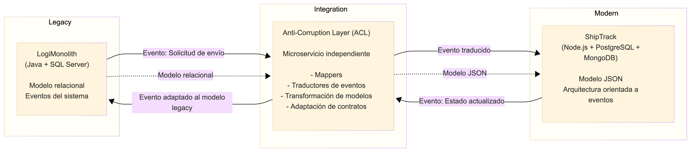

# Hito 3. Estrategia de interoperabilidad con el sistema legado (Diseño defensivo del sistema monolito)

## 1. Diseño y Ubicación de la Capa Anti-Corrupción (ACL)

Para este escenario considero que la mejor opción es implementar la **Capa Anti-Corrupción (ACL)** como un **microservicio independiente** ubicado entre LogiMonolith y ShipTrack. La razón principal es que permite mantener completamente separados ambos modelos de dominio, evitando que las decisiones técnicas del sistema legado afecten la evolución del nuevo microservicio.

Si la ACL se implementara dentro de LogiMonolith, cada cambio relacionado con la integración obligaría a modificar el monolito, aumentando el riesgo de afectar procesos críticos como la facturación o el inventario. Por otro lado, si se ubicara dentro de ShipTrack, el microservicio moderno terminaría conociendo detalles propios del sistema legado, lo que iría en contra del principio de desacoplamiento.

Al ubicar la ACL como un servicio independiente, ambos sistemas solo conocen el contrato definido por la capa de integración y no la implementación interna del otro. De esta manera, la ACL se convierte en el único componente responsable de traducir modelos de datos, protocolos y reglas de negocio específicas de cada plataforma.

Su responsabilidad principal es realizar una traducción bidireccional de la información. Cuando LogiMonolith envía una solicitud de envío, la ACL transforma el modelo relacional proveniente de SQL Server en un modelo basado en objetos JSON que ShipTrack puede procesar. De la misma forma, cuando ShipTrack genera un evento con un nuevo estado del envío, la ACL convierte ese mensaje al formato esperado por LogiMonolith antes de entregarlo.

Este enfoque también facilita el mantenimiento. Si en el futuro alguno de los sistemas cambia su estructura de datos o su forma de comunicación, únicamente será necesario actualizar la ACL, sin modificar el resto de la solución.

## 2. Matriz de Traducción de Protocolos y Formatos

| Concepto                      | Lado LogiMonolith (Legacy)                         | Lado ShipTrack (Moderno)                         | Estrategia de traducción de la ACL                                                                                   |
| ----------------------------- | -------------------------------------------------- | ------------------------------------------------ | -------------------------------------------------------------------------------------------------------------------- |
| **Modelo de datos**           | Tablas relacionales en SQL Server                  | Objetos JSON almacenados en PostgreSQL y MongoDB | Convierte registros relacionales en objetos JSON y viceversa mediante mapeadores (Mappers).                          |
| **Formato de mensajes**       | Objetos Java y estructuras tradicionales           | JSON                                             | Serializa y deserializa la información entre ambos formatos.                                                         |
| **Protocolo de comunicación** | Eventos generados por el sistema legacy            | Eventos consumidos por ShipTrack                 | Traduce los eventos al contrato definido para ambos sistemas sin exponer detalles internos.                          |
| **Identificadores**           | IDs numéricos generados por SQL Server             | Identificadores utilizados por ShipTrack         | Mantiene una correspondencia entre identificadores cuando sea necesario para conservar la trazabilidad.              |
| **Estados de negocio**        | Estados definidos por el legacy (ej. "Despachado") | Estados propios de ShipTrack (ej. "In Transit")  | Realiza la equivalencia entre estados para que ambos sistemas interpreten correctamente el mismo proceso de negocio. |
| **Reglas de validación**      | Validaciones implementadas en LogiMonolith         | Validaciones propias de ShipTrack                | Aplica las transformaciones necesarias para que cada sistema reciba únicamente información válida según sus reglas.  |

## 3. Diagrama Arquitectónico del Flujo de Interoperabilidad

En esta arquitectura la ACL funciona como un escudo entre ambos sistemas. LogiMonolith nunca necesita conocer el modelo interno de ShipTrack y ShipTrack tampoco depende de la estructura del sistema legado. Toda la responsabilidad de traducir datos, adaptar contratos y mantener la compatibilidad entre ambos mundos queda centralizada en la Capa Anti-Corrupción, permitiendo que cada aplicación evolucione de forma independiente y reduciendo el impacto de futuros cambios.
