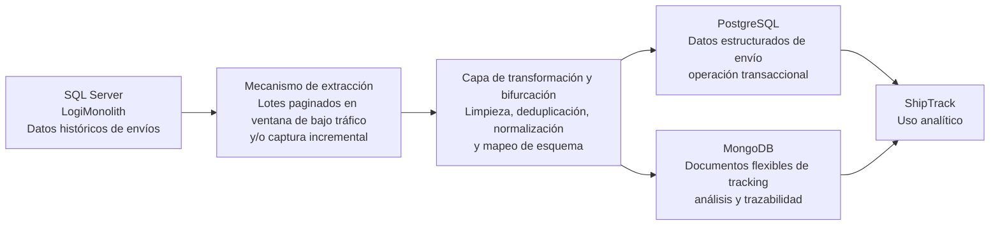

# Hito 4. Plan de migración de datos históricos (Data Engineering a alto nivel)

## 1. Estrategia de Migración y Justificación

Para este caso yo elegiría una **migración gradual o faseada**, no un Big Bang. La razón principal es que LogiMonolith depende de una base SQL Server local que soporta procesos críticos de negocio, así que una ventana de mantenimiento larga tendría un riesgo alto de afectar facturación, inventario y operación diaria. Además, por la naturaleza del sistema legado, una extracción masiva en un solo corte podría saturar la base de datos, aumentar bloqueos y degradar el rendimiento del monolito justo en el momento en que más estabilidad necesita.

Mi estrategia sería mover primero el histórico en lotes controlados durante ventanas de bajo tráfico y, si el entorno lo permite, complementar con un mecanismo incremental para capturar cambios recientes antes del corte final. De esa forma reduzco el impacto sobre producción, mantengo la trazabilidad de los datos y me aseguro de que la carga hacia PostgreSQL y MongoDB no exceda el throughput que el clúster de ShipTrack puede absorber. En este escenario, priorizo estabilidad operativa sobre velocidad de migración.

## 2. Flujo de Datos ETL (Pipeline de Datos)

En la práctica, yo no extraería todo de una sola vez. Primero haría lecturas paginadas por rangos o por lotes, siempre fuera de horas pico, para evitar presión sobre el SQL Server. Después pasaría la información por una capa de transformación que se encargue de normalizar los campos, limpiar valores inconsistentes, eliminar duplicados y separar los datos según su tipo de uso. La parte transaccional iría a PostgreSQL, mientras que la información más flexible o semiestructurada iría a MongoDB.

## 3. Matriz de Mapeo y Destinos de Datos

| Entidad / Dataset original (SQL Server) | Estrategia de transformación                                                     | Destino final | Propósito en ShipTrack |
| --------------------------------------- | -------------------------------------------------------------------------------- | ------------- | ---------------------- |
| Envío histórico principal               | Normalización de campos, validación de tipos y limpieza de registros incompletos | PostgreSQL    | Operativo              |
| Estados de envío                        | Estandarización de catálogos de estado y conversión de códigos legacy            | PostgreSQL    | Operativo              |
| Trazas y eventos de tracking            | Reestructuración a documentos con metadatos y marca temporal                     | MongoDB       | Analítico              |
| Comentarios o notas asociadas al envío  | Conversión a documentos flexibles, con preservación del contexto                 | MongoDB       | Analítico              |
| Relación orden-envío                    | Desduplicación y consolidación de claves referenciales                           | PostgreSQL    | Operativo              |
| Historial de cambios de estado          | Agregación por secuencia de eventos y enriquecimiento contextual                 | MongoDB       | Analítico              |

Con esta distribución yo separo claramente lo que ShipTrack necesita para operar de lo que necesita para analizar. PostgreSQL queda como base estructurada para consultas consistentes y MongoDB absorbe la parte más flexible del tracking, donde conviene conservar detalle histórico y variabilidad de formato.

## 4. Plan de Contingencia y Reconciliación (Rollback)

Para validar que la migración fue exitosa, yo compararía conteos de registros, sumas de control y muestras aleatorias entre origen y destino, además de revisar que no existan huérfanos, duplicados ni campos críticos vacíos. Si encuentro diferencias relevantes, detengo el avance, corrijo el lote afectado y repito la carga antes de continuar con el siguiente bloque.

Si la migración falla a mitad del proceso, mantengo LogiMonolith como sistema activo de referencia y revierto solo los lotes cargados en destino que no hayan sido reconciliados. Así evito dejar a ShipTrack con datos parciales o inconsistentes y puedo reanudar el proceso desde el último punto validado sin comprometer la operación del negocio.
