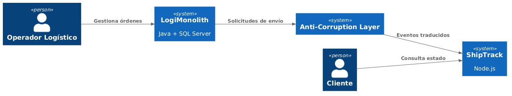
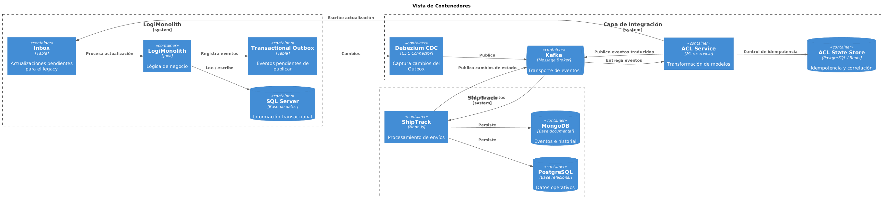
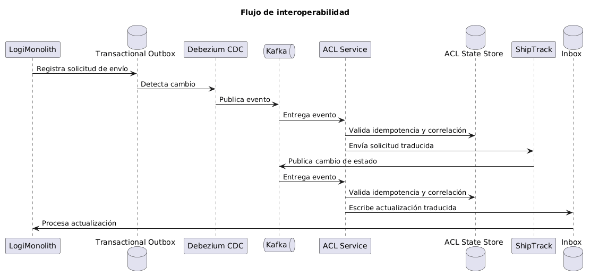
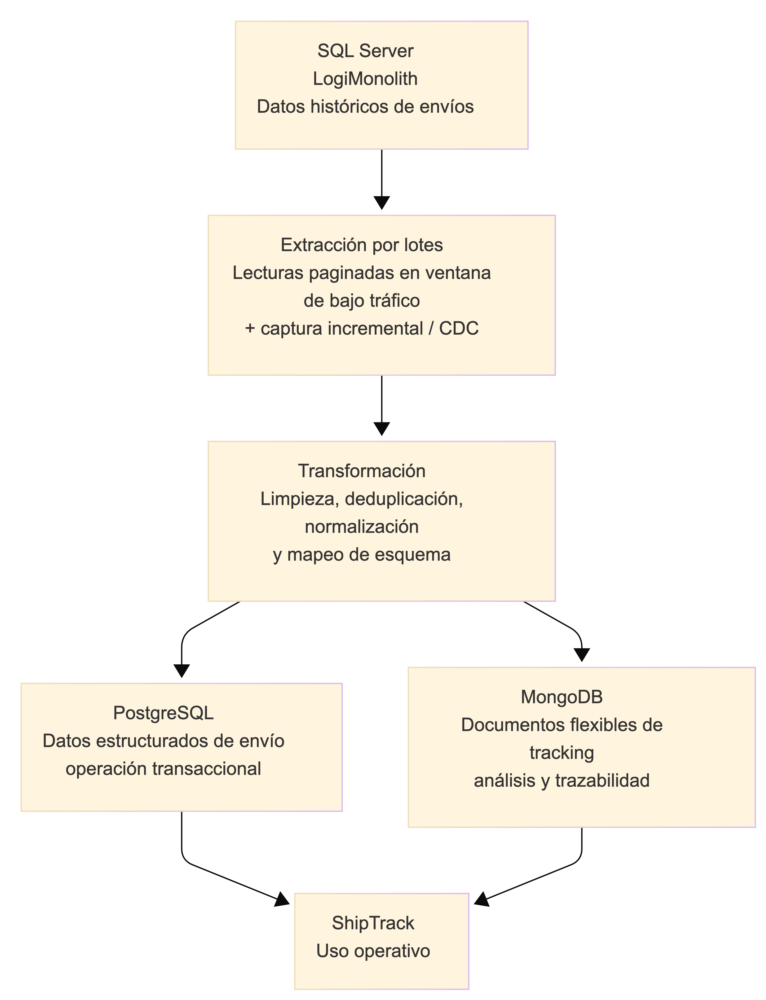

# Integración entre LogiMonolith y ShipTrack para GlobalLogistics Inc.

## Introducción

GlobalLogistics Inc. atraviesa un proceso de modernización tecnológica impulsado por la necesidad de integrar un sistema legado con una nueva plataforma cloud native. Actualmente, la operación principal del negocio depende de **LogiMonolith**, un sistema monolítico desarrollado en Java hace aproximadamente 15 años, responsable de procesos críticos como la gestión de clientes, inventario, facturación y órdenes. Como parte de su estrategia de transformación digital, la empresa desarrolló **ShipTrack**, un microservicio implementado en Node.js y desplegado sobre Kubernetes, cuyo objetivo es ofrecer seguimiento de envíos en tiempo real y capacidades analíticas avanzadas.

Aunque ambos sistemas cumplen funciones diferentes, el negocio requiere que trabajen de manera integrada: LogiMonolith debe iniciar las solicitudes de envío hacia ShipTrack y, posteriormente, ShipTrack debe informar al sistema legado los cambios de estado de cada envío. Adicionalmente, es necesario migrar el histórico de envíos almacenado en SQL Server hacia PostgreSQL y MongoDB, para que la nueva plataforma pueda explotar esa información sin afectar el rendimiento del sistema transaccional.

En este documento se presenta una propuesta de arquitectura para resolver estos desafíos. El análisis se desarrolla en cinco hitos: el diagnóstico del ecosistema actual, la selección de los estilos de integración, el diseño de una Capa Anti-Corrupción (ACL) para proteger el dominio moderno de la deuda técnica del legacy, un plan de migración de datos históricos que prioriza la continuidad operativa y, finalmente, una vista integrada de la arquitectura junto con una reflexión personal sobre el proceso.

### Vista Arquitectónica General

Antes de analizar cada hito en detalle, se presenta una vista general de la arquitectura propuesta. Esta permite identificar los principales componentes del ecosistema y comprender la relación entre el sistema legado, la capa de integración y la plataforma moderna.

**Diagrama C4 – Nivel 1 (Contexto)**

Este diagrama muestra que LogiMonolith y ShipTrack no se comunican directamente. Toda la comunicación atraviesa la Capa Anti-Corrupción (ACL), encargada de adaptar los modelos de datos. El intercambio de información mediante un Message Broker orientado a eventos se detalla en el nivel de contenedores.

**Diagrama C4 – Nivel 2 (Contenedores)**

La propuesta incorpora dos patrones arquitectónicos importantes. El primero es **Transactional Outbox**, que garantiza que un cambio en la base de datos y la generación del evento ocurran dentro de la misma transacción, evitando problemas de consistencia. El segundo es el patrón **Inbox**, que permite que LogiMonolith procese las actualizaciones provenientes de ShipTrack sin depender de llamadas directas al sistema legado.

La ACL se implementa como un microservicio independiente y cuenta con un almacenamiento propio para administrar la correlación de identificadores, la idempotencia y el estado de los mensajes procesados. De esta manera, se evita que cualquiera de los dos sistemas conozca detalles internos del otro y se permite que ambos evolucionen de manera independiente.

---

## Hito 1. Comprensión del ecosistema y riesgos del legacy (Análisis inicial)

Antes de plantear una solución de integración, se analiza el estado actual del ecosistema de GlobalLogistics Inc. La empresa cuenta con dos sistemas muy diferentes entre sí: por un lado, un sistema monolítico que lleva aproximadamente 15 años en funcionamiento y soporta la operación principal del negocio; por otro, un microservicio moderno desarrollado para ofrecer seguimiento de envíos en tiempo real y capacidades analíticas.

En esta etapa no se define cómo se integrarán ambos sistemas. El objetivo es comprender las responsabilidades de cada uno, los datos que controla, el flujo de información entre ellos y los principales riesgos que representa el sistema legado antes de iniciar cualquier proceso de interoperabilidad o migración.

### 1.1. Delimitación de Dominios y Responsabilidades

**LogiMonolith (Java + SQL Server).** LogiMonolith se identifica como el núcleo transaccional de la organización: es el sistema responsable de administrar clientes, órdenes, inventario y facturación, por lo que concentra los procesos más críticos del negocio. Después de quince años de evolución, gran parte de la lógica de negocio está estrechamente ligada tanto al código Java como a la base de datos SQL Server, lo que hace que cualquier modificación pueda afectar procesos que aparentemente no tienen relación directa entre sí.

Asimismo, toda la información crítica se encuentra almacenada en una única base de datos local. Este fenómeno se conoce como **gravedad de los datos (Data Gravity)**: mientras más información y procesos dependen de una misma base de datos, más difícil resulta mover funcionalidades o integrar nuevos sistemas sin afectar la operación existente. Por este motivo, LogiMonolith sigue siendo el sistema con mayor responsabilidad sobre los datos transaccionales de la empresa.

**ShipTrack (Node.js + PostgreSQL + MongoDB).** ShipTrack tiene un propósito completamente diferente: gestionar el seguimiento de los envíos en tiempo real y generar información útil para el análisis de las operaciones logísticas. Al estar desarrollado como un microservicio cloud native y ejecutarse sobre Kubernetes, fue diseñado para procesar un alto volumen de solicitudes y adaptarse fácilmente al crecimiento de la empresa. El uso combinado de PostgreSQL y MongoDB muestra que busca combinar almacenamiento relacional para información estructurada y almacenamiento documental para datos más flexibles, como eventos o cambios de estado.

A diferencia de LogiMonolith, ShipTrack no pretende reemplazar las funciones principales del negocio. Su objetivo es complementar la operación ofreciendo información actualizada sobre los envíos y permitiendo realizar análisis sin afectar el rendimiento del sistema transaccional.

### 1.2. Matriz de Datos y Flujos de Información Críticos

| Entidad de datos | Sistema responsable | Almacenamiento | Tipo de integración | Consistencia |
|---|---|---|---|---|
| Clientes | LogiMonolith | SQL Server | Consulta (unidireccional hacia ShipTrack) | Fuerte |
| Facturación | LogiMonolith | SQL Server | Sin integración directa | Fuerte |
| Inventario | LogiMonolith | SQL Server | Eventos (unidireccional hacia ShipTrack) | Eventual |
| Órdenes | LogiMonolith | SQL Server | Bidireccional | Eventual |
| Solicitudes de envío | ShipTrack | PostgreSQL | Eventos (originadas en LogiMonolith) | Eventual |
| Estados de envío | ShipTrack | PostgreSQL | Eventos (regresan a LogiMonolith) | Eventual |
| Historial de envíos | ShipTrack | PostgreSQL y MongoDB | Migración inicial + gestión posterior | Fuerte |
| Eventos de tracking | ShipTrack | MongoDB | Eventos (uso analítico) | Eventual |

A partir de esta matriz, se concluye que ambos sistemas deben compartir información, pero no deben ser responsables de los mismos datos. LogiMonolith continúa siendo el sistema principal para la información del negocio, mientras que ShipTrack se convierte en el responsable de toda la información relacionada con el seguimiento de los envíos. Mantener un único dueño por entidad ayuda a reducir inconsistencias y facilita la integración entre ambas plataformas.

### 1.3. Diagnóstico de Riesgos Críticos y Limitaciones del Legacy

- **Acoplamiento entre la aplicación y la base de datos.** Después de muchos años de evolución, gran parte de la lógica de negocio depende directamente de tablas, procedimientos almacenados y estructuras específicas de SQL Server. Cualquier cambio en el esquema puede afectar múltiples funcionalidades, y si otros sistemas comienzan a depender directamente de esa base de datos, el nivel de acoplamiento aumentará todavía más.
- **Ausencia de interfaces de integración nativas.** LogiMonolith no fue diseñado para publicar eventos ni exponer APIs modernas, por lo que cualquier mecanismo de integración debe construirse "por fuera" del monolito, sin modificar su núcleo transaccional.
- **Obsolescencia tecnológica y dificultad para evolucionar.** Un monolito de 15 años normalmente acumula deuda técnica, componentes desactualizados y una estructura que no fue diseñada para integrarse fácilmente con aplicaciones modernas. Mientras ShipTrack puede evolucionar rápidamente gracias a su arquitectura cloud native, LogiMonolith requiere cambios más cuidadosos y ciclos de prueba más extensos.
- **Riesgos del entorno híbrido.** LogiMonolith y ShipTrack se ejecutan en plataformas distintas (infraestructura local vs. Kubernetes), lo que introduce desafíos de latencia de red, posibles interrupciones en la comunicación y la necesidad de proteger el tráfico entre ambos entornos.
- **Impacto en el rendimiento durante la integración y la migración.** SQL Server soporta procesos críticos como facturación, inventario y gestión de órdenes. Si durante la integración o la migración se ejecutan consultas pesadas o se extraen grandes volúmenes de información histórica, estas operaciones pueden competir con las transacciones diarias del negocio, aumentando tiempos de respuesta y generando bloqueos. Para mitigar este riesgo, se recomienda utilizar mecanismos como Read Committed Snapshot Isolation (RCSI) o réplicas de solo lectura para aislar las consultas de integración.
- **Riesgo de modificar procesos críticos del negocio.** Debido a la cantidad de funcionalidades que concentra el monolito, un cambio aparentemente pequeño puede terminar afectando otros procesos no considerados inicialmente. Si además la aplicación cuenta con pocas pruebas automatizadas o documentación limitada, la probabilidad de generar regresiones es todavía mayor. Esta deuda técnica representa uno de los principales desafíos para cualquier iniciativa de modernización, ya que obliga a avanzar con cuidado para no comprometer la estabilidad de la operación actual.

---

## Hito 2. Casos de interacción y elección de estilos de integración

Con base en el análisis del Hito 1, se considera que una arquitectura basada en **mensajería orientada a eventos** es la alternativa más adecuada para integrar ambos sistemas. Esta decisión desacopla temporalmente a LogiMonolith y ShipTrack, reduce la dependencia entre ambos y permite que cada sistema procese la información a su propio ritmo sin comprometer la operación principal.

Sin embargo, un sistema legado como LogiMonolith no fue diseñado para publicar eventos de forma nativa. Si la aplicación escribiera primero en SQL Server y luego intentara publicar un evento por separado, podrían generarse inconsistencias cuando una de las dos operaciones falle, un problema conocido como **Dual Write Problem**. Para evitar este riesgo, se propone implementar el patrón **Transactional Outbox**, donde la transacción del negocio y el registro del evento ocurren de manera atómica en la misma base de datos. Posteriormente, un proceso de **Change Data Capture (CDC)**, como Debezium, detecta los nuevos registros de la tabla Outbox y los publica en el broker de mensajería sin que LogiMonolith tenga que interactuar directamente con él.

### 2.1. Matriz de Decisiones de Integración

| Caso de interacción | Estilo / patrón de integración | Componentes involucrados | Justificación |
|---|---|---|---|
| Creación de solicitud de envío (LogiMonolith → ShipTrack) | Transactional Outbox + CDC + Message Broker (Command Message) | Outbox, CDC, Kafka, ACL | LogiMonolith publica la solicitud como mensaje y ShipTrack la consume cuando esté disponible. Se evita el Dual Write y no se depende de la disponibilidad inmediata del servicio moderno. |
| Actualización de estado de la orden (ShipTrack → LogiMonolith) | Domain Event + Inbox Pattern | Kafka, ACL, Inbox | ShipTrack emite un evento de cambio de estado y LogiMonolith lo procesa de forma asíncrona cuando esté disponible, sin depender de llamadas directas al legacy. |
| Sincronización de inventario tras un envío exitoso | Publish-Subscribe / Event-Driven Architecture | Kafka | El evento de envío completado puede ser consumido por varios sistemas sin duplicar lógica de integración, mejorando la escalabilidad funcional. |
| Consulta puntual del estado de un envío | API REST de solo lectura | ACL | Las consultas bajo demanda no requieren eventos; pueden resolverse mediante una API desacoplada expuesta por la ACL. |

### 2.2. Análisis de Compensaciones (Trade-offs)

Con este enfoque se evita una integración sincrónica basada en llamadas directas para los casos principales. Aunque una API REST podría parecer más simple al inicio, seguiría introduciendo una dependencia inmediata entre los sistemas y haría que la disponibilidad de ShipTrack impactara directamente el flujo de LogiMonolith.

El uso de eventos mantiene una separación más clara entre responsabilidades: el monolito continúa siendo dueño de su operación transaccional y ShipTrack gestiona la evolución de los envíos como un proceso desacoplado. A cambio, se asume una mayor complejidad en la gestión de consistencia eventual, reintentos e idempotencia; no obstante, este costo resulta razonable frente al beneficio de resiliencia y menor acoplamiento. Estos aspectos se abordan mediante la Capa Anti-Corrupción, que se describe en el siguiente hito.

---

## Hito 3. Estrategia de interoperabilidad con el sistema legado (Diseño defensivo del sistema monolito)

### 3.1. Diseño y Ubicación de la Capa Anti-Corrupción (ACL)

Para este escenario, se considera que la mejor opción es implementar la **Capa Anti-Corrupción (ACL)** como un **microservicio independiente**, ubicado entre el broker de mensajería y ambos sistemas. Esta ubicación permite mantener completamente separados ambos modelos de dominio y evita que las decisiones técnicas del sistema legado afecten la evolución del nuevo microservicio.

Si la ACL se implementara dentro de LogiMonolith, cada cambio relacionado con la integración obligaría a modificar el monolito, aumentando el riesgo de afectar procesos críticos como la facturación o el inventario. Por otro lado, si se ubicara dentro de ShipTrack, el microservicio moderno terminaría conociendo detalles propios del sistema legado, lo que iría en contra del principio de desacoplamiento.

Al ubicar la ACL como un servicio independiente, ambos sistemas solo conocen el contrato definido por la capa de integración y no la implementación interna del otro. La ACL centraliza así todas las responsabilidades de integración:

- Traducción bidireccional entre el modelo relacional de LogiMonolith y el modelo JSON de ShipTrack, mediante mappers.
- Conversión de contratos y formatos de eventos entre ambos dominios.
- Correlación de identificadores entre el sistema legado y el moderno.
- Validación y adaptación de reglas de negocio propias de cada plataforma.
- Control de idempotencia, para evitar el procesamiento duplicado de mensajes.

Para ello, la ACL cuenta con un almacenamiento propio (ACL State Store) donde mantiene la relación entre identificadores, el historial de eventos procesados y el estado de los mensajes, lo que le permite detectar duplicados y garantizar que cada actualización se procese una única vez. Adicionalmente, se incorporan mecanismos de resiliencia como **Retry con Exponential Backoff**, **Circuit Breaker** y una **Dead Letter Queue (DLQ)**, de modo que, si LogiMonolith no está disponible temporalmente, los eventos no se pierdan y puedan reprocesarse cuando el sistema vuelva a estar operativo.

Este enfoque también facilita el mantenimiento: si en el futuro alguno de los sistemas cambia su estructura de datos o su forma de comunicación, únicamente será necesario actualizar la ACL, sin modificar el resto de la solución.

### 3.2. Matriz de Traducción de Protocolos y Formatos

| Concepto | Lado LogiMonolith (Legacy) | Lado ShipTrack (Moderno) | Estrategia de traducción de la ACL |
|---|---|---|---|
| Modelo de datos | Tablas relacionales en SQL Server | Objetos JSON (PostgreSQL / MongoDB) | Convierte registros relacionales en objetos JSON y viceversa mediante mappers. |
| Formato de mensajes | Objetos Java y estructuras tradicionales | JSON | Serializa y deserializa la información entre ambos formatos. |
| Protocolo / contrato de integración | Eventos generados por el sistema legacy | Eventos consumidos por ShipTrack | Traduce los eventos al contrato definido para ambos sistemas, sin exponer detalles internos. |
| Identificadores | IDs numéricos generados por SQL Server | Identificadores utilizados por ShipTrack | Mantiene una correspondencia entre identificadores para conservar la trazabilidad. |
| Estados de negocio | Estados definidos por el legacy (ej. "Despachado") | Estados propios de ShipTrack (ej. "In Transit") | Realiza la equivalencia entre estados para que ambos sistemas interpreten correctamente el mismo proceso. |
| Reglas de validación | Validaciones implementadas en LogiMonolith | Validaciones propias de ShipTrack | Aplica las transformaciones necesarias para que cada sistema reciba únicamente información válida según sus reglas. |

### 3.3. Flujo de Interoperabilidad

En esta arquitectura, LogiMonolith y ShipTrack nunca se comunican directamente. Toda la comunicación pasa por la ACL, que funciona como un escudo entre ambos dominios y garantiza que cada aplicación pueda evolucionar de forma independiente, reduciendo el impacto de futuros cambios.

---

## Hito 4. Plan de migración de datos históricos (Data Engineering a alto nivel)

### 4.1. Estrategia de Migración y Justificación

Para este caso se selecciona una **migración gradual o faseada**, no un Big Bang. LogiMonolith depende de una base SQL Server local que soporta procesos críticos de negocio, por lo que una ventana de mantenimiento larga tendría un riesgo alto de afectar facturación, inventario y operación diaria. Asimismo, dada la naturaleza del sistema legado, una extracción masiva en un solo corte podría saturar la base de datos, aumentar bloqueos y degradar el rendimiento del monolito justo en el momento en que más estabilidad necesita.

La estrategia propuesta consiste en mover primero el histórico en lotes controlados durante ventanas de bajo tráfico y complementarlo con un mecanismo incremental, basado en CDC, para capturar los cambios recientes antes del corte final. De esta manera, se reduce el impacto sobre producción, se mantiene la trazabilidad de los datos y se asegura que la carga hacia PostgreSQL y MongoDB no exceda el throughput que el clúster de ShipTrack puede absorber. En este escenario, se prioriza la estabilidad operativa sobre la velocidad de migración.

### 4.2. Flujo de Datos ETL (Pipeline de Datos)

En la práctica, la información no se extrae de una sola vez. Primero se realizan lecturas paginadas por rangos o por lotes, siempre fuera de horas pico, para evitar presión sobre SQL Server. Posteriormente, la información pasa por una capa de transformación que normaliza los campos, limpia valores inconsistentes, elimina duplicados y separa los datos según su tipo de uso: la parte transaccional va a PostgreSQL, mientras que la información más flexible o semiestructurada va a MongoDB.

### 4.3. Matriz de Mapeo y Destinos de Datos

| Entidad / Dataset original (SQL Server) | Estrategia de transformación | Destino final | Propósito en ShipTrack |
|---|---|---|---|
| Envío histórico principal | Normalización de campos, validación de tipos y limpieza de registros incompletos | PostgreSQL | Operativo |
| Estados de envío | Estandarización de catálogos de estado y conversión de códigos legacy | PostgreSQL | Operativo |
| Relación orden-envío | Desduplicación y consolidación de claves referenciales | PostgreSQL | Operativo |
| Trazas y eventos de tracking | Reestructuración a documentos con metadatos y marca temporal | MongoDB | Analítico |
| Comentarios o notas asociadas al envío | Conversión a documentos flexibles, con preservación del contexto | MongoDB | Analítico |
| Historial de cambios de estado | Agregación por secuencia de eventos y enriquecimiento contextual | MongoDB | Analítico |

Con esta distribución, se separa claramente lo que ShipTrack necesita para operar de lo que requiere para analizar: PostgreSQL queda como base estructurada para consultas consistentes y MongoDB absorbe la parte más flexible del tracking, donde conviene conservar detalle histórico y variabilidad de formato.

### 4.4. Plan de Contingencia y Reconciliación (Rollback)

Para validar que la migración fue exitosa, se aplica una reconciliación en tres niveles: comparación del número de registros entre origen y destino, validación mediante checksum de los datos críticos y verificación de la integridad referencial y de las reglas principales del negocio. Cada lote migrado queda registrado en una tabla de control (`migration_batch_log`), lo que permite conocer su estado y reanudar la migración desde el último lote validado. Si se encuentran diferencias relevantes, se detiene el avance, se corrige el lote afectado y se repite la carga antes de continuar con el siguiente bloque.

Si la migración falla a mitad del proceso, LogiMonolith se mantiene como sistema activo de referencia y se revierten únicamente los lotes cargados en destino que no hayan sido reconciliados. Así se evita dejar a ShipTrack con datos parciales o inconsistentes y se puede reanudar el proceso desde el último punto validado sin comprometer la operación del negocio.

---

## Hito 5. Arquitectura integrada y narrativa final

### 5.1. Caso de uso end-to-end: creación y actualización de un envío

Para ilustrar cómo trabajan juntos todos los componentes definidos en los hitos anteriores, a continuación se describe el recorrido completo de una solicitud de envío, desde que se origina en LogiMonolith hasta que su estado final se refleja de vuelta en el sistema legado.

1. **Creación de la orden y la solicitud de envío.** Un operador logístico registra una nueva orden en LogiMonolith. Dentro de la misma transacción que persiste la orden en SQL Server, la aplicación escribe también un registro en la tabla **Outbox**, aplicando el patrón Transactional Outbox. Esto garantiza que la orden y el evento de "solicitud de envío" queden guardados de forma atómica, evitando el problema de Dual Write.
2. **Captura y publicación del evento.** El conector CDC (Debezium) detecta el nuevo registro en la tabla Outbox y lo publica como un evento en Kafka, sin que LogiMonolith tenga que comunicarse directamente con el broker.
3. **Traducción en la ACL.** El servicio ACL consume el evento, lo valida contra su State Store para descartar duplicados, y traduce el modelo relacional de la orden (IDs numéricos, campos SQL Server) al modelo JSON que ShipTrack espera. La ACL también traduce el estado inicial del envío a la nomenclatura utilizada por ShipTrack.
4. **Procesamiento en ShipTrack.** ShipTrack recibe el evento traducido, crea el registro operativo en PostgreSQL y comienza a generar eventos de tracking en MongoDB a medida que el envío avanza (recolección, tránsito, entrega).
5. **Actualización de estado hacia el legacy.** Cuando ShipTrack detecta un cambio relevante de estado (por ejemplo, "In Transit" o "Delivered"), publica un evento de dominio en Kafka. La ACL lo consume, lo traduce al formato y a los códigos de estado que LogiMonolith reconoce, y lo escribe en la tabla **Inbox** de LogiMonolith.
6. **Consumo en el legacy.** LogiMonolith procesa las actualizaciones de la tabla Inbox en su propio ritmo, actualizando el estado de la orden en SQL Server sin depender de una llamada síncrona ni de la disponibilidad inmediata de ShipTrack.
7. **Manejo de fallos.** Si en cualquier punto del flujo LogiMonolith o ShipTrack no están disponibles, la ACL aplica reintentos con backoff exponencial y, si el problema persiste, envía el mensaje a la Dead Letter Queue para su revisión y reprocesamiento posterior, sin bloquear el resto del flujo ni perder información.

Este recorrido muestra el valor de las decisiones tomadas en los hitos previos: el desacoplamiento temporal evita que un sistema dependa de la disponibilidad del otro, la ACL protege ambos dominios de conocerse mutuamente, y los patrones Outbox/Inbox garantizan consistencia sin exigirle al monolito capacidades que no tiene de forma nativa.

---

## Conclusión

La solución diseñada para GlobalLogistics Inc. parte de un principio central: LogiMonolith y ShipTrack deben poder evolucionar de forma independiente, sin que las limitaciones de uno se conviertan en una carga para el otro. Para lograrlo, se propone una arquitectura orientada a eventos, apoyada en los patrones Transactional Outbox e Inbox para resolver de forma segura las limitaciones nativas del sistema legado, y una Capa Anti-Corrupción independiente que centraliza toda la traducción de modelos, protocolos e identificadores entre ambos dominios.

Para la migración de los datos históricos, se prioriza la continuidad operativa por encima de la velocidad, mediante un enfoque gradual y por lotes, con mecanismos de reconciliación y rollback que permiten avanzar con seguridad sin comprometer la disponibilidad del sistema transaccional.

En conjunto, esta propuesta busca dar a GlobalLogistics Inc. una vía de modernización realista: una que respete las restricciones del sistema legado, que reduzca el riesgo de sus procesos más críticos, y que le permita capitalizar las capacidades analíticas y de escalabilidad de ShipTrack sin necesidad de una reescritura total del monolito a corto plazo.
