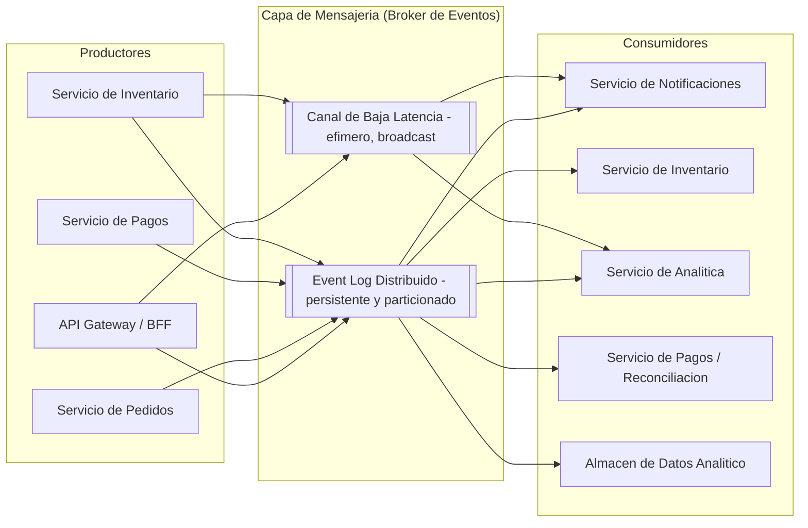

# Hito 2 (Parte 2): Diseño de Brokers de Mensajes y Arquitectura Orientada a Eventos (EDA)

## 1. Arquitectura EDA de Alto Nivel

### 1.1 Estructura del Flujo de Eventos

| Capa | Componente | Rol |
|---|---|---|
| Productores | API Gateway | Emite `user_joined`, `item_viewed` desde interacción del cliente |
| Productores | Servicio de Pedidos | Emite `purchase_attempt`, `purchase_successful` |
| Productores | Servicio de Inventario | Emite `inventory_updated` tras cada mutación de stock |
| Mensajería | **Apache Kafka** (broker principal) | Event log distribuido, particionado, con retención configurable — backbone de EDA |
| Mensajería | **Redis Streams** (canal complementario) | Canal de baja latencia para notificaciones efímeras (< 1s) que no requieren replay ni retención larga |
| Consumidores | Servicio de Notificaciones | Consume eventos de alta prioridad, entrega push/websocket/email |
| Consumidores | Servicio de Inventario | Consume `purchase_attempt` para reserva de stock (CP) |
| Consumidores | Servicio de Analítica | Consume todo el stream para métricas en tiempo real (dashboards) |
| Consumidores | Data Warehouse (batch) | Consume vía Kafka Connect para persistencia analítica de largo plazo |

### 1.2 Justificación CAP del Broker

| Decisión de Diseño | Configuración | Clasificación CAP | Justificación |
|---|---|---|---|
| Garantía de entrega para eventos de **inventario/pago** | `acks=all`, `min.insync.replicas=2`, idempotent producer, transacciones Kafka (exactly-once semantics) | **CP** | Evita duplicación de descuentos de stock o cobros dobles. Ante partición de red, el productor bloquea/reintenta antes que arriesgar inconsistencia — se sacrifica disponibilidad momentánea por corrección |
| Garantía de entrega para eventos de **notificación/analítica** | `acks=1`, at-least-once, sin transacciones | **AP** | Prioriza throughput y disponibilidad; una notificación duplicada o con delay de milisegundos es tolerable, una notificación perdida bajo saturación es preferible a bloquear el pipeline completo |
| Particionamiento de tópicos | Partition key = `user_id` (notificaciones) / `sku_id` (inventario) | Híbrido | Garantiza orden **dentro** de la partición (consistencia local) sin serializar el sistema completo (disponibilidad global) — el orden global entre usuarios/SKUs distintos no se garantiza ni se requiere |
| Replicación de partición (factor de replicación) | RF=3 | CP en escritura (mayoría de réplicas debe confirmar) | Tolerancia a fallo de 1 broker sin pérdida de datos; ante partición de red que aísle la mayoría, las particiones minoritarias dejan de aceptar escrituras (ISR shrinks) — disponibilidad sacrificada por consistencia |
| Consumer groups con offset commit | `enable.auto.commit=false`, commit manual post-procesamiento | At-least-once por diseño | El consumidor puede reprocesar en caso de fallo (duplicados posibles) — requiere idempotencia en el consumidor, no en el broker |

**Principio rector**: Kafka actúa como **log distribuido único** que sirve de fuente de verdad para replay y auditoría (retención 7 días mínimo en tópicos críticos). Redis Streams se usa como canal de **notificación efímera de ultra-baja latencia** (< 100ms) donde la pérdida de un mensaje individual no es catastrófica y el volumen de fan-out es extremo (ej. `user_joined` para contadores en vivo de "X personas viendo este producto").

---

## 2. Mapeo del Ciclo de Vida de Eventos

| Evento | Productor | Consumidores | Payload Sugerido (JSON) | Prioridad/Criticidad |
|---|---|---|---|---|
| `user_joined` | API Gateway (WebSocket connect) | Analítica, Servicio de Presencia (contador en vivo) | `{"event_id","event_type":"user_joined","user_id","session_id","flash_sale_id","timestamp","region"}` | **Baja** — informativo, tolera pérdida |
| `item_viewed` | Frontend/BFF | Analítica, Motor de Recomendación, Servicio de Presencia | `{"event_id","event_type":"item_viewed","user_id","sku_id","flash_sale_id","view_duration_ms","timestamp"}` | **Baja** — alto volumen, no crítico |
| `purchase_attempt` | Servicio de Pedidos | Servicio de Inventario (CP), Servicio de Fraude, Analítica | `{"event_id","event_type":"purchase_attempt","user_id","order_id","sku_id","quantity","idempotency_key","timestamp"}` | **Crítica** — dispara reserva de stock, requiere idempotencia estricta |
| `purchase_successful` | Servicio de Pedidos (post-confirmación de pago) | Notificaciones, Inventario (confirmación final), Analítica, Facturación | `{"event_id","event_type":"purchase_successful","order_id","user_id","sku_id","quantity","payment_id","total_amount","timestamp"}` | **Crítica** — dispara notificación al usuario y liquidación contable |
| `inventory_updated` | Servicio de Inventario | Notificaciones (alertas de "últimas unidades"), Catálogo (actualización de UI), Analítica | `{"event_id","event_type":"inventory_updated","sku_id","previous_stock","current_stock","flash_sale_id","timestamp"}` | **Alta** — afecta decisiones de compra en tiempo real de otros usuarios |

**Nota de estructura común**: todos los eventos comparten un envelope base (`event_id` UUID para deduplicación, `timestamp` ISO 8601, `schema_version`) para soportar evolución de esquema y trazabilidad distribuida (correlación vía `trace_id` para observabilidad).

---

## 3. Selección del Patrón y Tipo de Cola/Canal

| Evento | Modelo | Canal Concreto | Justificación Técnica |
|---|---|---|---|
| `user_joined` | **Pub/Sub** (fan-out) | Redis Streams / Kafka topic con múltiples consumer groups | Múltiples consumidores independientes (presencia, analítica) necesitan la misma copia del evento; no requiere persistencia larga ni orden estricto — Redis Streams minimiza latencia |
| `item_viewed` | **Pub/Sub** (event log, alto volumen) | Kafka topic particionado por `sku_id` | Volumen extremo (miles de eventos/seg); Kafka absorbe throughput vía particionamiento; consumidores (recomendación, analítica) leen a su propio ritmo sin acoplar al productor |
| `purchase_attempt` | **Punto a Punto** (Queue semantics vía consumer group único) | Kafka topic con **un solo consumer group activo** (Servicio de Inventario) | Requiere procesamiento exactamente una vez por el motor CP de inventario para evitar overselling; aunque técnicamente es un topic Kafka, se consume como cola (competing consumers dentro del mismo grupo, partición por `sku_id` garantiza serialización por producto) |
| `purchase_successful` | **Pub/Sub** (fan-out múltiple) | Kafka topic con consumer groups independientes por servicio consumidor | Múltiples subsistemas desacoplados (notificaciones, facturación, analítica) necesitan reaccionar al mismo evento sin coordinarse entre sí; Pub/Sub evita acoplamiento punto a punto entre Pedidos y N servicios downstream |
| `inventory_updated` | **Pub/Sub** con **prioridad de entrega diferenciada** | Kafka topic (persistencia/replay) + Redis Streams (broadcast de baja latencia a WebSocket) | Arquitectura dual: Kafka garantiza consistencia eventual y auditoría del histórico de stock; Redis Streams empuja el broadcast en tiempo real a clientes conectados (< 100ms) sin necesidad de replay |

---

# 4. Tabla técnica

| Criterio | Apache Kafka | RabbitMQ | AWS SQS/SNS | GCP Pub/Sub |
|---|---|---|---|---|
| Arquitectura y modelo | **Streaming log** append-only, distribuido, orientado a event streaming; consumers leen desde offsets y el broker actúa más “dumb”  [codingprotocols](https://codingprotocols.com/toolkit/comparisons/kafka-vs-rabbitmq-vs-sqs). | Broker de colas tradicional, exchange/queue/binding; “smart broker / smart routing” con fuerte flexibilidad de enrutamiento  [codingprotocols](https://codingprotocols.com/toolkit/comparisons/kafka-vs-rabbitmq-vs-sqs). | SQS es cola gestionada; SNS es pub/sub fan-out. El modelo es desacoplado y más “managed” que “broker controlado por ti”  [docs.aws.amazon](https://docs.aws.amazon.com/AWSSimpleQueueService/latest/SQSDeveloperGuide/FIFO-queues-exactly-once-processing.html). | Servicio pub/sub gestionado para fan-out y eventos; orientado a desacoplar productores y consumidores  [docs.cloud.google](https://docs.cloud.google.com/pubsub/docs/subscription-overview). |
| Comunicación y garantías | Pub/sub por topics y particiones; orden solo dentro de una partición; exactly-once posible con configuración y procesamiento idempotente, pero la operación real suele diseñarse como at-least-once + idempotencia  [codingprotocols](https://codingprotocols.com/toolkit/comparisons/kafka-vs-rabbitmq-vs-sqs). | Punto a punto, work queues y pub/sub vía exchanges; ordering fuerte dentro de una cola, pero sin semántica global de orden entre colas  [aws.amazon](https://aws.amazon.com/es/compare/the-difference-between-rabbitmq-and-kafka/). | SQS estándar es at-least-once; FIFO ofrece ordering estricto y exactly-once processing/deduplication, pero con límites de throughput más bajos que el modo estándar  [docs.aws.amazon](https://docs.aws.amazon.com/AWSSimpleQueueService/latest/SQSDeveloperGuide/FIFO-queues-exactly-once-processing.html). SNS es pub/sub para distribución a múltiples destinos  [docs.aws.amazon](https://docs.aws.amazon.com/AWSSimpleQueueService/latest/SQSDeveloperGuide/sqs-fifo-queues.html). | At-least-once por defecto; ordering keys opcionales y exactly-once delivery disponible, pero sigue requiriendo consumidores idempotentes por redelivery posible  [docs.cloud.google](https://docs.cloud.google.com/pubsub/docs/subscription-overview). |
| Persistencia, retención y tolerancia a fallos | Persistencia en disco tipo log, retención por política, replicación entre brokers; muy fuerte para replay y recuperación  [codingprotocols](https://codingprotocols.com/toolkit/comparisons/kafka-vs-rabbitmq-vs-sqs). | Persistencia en disco y ACK/confirmations; colas quorum mejoran resiliencia, pero el modelo sigue siendo de cola, no de histórico de eventos  [codingprotocols](https://codingprotocols.com/toolkit/comparisons/kafka-vs-rabbitmq-vs-sqs). | SQS persiste mensajes hasta entrega/retención; FIFO evita duplicados introducidos por la cola durante la ventana de dedup; muy robusto como servicio gestionado  [docs.aws.amazon](https://docs.aws.amazon.com/AWSSimpleQueueService/latest/SQSDeveloperGuide/FIFO-queues-exactly-once-processing.html). | Mensajes persistidos por el servicio; redeliveries posibles incluso tras ACK exitoso, por lo que la aplicación debe tolerar duplicados  [docs.cloud.google](https://docs.cloud.google.com/pubsub/docs/subscription-overview). |
| Rendimiento y throughput | Diseñado para millones de mensajes por segundo en clusters bien dimensionados; p99 normalmente depende de batching, acks y replicación  [aws.amazon](https://aws.amazon.com/es/compare/the-difference-between-rabbitmq-and-kafka/). | Muy bueno en latencia baja y routing complejo, pero su techo práctico suele ser inferior al de Kafka en cargas extremas  [codingprotocols](https://codingprotocols.com/toolkit/comparisons/kafka-vs-rabbitmq-vs-sqs). | SQS estándar escala muy alto; FIFO prioriza orden y exactly-once, pero sacrifica throughput relativo y tiene cuotas más restrictivas  [docs.aws.amazon](https://docs.aws.amazon.com/AWSSimpleQueueService/latest/SQSDeveloperGuide/sqs-fifo-queues.html). | Escala muy alto como servicio gestionado; adecuado para fan-out masivo, pero la latencia y redelivery hacen que la app deba ser idempotente  [docs.cloud.google](https://docs.cloud.google.com/pubsub/docs/subscription-overview). |
| Backpressure y entrega | Consumer groups, control por offset, pull model y batching ayudan a absorber picos; at-least-once es el patrón más común, exactly-once depende del diseño  [codingprotocols](https://codingprotocols.com/toolkit/comparisons/kafka-vs-rabbitmq-vs-sqs). | Prefetch, ACK y cola de trabajo permiten backpressure explícito; muy útil para “dejar respirar” a consumidores lentos  [aws.amazon](https://aws.amazon.com/es/compare/the-difference-between-rabbitmq-and-kafka/). | Visibility timeout, redrive/DLQ y FIFO groups ayudan a controlar presión sobre consumidores; el control es simple, pero menos granular que Kafka  [docs.aws.amazon](https://docs.aws.amazon.com/AWSSimpleQueueService/latest/SQSDeveloperGuide/sqs-fifo-queues.html). | El suscriptor debe ser idempotente; la plataforma reentrega si hace falta, así que el backpressure se resuelve más en el consumer design que en el broker  [docs.cloud.google](https://docs.cloud.google.com/pubsub/docs/subscription-overview). |
| Escalabilidad horizontal | Excelente: particiones, replicas, consumer groups; muy apto para escalar por dominio/clave de partición  [aws.amazon](https://aws.amazon.com/es/compare/the-difference-between-rabbitmq-and-kafka/). | Escala, pero exige más cuidado de colas, quorum, clustering y hot queues; buena flexibilidad, menos natural para “millions/sec”  [aws.amazon](https://aws.amazon.com/es/compare/the-difference-between-rabbitmq-and-kafka/). | Muy alta, especialmente por ser managed; SQS/SNS reduce carga operativa, aunque FIFO impone límites más estrictos  [docs.aws.amazon](https://docs.aws.amazon.com/AWSSimpleQueueService/latest/SQSDeveloperGuide/sqs-fifo-queues.html). | Muy alta y nativa; buena para fan-out y eventos multi-consumidor sin administrar brokers  [docs.cloud.google](https://docs.cloud.google.com/pubsub/docs/subscription-overview). |

## 4.1. Negocio y operatividad

| Criterio | Kafka | RabbitMQ | AWS SQS/SNS | GCP Pub/Sub |
|---|---|---|---|---|
| Curva de aprendizaje | 4/5. Particiones, offsets, retention, ISR, batching, idempotencia y tuning exigen experiencia real  [codingprotocols](https://codingprotocols.com/toolkit/comparisons/kafka-vs-rabbitmq-vs-sqs). | 3/5. Más intuitivo para colas y routing, aunque quorum/ha añade complejidad  [aws.amazon](https://aws.amazon.com/es/compare/the-difference-between-rabbitmq-and-kafka/). | 2/5. Muy rápido de adoptar si ya usas AWS; la semántica es simple pero hay matices FIFO/standard  [docs.aws.amazon](https://docs.aws.amazon.com/AWSSimpleQueueService/latest/SQSDeveloperGuide/sqs-fifo-queues.html). | 2/5. API y operación sencillas; la complejidad aparece al diseñar consumidores idempotentes y ordenados  [docs.cloud.google](https://docs.cloud.google.com/pubsub/docs/subscription-overview). |
| Mantenimiento / carga operativa | Alta si lo autogestionas; media si usas servicio administrado, pero sigue requiriendo criterio de plataforma  [aws.amazon](https://aws.amazon.com/es/compare/the-difference-between-rabbitmq-and-kafka/). | Media; menos pesado que Kafka en muchos equipos, aunque sigue pidiendo buena disciplina operativa  [aws.amazon](https://aws.amazon.com/es/compare/the-difference-between-rabbitmq-and-kafka/). | Baja; es el más cercano a serverless-managed de la lista  [docs.aws.amazon](https://docs.aws.amazon.com/AWSSimpleQueueService/latest/SQSDeveloperGuide/sqs-fifo-queues.html). | Baja; también muy gestionado y con poco peso operativo  [docs.cloud.google](https://docs.cloud.google.com/pubsub/docs/subscription-overview). |
| Costos y predictibilidad | Mejor para cargas enormes y sostenidas; el costo puede ser más predecible si explotas bien la infraestructura, peor si sobredimensionas por picos  [codingprotocols](https://codingprotocols.com/toolkit/comparisons/kafka-vs-rabbitmq-vs-sqs). | Bueno para cargas moderadas/medias; en picos enormes suele exigir más instancias o ajuste fino  [aws.amazon](https://aws.amazon.com/es/compare/the-difference-between-rabbitmq-and-kafka/). | Muy predecible por uso, especialmente estándar; FIFO y fan-out masivo requieren revisar cuotas y costos de mensajes  [docs.aws.amazon](https://docs.aws.amazon.com/AWSSimpleQueueService/latest/SQSDeveloperGuide/sqs-fifo-queues.html). | Muy predecible y Opex-friendly; pagas por uso y reduces costos de operación, aunque debes vigilar reintentos/duplicados  [docs.cloud.google](https://docs.cloud.google.com/pubsub/docs/subscription-overview). |
| Ecosistema y talento | Muy fuerte en streaming, data platform y event-driven; talento disponible pero más especializado  [aws.amazon](https://aws.amazon.com/es/compare/the-difference-between-rabbitmq-and-kafka/). | Muy fuerte en integración empresarial, colas y mensajería clásica; contratación relativamente fácil en stacks backend tradicionales  [aws.amazon](https://aws.amazon.com/es/compare/the-difference-between-rabbitmq-and-kafka/). | Amplio ecosistema AWS y alta empleabilidad en cloud engineering; fuerte soporte oficial  [docs.aws.amazon](https://docs.aws.amazon.com/AWSSimpleQueueService/latest/SQSDeveloperGuide/sqs-fifo-queues.html). | Ecosistema cloud sólido, especialmente en GCP-native; soporte oficial fuerte y adopción creciente  [docs.cloud.google](https://docs.cloud.google.com/pubsub/docs/subscription-overview). |
| Time-to-market | Medio-alto; arquitectura madura tarda más por tuning, particionado y observabilidad  [aws.amazon](https://aws.amazon.com/es/compare/the-difference-between-rabbitmq-and-kafka/). | Medio; rápido para colas y routing, más lento si necesitas HA compleja  [aws.amazon](https://aws.amazon.com/es/compare/the-difference-between-rabbitmq-and-kafka/). | Bajo; normalmente el más rápido para salir a producción en una solución robusta  [docs.aws.amazon](https://docs.aws.amazon.com/AWSSimpleQueueService/latest/SQSDeveloperGuide/sqs-fifo-queues.html). | Bajo; muy ágil para publicar/consumir con poco esfuerzo de plataforma  [docs.cloud.google](https://docs.cloud.google.com/pubsub/docs/subscription-overview). |

Considerando las características técnicas de los brokers evaluados y los requerimientos de FlashSale Inc., RabbitMQ representa la alternativa más adecuada para implementar la arquitectura orientada a eventos. Aunque soluciones como Apache Kafka ofrecen un mayor throughput para plataformas que procesan millones de eventos por segundo, RabbitMQ proporciona un excelente equilibrio entre rendimiento, flexibilidad y facilidad de implementación para un sistema de comercio electrónico que requiere procesar eventos transaccionales de forma confiable.

La principal ventaja de RabbitMQ en este escenario es su capacidad para soportar tanto el patrón Publish/Subscribe como Work Queue dentro de la misma plataforma. Los eventos user_joined, item_viewed, purchase_successful e inventory_updated pueden distribuirse mediante exchanges de tipo topic o fanout, permitiendo que múltiples consumidores reaccionen de forma independiente sin generar acoplamiento entre servicios. Por otro lado, el evento purchase_attempt puede procesarse mediante una Work Queue, garantizando que un único consumidor ejecute el flujo de validación de inventario y procesamiento del pago, evitando duplicidad de trabajo y facilitando el balanceo de carga entre varios workers.

