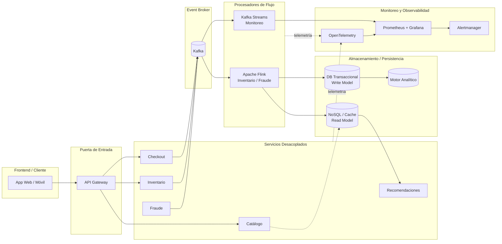

# Resumen Ejecutivo — Arquitectura Orientada a Eventos de FlashSale Inc.

## 1. Descripción del Diagrama Integrador de Arquitectura

El flujo inicia en el **Frontend/Cliente** (web, app móvil), que interactúa exclusivamente a través del **API Gateway**, punto único de entrada responsable de autenticación, rate limiting y enrutamiento hacia los **Servicios Desacoplados** (catálogo, checkout, inventario, fraude, recomendaciones), cada uno propietario de su propio dominio de datos. Los servicios que ejecutan operaciones críticas de negocio no se comunican entre sí de forma síncrona: publican eventos de dominio (`PedidoCreado`, `PagoConfirmado`, `StockActualizado`) hacia el **Event Broker** (Kafka), que actúa como columna vertebral de desacople temporal entre productores y consumidores.

Sobre ese broker operan los **Procesadores de Flujo** (Apache Flink para inventario y fraude, Kafka Streams para monitoreo), que consumen eventos en tiempo real, mantienen estado con particionado por clave y emiten resultados enriquecidos de vuelta al broker o directamente a la capa de **Almacenamiento/Persistencia**: bases relacionales para el estado transaccional de escritura (source of truth), bases NoSQL/caches de baja latencia para las vistas de lectura optimizadas (patrón CQRS) y un motor analítico para reportería. Transversalmente, la capa de **Monitoreo y Observabilidad** (Prometheus + Grafana, OpenTelemetry) recolecta métricas, logs y trazas distribuidas de cada componente, alimentando el sistema de alertas que cierra el ciclo operativo sin intervenir en el flujo de datos de negocio.

## 2. Justificación de Decisiones Clave y Trade-offs

**EDA sobre REST síncrono.** El diagnóstico del monolito (Hito 1) identificó que el acoplamiento temporal del flujo de checkout —donde cada solicitud retiene un hilo hasta completar validación, pago y notificación— era la causa directa del thread starvation bajo carga. EDA rompe ese acoplamiento: los servicios publican eventos y continúan sin bloquearse en la respuesta de sus consumidores, lo que permite escalar cada servicio de forma independiente según su propia curva de demanda y aislar la disponibilidad de un componente secundario (ej. notificaciones) de la del flujo crítico de compra.

**Consistencia vs. latencia.** Se adopta consistencia eventual como norma general, reservando consistencia fuerte únicamente donde el costo de negocio de una inconsistencia es intolerable: la reserva de stock (REQ-INV-002), validada de forma atómica dentro del procesador de Flink antes de confirmar la operación. Para el resto del sistema —vistas de catálogo, recomendaciones, reportes— aceptar una ventana de desactualización de segundos reduce la contención sobre la base transaccional y evita que servicios no críticos impongan latencia sobre el flujo de compra. El trade-off es explícito y acotado: la inconsistencia temporal se tolera donde no genera overselling ni pérdida financiera directa.

**Complejidad operativa.** La distribución del sistema introduce desafíos reales que no existían en el monolito: despliegue coordinado de múltiples servicios y del clúster de streaming, necesidad de trazabilidad end-to-end para depurar un flujo que ahora cruza varios procesos asíncronos, y gestión de esquemas de eventos entre productores y consumidores independientes. Esta complejidad se mitiga con instrumentación obligatoria vía OpenTelemetry desde el día uno (no como adición posterior), un schema registry que impone contratos versionados sobre los eventos, y la adopción de Kafka Streams —en lugar de un segundo clúster de Flink— para los flujos que no exigen su capacidad de estado avanzada, conteniendo la superficie operativa a lo estrictamente necesario.

## 3. Alineación con Requerimientos del Sistema

**Escalabilidad.** El sistema deberá escalar cada servicio y cada procesador de flujo de forma independiente y horizontal en función de su propia demanda, sin que el crecimiento de tráfico en un dominio (ej. catálogo) exija sobre-aprovisionar componentes no relacionados (ej. fraude).

**Resiliencia/Tolerancia a fallos.** El sistema deberá contener la falla de un servicio o procesador dentro de su propio dominio, sin propagarla al flujo crítico de compra, mediante desacople vía broker, checkpointing de estado y degradación controlada (ej. recomendaciones sirviendo el último estado válido ante caída del stream processor).

**Tiempo real.** El sistema deberá procesar los eventos de inventario, fraude y recomendaciones dentro de los umbrales de latencia definidos en el Hito 2 (p95/p99 en el orden de cientos de milisegundos), sostenidos mediante procesamiento evento por evento con estado particionado por clave, evitando el modelo de micro-batching en los caminos críticos de baja latencia.