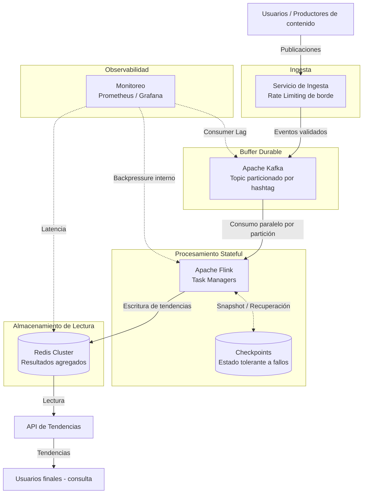
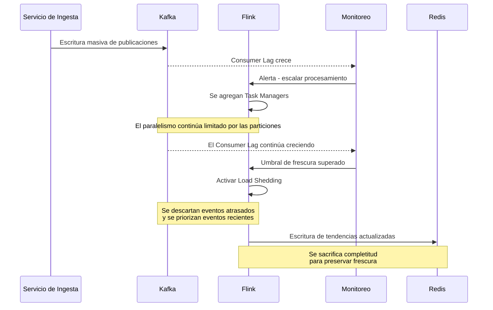

Hito 2: Síntesis y Creación de Entregables

Vamos a integrar lo aprendido y producir una propuesta arquitectónica coherente y justificada.

2.1 Selección de una estrategia

Utilizando todo lo que obtuvimos en el hito 1 (aca el stack de prompts y respuestas puede ser de mucha ayuda!):

- Elegir una estrategia principal para manejar la contrapresión
- Justificar por qué es adecuada para GlobalNewsFeed
- Explicar qué problemas resuelve y cuáles no.

IMPORTANTE. Pedir feedback crítico a la IA: ejemplo: “¿Qué debilidades tiene esta arquitectura?”, “¿Qué pasaría si el tráfico se duplica?”. Vamos a controlar esto 🙂

2.2 Diseño de la arquitectura

Terminamos de describir la arquitectura propuesta, incluyendo:

- componentes principales
- flujo de datos entre ellos
- punto(s) donde se gestiona la contrapresión (Importantisimo).

Para esto pueden hacer: un diagrama simple (algunos ya lo tienen), una descripción textual estructurada, o ambos.

2.3 Entregables finales

Elaboramos una reflexión final que incluya como punto fundamental el uso de la IA en este trabajo. 

[OPCIONAL]

La tarea ahora es diseñar un buen prompt para mejorar redacción, estructurar el texto y revisar consistencia, sin delegar la decisión técnica o modificar sustancialmente el contenido en términos técnicos. Solo queremos mejorar el fraseo, la sintaxis, formas y mantener en líneas generales el tono de escritura que tendríamos nosotros como redactores. Un buen prompt de este tipo lo podes usar y reusar en otras cosas que hagas, principalmente las entregas que te permitan uso de IA.

Terminamos de pulir el entregable y lo subimos!

--- 

# Hito 2 — Síntesis y Creación de Entregables
## GlobalNewsFeed: Análisis de Hashtags en Tendencia

---

## 1. Estrategia Principal de Contrapresión

La estrategia principal se basa en un **desacoplamiento asíncrono en capas**. Primero, el sistema absorbe los aumentos temporales de tráfico mediante un **buffer durable**. Después, intenta adaptarse a la carga mediante **escalado horizontal y control de flujo**. Finalmente, si estas medidas no son suficientes para mantener el sistema dentro de niveles aceptables, se aplica una **degradación controlada mediante Load Shedding** como última línea de defensa.

La decisión de negocio que guía esta estrategia es **priorizar la frescura de las tendencias sobre la completitud de los datos**. Ante una situación de saturación extrema, se acepta descartar publicaciones individuales antes que mantener un backlog que provoque que las tendencias mostradas correspondan a información desactualizada.

Esta decisión es coherente con el propósito de GlobalNewsFeed: mostrar **qué está pasando ahora**, en lugar de mantener un registro exhaustivo de cada publicación recibida. Por esta razón, la misma prioridad entre frescura y completitud se mantiene como criterio para las decisiones de contrapresión y degradación descritas en las siguientes secciones.


---

## 2. Componentes Principales y Responsabilidad

La arquitectura distribuye las responsabilidades entre componentes especializados para evitar que los picos de tráfico afecten directamente a todo el flujo. El **Servicio de Ingesta** recibe y controla la entrada de publicaciones, **Kafka** desacopla la recepción del procesamiento, **Flink** realiza el análisis stateful y **Redis** mantiene los resultados agregados disponibles para consulta. De esta forma, cada parte puede responder de manera diferente ante situaciones de saturación.

| Componente                                 | Responsabilidad                                                                 | Por qué existe                                                                                                                                   |
| ------------------------------------------ | ------------------------------------------------------------------------------- | ------------------------------------------------------------------------------------------------------------------------------------------------ |
| **Servicio de Ingesta**                    | Valida, serializa y aplica Rate Limiting de borde a las publicaciones entrantes | Protege a Kafka frente a tasas de escritura que el broker no podría sostener y desacopla a los productores del formato interno                   |
| **Kafka (topic particionado por hashtag)** | Actúa como buffer durable entre la ingesta y el procesamiento                   | Absorbe picos temporales de tráfico sin bloquear al productor y permite conservar los eventos mientras Flink recupera capacidad de procesamiento |
| **Apache Flink (Task Managers)**           | Realiza el procesamiento stateful y distribuido mediante ventanas temporales    | Permite mantener el estado necesario para calcular conteos y detectar tendencias de forma continua                                               |
| **Estado de Flink (Checkpoints)**          | Mantiene la tolerancia a fallos del procesamiento                               | Permite recuperar el estado de los conteos desde un punto consistente después de un fallo, sin reiniciar el procesamiento desde cero             |
| **Redis (Cluster mode)**                   | Almacena los resultados agregados para lectura rápida                           | Permite que la API consulte las tendencias sin depender directamente del pipeline de procesamiento                                               |
| **API de Tendencias**                      | Expone a los usuarios los resultados almacenados en Redis                       | Aísla el tráfico de consulta del procesamiento de publicaciones y permite responder las solicitudes de lectura de forma independiente            |
| **Monitoreo y Observabilidad**             | Supervisa lag, throughput, latencia y backpressure interno                      | Proporciona las métricas necesarias para detectar saturación y activar las decisiones de escalado o degradación                                  |

### Componentes evaluados y descartados por ahora

También se evaluó incorporar un **almacenamiento persistente adicional**, como un data warehouse. Sin embargo, actualmente no existe un requisito de analítica histórica que justifique agregarlo al pipeline principal. Si esta necesidad aparece posteriormente, podría incorporarse como un consumidor adicional de Kafka sin modificar el flujo encargado de calcular las tendencias.

De forma similar, **CQRS** no se incorpora como un componente adicional porque la separación entre escritura y lectura ya está presente en la arquitectura. Las publicaciones siguen el flujo Kafka → Flink para su procesamiento, mientras que las consultas utilizan Redis → API sobre un modelo orientado a lectura. Por esta razón, CQRS se documenta como un patrón presente en la solución y no como infraestructura adicional.

### Riesgo estructural aceptado

La estrategia de particionar Kafka por hashtag simplifica la distribución y el mantenimiento del estado asociado a cada hashtag. Sin embargo, también introduce un riesgo: si un hashtag concentra una cantidad extraordinaria de publicaciones, puede convertirse en un **hot-spot**. En ese escenario, aumentar únicamente el número de consumidores no necesariamente resuelve el problema, ya que el procesamiento asociado a esa clave continúa condicionado por la partición a la que fue asignada.

Este riesgo se acepta dentro del diseño actual y se tendrá en cuenta al analizar los puntos de contrapresión y las medidas de degradación del sistema.


---

## 3. Flujo de Datos End-to-End

El flujo comienza cuando un usuario genera una publicación. El **Servicio de Ingesta** recibe la solicitud, valida la información y aplica el Rate Limiting de borde antes de enviar el evento a **Kafka**. A partir de este punto, la recepción de publicaciones queda desacoplada del procesamiento, permitiendo que Kafka funcione como buffer durable cuando la velocidad de entrada supera temporalmente la capacidad de procesamiento de Flink.

El flujo completo se representa de la siguiente manera:

```text
Publicación (usuario)
    → Servicio de Ingesta (validación + Rate Limiting de borde)
    → Kafka — topic particionado por hashtag (buffer durable)
    → Flink — Source Operators (consumo paralelo por partición)
        → extracción de hashtags
        → conteo stateful en ventanas deslizantes (5 / 15 / 60 min)
        → watermarks (tolerancia a desorden, ~30 s de retraso admitido)
        → detección de crecimiento de popularidad
    → Sink de Flink → Redis (Cluster mode, resultados agregados)
    → API de Tendencias (lectura desde Redis)
    → Usuario final
```

### Procesamiento en Flink

Una vez que las publicaciones están disponibles en Kafka, **Apache Flink** las consume en paralelo de acuerdo con las particiones disponibles. Durante este procesamiento se extraen los hashtags y se mantiene el estado necesario para calcular sus conteos dentro de ventanas deslizantes de **5, 15 y 60 minutos**.

Debido a que los eventos pueden llegar fuera de orden, se utilizan **watermarks** con aproximadamente **30 segundos de retraso admitido**. Esto permite establecer un margen antes de considerar completa una ventana y evita depender únicamente del orden exacto de llegada de las publicaciones.

Flink mantiene el estado agrupado por hashtag y utiliza **checkpoints** para conservar puntos consistentes de recuperación. Si ocurre un fallo durante el procesamiento, el estado puede restaurarse desde el último checkpoint disponible en lugar de reconstruir todos los conteos desde cero.

El procesamiento puede escalar horizontalmente agregando **Task Managers**, aunque esta capacidad está limitada por el paralelismo disponible en las particiones de Kafka. Además, cuando un operador procesa datos más lentamente que el anterior, Flink propaga internamente el **backpressure** mediante su mecanismo de control de flujo. Este comportamiento ayuda a contener temporalmente el desbalance, pero no elimina por sí mismo un cuello de botella sostenido.

Finalmente, los resultados agregados se escriben en **Redis Cluster**, desde donde la **API de Tendencias** realiza las consultas. De esta manera, el tráfico de los usuarios finales permanece separado del pipeline encargado de recibir y procesar las publicaciones.


---

## 4. Puntos de Contrapresión y Mecanismos de Reacción

La contrapresión puede aparecer en diferentes puntos del pipeline, por lo que no existe una única medida que resuelva todos los escenarios de saturación. La estrategia consiste en detectar dónde se está acumulando la carga y aplicar una respuesta acorde con ese punto. Siempre que sea posible, el sistema intenta absorber o adaptarse al aumento de tráfico antes de recurrir al **Load Shedding**.

| # | Punto                              | Detección                                                               | Mitigación                                                                                              |
| - | ---------------------------------- | ----------------------------------------------------------------------- | ------------------------------------------------------------------------------------------------------- |
| 1 | Ingesta → Kafka                    | Latencia de `produce()` y utilización del buffer del productor          | Rate Limiting de borde                                                                                  |
| 2 | **Kafka → Flink (punto crítico)**  | **Consumer Lag** por partición                                          | Escalado horizontal hasta el límite de particiones; si el problema persiste, Load Shedding en el Source |
| 3 | Dentro de Flink (entre operadores) | `backPressuredTimeMsPerSecond` por subtask                              | Flow control interno; si la saturación persiste, rebalanceo o shedding dirigido al hot-spot             |
| 4 | Flink → Redis                      | Latencia y timeouts del sink, junto con utilización de memoria de Redis | Circuit Breaker y escalado de Redis Cluster                                                             |

### Punto crítico: Kafka → Flink

El principal punto de contrapresión se encuentra entre **Kafka y Flink**. Cuando la velocidad de llegada de publicaciones supera de forma sostenida la capacidad de procesamiento, los eventos comienzan a acumularse en Kafka y aumenta el **Consumer Lag**.

La primera respuesta es utilizar la capacidad de escalado horizontal de Flink mediante nuevos Task Managers, siempre dentro del paralelismo permitido por las particiones de Kafka. Mientras este mecanismo consiga recuperar el ritmo de procesamiento, Kafka funciona como buffer y permite absorber el aumento temporal de carga sin recurrir al descarte de publicaciones.

Sin embargo, si el Consumer Lag continúa creciendo y supera durante un periodo sostenido el límite considerado útil para mantener la frescura de las tendencias, se activa el **Load Shedding**. En este escenario, el sistema deja de priorizar el procesamiento completo del backlog acumulado y descarta eventos atrasados para continuar procesando información reciente.

Esta degradación responde directamente a la decisión de negocio establecida al inicio: **es preferible perder parte de las publicaciones individuales antes que mostrar tendencias que ya no representan lo que está ocurriendo en ese momento**.

### Progresión del problema

Si la saturación entre Kafka y Flink no se mitiga, el impacto aumenta con el tiempo. Durante los primeros minutos, el Consumer Lag provoca que las tendencias comiencen a representar publicaciones cada vez más antiguas. Aunque el pipeline continúa funcionando, el producto pierde progresivamente su principal característica: la frescura.

Si esta situación se mantiene durante horas, el backlog puede continuar creciendo hasta acercarse al límite de retención configurado para el topic de Kafka. En ese punto, seguir intentando procesar todo lo acumulado deja de ser coherente con la prioridad definida para el sistema. La respuesta prevista es aplicar **Load Shedding activo**, descartando el backlog que ya perdió valor para el cálculo de tendencias actuales y retomando el procesamiento de eventos recientes.


---

## 5. Diagramas

Los siguientes diagramas representan la arquitectura propuesta desde diferentes perspectivas. El primero muestra los componentes principales y sus relaciones; el segundo identifica los puntos donde puede aparecer contrapresión; y el tercero representa el comportamiento esperado durante un pico extremo de tráfico.

### 5.1 Diagrama C4 — Nivel 2 (Contenedores)

El diagrama de contenedores muestra la separación entre la ingesta, el buffer durable, el procesamiento stateful y el almacenamiento utilizado para las consultas. También incluye el componente de monitoreo, encargado de observar las métricas que permiten detectar situaciones de saturación.



### 5.2 Diagrama de Puntos de Contrapresión

En el pipeline se identifican cuatro puntos principales de contrapresión. El más crítico se encuentra entre **Kafka y Flink**, ya que una diferencia sostenida entre la tasa de entrada y la capacidad de procesamiento provoca un aumento del Consumer Lag y, como consecuencia, una pérdida progresiva de frescura.

```mermaid
graph LR
    ING[Servicio de Ingesta]
    K[Kafka]
    F[Flink]
    R[Redis]

    ING -->|① Latencia produce&#40;&#41;| K
    K -->|② Consumer Lag - punto crítico| F
    F -->|④ Latencia sink / timeouts| R
    F -->|③ Backpressure interno<br/>Flow control| F

    style K fill:#f9d5a7
    style F fill:#f9a7a7
```



El **flow control** interno de Flink ayuda a propagar la contrapresión entre operadores cuando alguno procesa los eventos más lentamente. Sin embargo, este mecanismo no elimina por sí solo un cuello de botella sostenido, por lo que debe complementarse con las medidas de escalado o degradación definidas anteriormente.

### 5.3 Secuencia — Pico Extremo de Tráfico (Evento Global)

El siguiente escenario representa una situación en la que Kafka inicialmente absorbe el aumento de publicaciones, pero Flink no consigue recuperar el ritmo de procesamiento incluso después de escalar. Cuando el atraso supera el límite de frescura considerado útil, el sistema pasa de una estrategia de adaptación a una estrategia de degradación controlada.



El escenario muestra la progresión definida para la estrategia de contrapresión: **absorber primero, escalar cuando sea necesario y degradar únicamente cuando las medidas anteriores ya no permiten conservar la frescura de las tendencias**.

---

## 6. Monitoreo: Métrica → Problema → Acción

La estrategia de contrapresión depende de poder identificar cuándo el sistema comienza a perder capacidad frente al volumen de publicaciones entrantes. Por esta razón, el monitoreo no se limita al uso de CPU o memoria, sino que también debe observar el comportamiento del flujo completo, especialmente el **Consumer Lag**, el throughput y la latencia end-to-end.

Estas métricas permiten determinar si un aumento de carga puede ser absorbido temporalmente, si es necesario escalar el procesamiento o si el sistema debe entrar en un estado de degradación controlada.

| Métrica                                                   | Problema que detecta                                                                           | Acción disparada                                                                                             |
| --------------------------------------------------------- | ---------------------------------------------------------------------------------------------- | ------------------------------------------------------------------------------------------------------------ |
| **Consumer Lag por partición**                            | Flink no está procesando al mismo ritmo que llegan los eventos a Kafka                         | Escalado horizontal; si el lag persiste y supera el límite de frescura, activar Load Shedding                |
| **Throughput de entrada vs. procesamiento**               | Existe un desbalance sostenido entre la cantidad de eventos recibidos y procesados             | Determinar si el procesamiento necesita escalar o si ya alcanzó el límite permitido por las particiones      |
| **`backPressuredTimeMsPerSecond`**                        | Un operador o subtask de Flink está generando contrapresión interna                            | Identificar el cuello de botella; aplicar rebalanceo o shedding dirigido al hot-spot si el problema persiste |
| **Latencia end-to-end (publicación → tendencia visible)** | Las tendencias están perdiendo frescura aunque el pipeline continúe funcionando                | Activar progresivamente las medidas de degradación definidas para preservar la frescura                      |
| **Utilización de CPU y memoria de Task Managers**         | Los recursos disponibles para el procesamiento se están acercando a su capacidad               | Aplicar escalado horizontal de forma preventiva                                                              |
| **Latencia de escritura en Redis**                        | Redis comienza a limitar la velocidad con la que Flink puede publicar los resultados agregados | Activar Circuit Breaker y evaluar el escalado de Redis Cluster                                               |
| **Tasa de eventos descartados (Load Shedding)**           | Indica cuánto tráfico está siendo descartado durante un estado de degradación                  | Dar visibilidad del nivel de degradación activo y permitir el ajuste de los umbrales                         |

El **Consumer Lag por partición** funciona como la señal principal para detectar acumulación entre Kafka y Flink, mientras que la **latencia end-to-end** permite observar el efecto que esa acumulación tiene sobre el producto. Esta distinción es importante: el sistema puede continuar procesando eventos y, aun así, estar entregando tendencias demasiado antiguas para resultar útiles.

Por otro lado, la **tasa de eventos descartados** permite conocer el costo de mantener la frescura durante una saturación extrema. De esta forma, el Load Shedding no ocurre de manera invisible, sino que puede ser observado por el equipo de operaciones y utilizado posteriormente para revisar los umbrales definidos.

---

## 7. Trade-offs Reconocidos

La estrategia propuesta busca mantener la disponibilidad y, especialmente, la frescura de las tendencias durante aumentos extremos de tráfico. Sin embargo, las decisiones adoptadas también introducen compromisos que deben reconocerse como parte de la arquitectura.

* **Consistencia eventual de las tendencias:** los resultados no representan de forma instantánea cada publicación recibida. Existe un tiempo entre la ingesta, el procesamiento en Flink y la actualización de los resultados en Redis, por lo que las tendencias operan bajo un modelo de consistencia eventual.

* **Riesgo de hot-spots:** el particionado de Kafka por hashtag facilita mantener agrupado el procesamiento asociado a una misma clave, pero un hashtag con una cantidad extraordinaria de publicaciones puede concentrar carga y convertirse en un hot-spot. Este riesgo se acepta dentro del diseño actual.

* **Pérdida deliberada de publicaciones:** ante una saturación extrema que no pueda resolverse mediante los mecanismos anteriores, se acepta aplicar Load Shedding y descartar eventos atrasados. Este comportamiento no se considera un fallo accidental, sino una consecuencia de la decisión de priorizar la frescura de las tendencias sobre la completitud de los datos.

* **Límites del escalado horizontal:** agregar capacidad de procesamiento permite responder a incrementos de carga, pero el escalado no es ilimitado. El paralelismo disponible está condicionado por las particiones de Kafka y por los recursos de infraestructura que puedan incorporarse durante un pico de tráfico.

En conjunto, estos trade-offs reflejan la prioridad establecida para GlobalNewsFeed: **mantener tendencias suficientemente recientes y útiles incluso cuando el sistema no pueda procesar la totalidad de las publicaciones recibidas**. La arquitectura no intenta eliminar completamente la contrapresión, sino detectarla, contenerla y degradarse de forma controlada cuando la capacidad disponible deja de ser suficiente.
