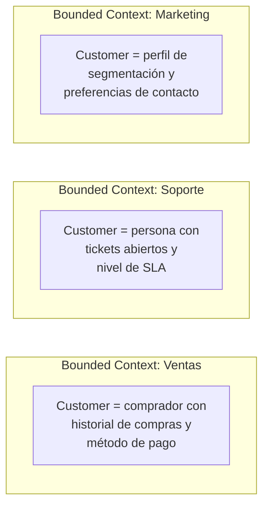
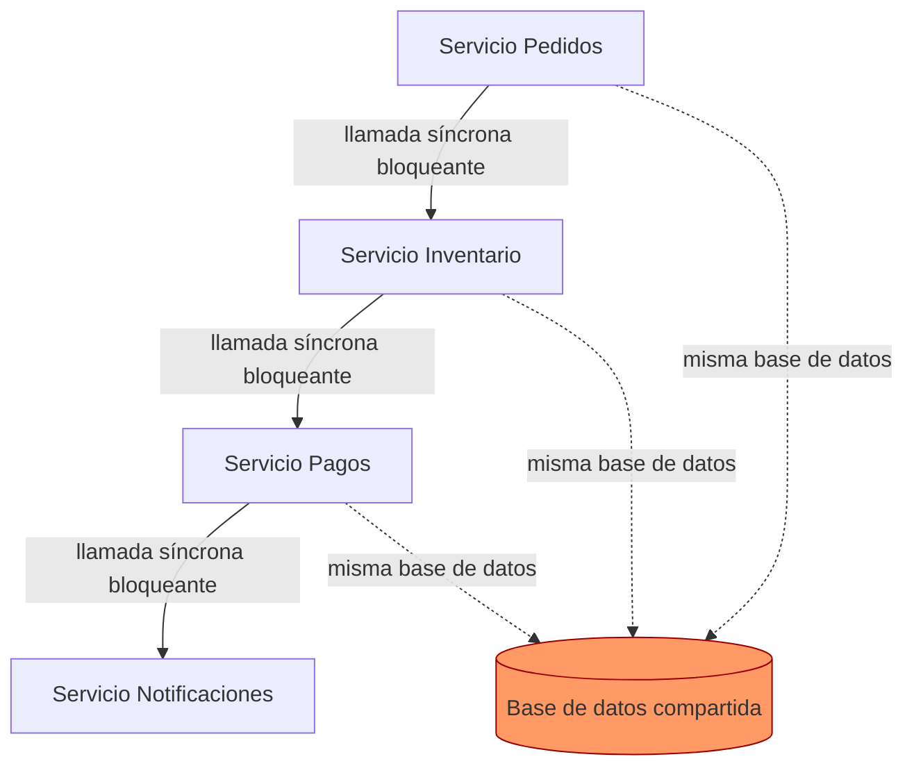
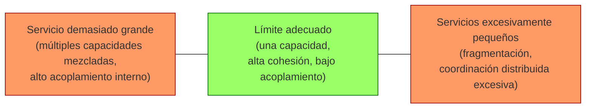
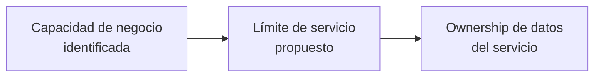
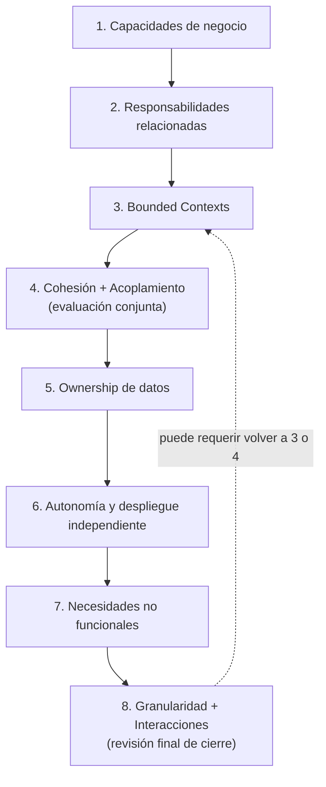

# Investigación previa al diseño de una arquitectura de microservicios

> **Alcance de este documento:** este es un marco conceptual y un conjunto de criterios de razonamiento. **No** contiene una descomposición de ningún sistema específico, ni una lista de microservicios propuestos. El objetivo es que, en una etapa posterior, puedas aplicar este marco a un monolito real y tomar decisiones justificadas.

---

## 1. El problema fundamental: ¿cómo se identifica un microservicio?

Un arquitecto no descubre los límites de un microservicio inspeccionando el código de un monolito y preguntando "¿qué módulo es este?". Los descubre preguntando **"¿qué hace el negocio, y qué partes de eso cambian por razones distintas?"**.

La razón por la que **no basta con tomar módulos, tablas, entidades o funcionalidades existentes** y convertir cada uno en un servicio es que esas unidades reflejan decisiones técnicas *ya tomadas* (cómo se organizó el código, cómo se normalizó la base de datos), no la estructura real del negocio. Un monolito mal modularizado, si se descompone literalmente, simplemente reproduce sus mismos problemas — pero ahora distribuidos por red. Este es precisamente el origen del **Distributed Monolith** (sección 6).

Sam Newman lo resume como principio rector: los servicios deben modelarse alrededor de dominios de negocio, no de capas técnicas, y la **desplegabilidad independiente** es el objetivo central — los límites de servicio, las APIs y el ownership de equipos existen sobre todo para que los equipos puedan desplegar cambios sin coordinarse con otros equipos<cite index="3-1">, alineando servicios con capacidades de negocio cohesivas para que la mayoría de los cambios permanezcan dentro de un solo servicio, siendo el information hiding la base de los buenos límites de servicio</cite>.

### Características de un buen límite de servicio

| Característica | Qué significa | Señal de que existe |
|---|---|---|
| **Alta cohesión interna** | Lo que cambia junto, vive junto | Las reglas de negocio relacionadas están en un solo lugar |
| **Bajo acoplamiento externo** | El servicio depende poco de detalles internos de otros | Cambiar la implementación interna no rompe a otros servicios |
| **Ownership claro** | Un solo equipo/servicio es dueño de una responsabilidad y sus datos | No hay ambigüedad sobre "quién decide" sobre un concepto |
| **Independencia de despliegue** | Se puede liberar sin coordinar con otros servicios | No existen "ventanas de despliegue conjunto" |
| **Límite de responsabilidad explícito** | El servicio "hace una cosa" a nivel de negocio, no de CRUD | Se puede describir su propósito en una frase sin usar "y" |
| **Estabilidad relativa** | El límite no cambia constantemente | Las fronteras sobreviven a la mayoría de los cambios de requisitos |

### Señales para agrupar vs. separar

**"Esto debería estar en el mismo servicio" cuando:**
- Las funcionalidades comparten reglas de negocio y suelen cambiar en el mismo commit/release.
- Requieren consistencia transaccional fuerte y frecuente entre sí.
- Usan el mismo lenguaje ubicuo (las mismas palabras significan lo mismo).
- Son operadas y evolucionadas por el mismo equipo.

**"Esto probablemente debería separarse" cuando:**
- Tienen ciclos de cambio distintos (una cambia semanalmente, otra casi nunca).
- Pertenecen a capacidades de negocio distintas, aunque comparten una entidad de nombre similar.
- Tienen necesidades no funcionales muy distintas (escalabilidad, disponibilidad, seguridad).
- Son propiedad conceptual de equipos/áreas de negocio distintas.

Newman insiste en que, ante la duda, es más seguro **empezar con servicios más grandes y dividir después**: la descomposición prematura produce límites inestables y cambios constantes entre servicios, mientras que refinar los límites a medida que se comprende mejor el dominio reduce ese riesgo<cite index="3-1">, ya que la descomposición prematura conduce a límites inestables y cambios frecuentes entre servicios</cite>. Esta idea reaparece en la guía de dominio de Microsoft: cuando hay duda, conviene empezar con microservicios más gruesos, porque **dividir un microservicio en dos es más fácil que rediseñar la funcionalidad repartida entre varios servicios ya existentes**<cite index="38-1">, dado que dividir un microservicio en dos servicios más pequeños es más fácil que refactorizar funcionalidad entre varios microservicios existentes</cite>.

---

## 2. Descomposición por capacidad de negocio (Decompose by Business Capability)

Una **capacidad de negocio** es algo que el negocio *hace* para generar valor, independientemente de cómo esté implementado hoy: "Gestión de Pedidos", "Gestión de Inventario", "Facturación". Chris Richardson describe este patrón como uno de los dos enfoques centrales de descomposición, con origen en la arquitectura de negocio (el otro es por subdominio, con origen en DDD)<cite index="12-1">, señalando que los servicios en una arquitectura de microservicios se organizan alrededor de intereses de negocio — capacidades de negocio o subdominios — en lugar de intereses técnicos</cite>.

Una capacidad de negocio típicamente se identifica **analizando la organización y su estructura**, no el código: qué áreas de expertise existen, qué resultados produce cada una, y a menudo se corresponde con cómo la empresa divide sus departamentos o líneas de responsabilidad<cite index="17-1">, siendo identificadas analizando el negocio y su estructura organizacional, e identificando las diferentes áreas de expertise</cite>. Una ventaja clave de organizar servicios alrededor de capacidades es su estabilidad: aunque el *cómo* del negocio cambie con el tiempo, la arquitectura basada en capacidades tiende a permanecer relativamente estable<cite index="18-1">, ya que los componentes individuales pueden evolucionar según cambia el "cómo" del negocio, pero la arquitectura en sí permanece sin cambios</cite>.

### Diferenciando conceptos que se confunden fácilmente

| Concepto | Pregunta que responde | Ejemplo |
|---|---|---|
| **Entidad** | ¿Qué objeto de datos existe? | `Order` |
| **Funcionalidad** | ¿Qué acción puntual se ejecuta? | "Crear pedido" |
| **Componente técnico** | ¿Qué pieza de infraestructura/código existe? | `OrderController`, `OrdersTable` |
| **Capacidad de negocio** | ¿Qué responsabilidad de negocio existe, independientemente de su implementación? | *Order Management* (crear, modificar, cancelar, consultar, aplicar reglas de pedidos) |

Por qué no son equivalentes:

- **Una entidad no es una capacidad.** `Order` es solo un sustantivo; `Order Management` es todo el conjunto de reglas, procesos y decisiones alrededor de ese sustantivo. Una capacidad casi siempre involucra múltiples entidades relacionadas (Order, OrderLine, Discount, Shipment) que colaboran para cumplir un propósito de negocio.
- **Una funcionalidad no es una capacidad.** "Crear pedido" es una operación dentro de la capacidad Order Management, junto con "modificar pedido", "cancelar pedido", "aplicar promoción", etc. Convertir cada funcionalidad en un servicio produciría decenas de micro-servicios anémicos y altamente acoplados entre sí (ver sección 7).
- **Un componente técnico no es una capacidad.** Una capa de acceso a datos, un controlador REST o una tabla son decisiones de implementación; el negocio no piensa en esos términos, y esos límites no sobreviven a un refactor técnico.

---

## 3. Domain-Driven Design y Bounded Contexts

### Conceptos clave (solo lo útil para límites de servicio)

- **Domain (Dominio):** el problema completo que la organización intenta resolver (p. ej., "comercio electrónico").
- **Subdomain (Subdominio):** una parte del dominio general.
  - **Core Domain:** lo que da ventaja competitiva; merece la mejor inversión de diseño.
  - **Supporting Subdomain:** necesario para el negocio, pero no diferenciador.
  - **Generic Subdomain:** problema resuelto igual en cualquier empresa (p. ej., autenticación); candidato a comprar/usar soluciones ya existentes.
- **Bounded Context:** el límite dentro del cual un modelo y un lenguaje tienen un significado consistente y único.
- **Ubiquitous Language (Lenguaje Ubicuo):** el vocabulario compartido entre desarrolladores y expertos de negocio *dentro* de un Bounded Context.
- **Context Mapping:** técnica para documentar cómo se relacionan e integran distintos Bounded Contexts entre sí (relaciones de tipo partnership, upstream/downstream, anticorruption layer, etc.).

### ¿Qué es realmente un Bounded Context?

Un Bounded Context existe porque el lenguaje humano es ambiguo: la misma palabra significa cosas distintas en distintas partes de una organización. DDD resuelve esto exigiendo que cada Lenguaje Ubicuo tenga un contexto estricto de aplicabilidad — eso es el Bounded Context: el límite (a menudo, aunque no necesariamente, el límite de un subsistema) dentro del cual un término tiene un solo significado, sin ambigüedad<cite index="19-1">, definiendo un límite dentro del cual un Lenguaje Ubicuo puede usarse libremente, mientras que fuera de él los términos de ese lenguaje pueden tener significados distintos</cite>. Martin Fowler ilustra esto con su propio ejemplo profesional: trabajando para una empresa eléctrica, la palabra "meter" (medidor) significaba cosas distintas según el área de la organización que la usara<cite index="19-1">, relatando cómo la palabra "meter" tenía significados diferentes en distintas partes de la organización</cite>.

Fowler ubica el Bounded Context como el patrón central del "strategic design" en DDD: la manera en que DDD gestiona modelos grandes y equipos grandes es dividiendo el sistema en distintos Bounded Contexts y siendo explícito sobre cómo se relacionan entre sí<cite index="23-1">, ya que DDD trata sobre diseñar software basado en modelos del dominio subyacente, y un modelo actúa como Lenguaje Ubicuo para facilitar la comunicación entre desarrolladores y expertos de dominio</cite>.

### ¿"Un Bounded Context = un microservicio"? Una simplificación útil, pero no una regla exacta

Esta equivalencia es una **heurística de partida razonable, no una ley**. Hay al menos dos matices importantes:

1. **Dirección de la relación.** La guía de Microsoft es explícita: un microservicio no debería abarcar más de un Bounded Context, pero **un Bounded Context sí puede contener más de un microservicio** (varios agregados relacionados que colaboran estrechamente)<cite index="38-1">, señalando que en general la funcionalidad de un microservicio no debería abarcar más de un Bounded Context, ya que por definición un bounded context marca el límite de un modelo de dominio específico</cite>. La recomendación práctica de Azure Architecture Center es diseñar un microservicio para que **no sea más pequeño que un agregado ni más grande que un Bounded Context**<cite index="42-1">, aplicando patrones tácticos de DDD donde cada Bounded Context es candidato a microservicio, y donde entidades y agregados ayudan a identificar los límites naturales de los servicios</cite>.
2. **Perspectiva crítica.** Vlad Khononov argumenta que tratar Bounded Context como sinónimo de microservicio es incluso conceptualmente invertido: un Bounded Context es, ante todo, un límite de **modelo y lenguaje** (una preocupación de diseño de software y comunicación), mientras que un microservicio es, ante todo, un límite de **despliegue e infraestructura** (una preocupación operacional). Pueden coincidir, pero no son la misma clase de cosa<cite index="19-1">, habiendo llegado a considerar que la equivalencia entre Bounded Context y microservicio es una heurística incorrecta</cite>.

En la práctica, la postura que concilia ambas fuentes es: **usa Bounded Context para descubrir dónde el significado del dominio cambia (eso te da candidatos de límite superior); usa agregados y capacidades para decidir si dentro de ese contexto necesitas uno o varios servicios**.

### Ejemplo: la misma palabra, significados distintos

`Customer`, `Product` u `Order` no son "una entidad universal" que todos los servicios comparten tal cual — son *proyecciones distintas* del mismo concepto de negocio, cada una relevante solo dentro de su Bounded Context. Intentar mantener un único modelo de `Customer` "válido para todos" es, de hecho, una de las causas más comunes de acoplamiento excesivo entre servicios.

---

## 4. Service Boundaries: ¿dónde empieza y termina un servicio?

Un límite de servicio bien trazado responde simultáneamente a varias fuerzas, no solo a una:

| Factor | Pregunta que ayuda a responder |
|---|---|
| Cohesión funcional | ¿Estas reglas de negocio pertenecen conceptualmente juntas? |
| Reglas de negocio | ¿Quién es la autoridad de decisión sobre esta regla? |
| Frecuencia de cambio | ¿Estas partes cambian por las mismas razones y al mismo ritmo? |
| Dependencias | ¿Cuántas otras partes necesitan saber de esto para funcionar? |
| Ownership de datos | ¿Quién debería ser el único capaz de escribir estos datos? |
| Escalabilidad | ¿Esta funcionalidad tiene una carga/perfil de tráfico distinto? |
| Disponibilidad | ¿Necesita un SLA distinto al resto del sistema? |
| Seguridad | ¿Maneja datos sensibles que exigen aislamiento? |
| Equipo responsable | ¿Qué equipo tiene el contexto de negocio para evolucionar esto? |
| Ciclo de vida | ¿Nace, evoluciona y eventualmente se retira de forma independiente? |
| Patrones de comunicación | ¿Cómo necesita interactuar con el resto del sistema? |

### "Things that change together should stay together"

Esta heurística (raíz del *Common Closure Principle* de Robert C. Martin, que aparece citado explícitamente en el libro de Richardson) dice: agrupa el código que cambia por las mismas razones, para que un cambio de negocio toque un solo servicio y no varios<cite index="12-1">, siguiendo el Common Closure Principle: las clases de un paquete deberían estar cerradas juntas frente a los mismos tipos de cambio, de modo que un cambio que afecta a un paquete afecte a todas las clases de ese paquete</cite>.

**Cuándo es útil:** para decidir si dos funcionalidades "hermanas" (p. ej., aplicar un descuento y calcular el precio final) deberían vivir en el mismo servicio, evitando que una liberación de negocio obligue a desplegar dos servicios coordinadamente.

**Limitaciones:**
- Es retrospectivo: necesitas historial de cambios (o buen conocimiento del dominio) para aplicarlo; en un sistema nuevo es más una hipótesis que una medición.
- Puede entrar en tensión con otros criterios: dos cosas pueden cambiar juntas *hoy* por acoplamiento accidental (mala arquitectura), no porque deban estar juntas conceptualmente.
- No dice nada sobre necesidades no funcionales (escalabilidad, seguridad) que sí pueden justificar separación aunque el ritmo de cambio sea similar.

---

## 5. Cohesión a nivel de servicio

**Alta cohesión** significa que todo lo que vive dentro de un servicio tiene una razón de negocio compartida para estar ahí — comparten datos, reglas y motivo de cambio. **Baja cohesión** significa que un servicio agrupa responsabilidades que, en realidad, pertenecen a preocupaciones de negocio distintas y solo coinciden por conveniencia técnica (p. ej., "todo lo relacionado con notificaciones", sin importar de qué capacidad de negocio provienen).

**Cohesión funcional** es el tipo más fuerte y deseable en este contexto: todos los elementos del servicio contribuyen a una única tarea de negocio bien definida (a diferencia de la cohesión "casual" o "de comunicación", donde las cosas están juntas solo porque comparten datos o se ejecutan en secuencia).

### Cómo detectar que un servicio agrupa cosas que no deberían estar juntas

- Necesitas describir su propósito con "y" repetidamente ("gestiona pedidos **y** procesa pagos **y** envía notificaciones").
- Distintas partes del servicio son modificadas casi siempre por equipos distintos.
- Algunas partes cambian con mucha frecuencia y otras casi nunca — sugiere que no comparten un mismo motor de cambio.
- Existen "zonas muertas" de código que un desarrollador nuevo del equipo nunca toca porque "no es su área", aunque estén en el mismo servicio.

### Alta cohesión interna + bajo acoplamiento externo

Esta combinación es deseable porque produce el efecto exactamente opuesto al Distributed Monolith: el servicio puede cambiar por dentro libremente (alta cohesión → los cambios quedan contenidos) sin forzar cambios en otros servicios (bajo acoplamiento → nadie más depende de sus detalles internos). Es, en esencia, la aplicación del principio de **information hiding** a nivel de servicio en lugar de a nivel de clase u objeto<cite index="3-1">, siendo el information hiding la base de los buenos límites de servicio: un servicio debería exponer comportamiento a través de APIs mientras oculta detalles de implementación como bases de datos, elecciones tecnológicas y flujos internos de trabajo</cite>.

---

## 6. Acoplamiento entre microservicios y el Distributed Monolith

### Tipos de acoplamiento relevantes al diseñar límites

| Tipo | Qué es | Ejemplo del síntoma |
|---|---|---|
| **Temporal coupling** | Un servicio necesita que otro esté disponible *en ese instante* para completar su trabajo | Llamada síncrona bloqueante; si el downstream cae, el upstream falla de inmediato |
| **Implementation coupling** | Un servicio depende de detalles internos de otro, no solo de su contrato | Compartir una librería con lógica de dominio interna entre servicios |
| **Data coupling** | Dos servicios dependen de la misma estructura de datos compartida | Esquema de base de datos compartido |
| **Contract coupling** | Cambios en la API de un servicio obligan a cambios coordinados en sus consumidores | Versión de API que rompe a todos los clientes a la vez |
| **Semantic coupling** | Dos servicios asumen implícitamente las mismas reglas de negocio, sin que estén explícitas en ningún contrato | Ambos calculan impuestos "a su manera", y deben coincidir sin que exista una fuente única de verdad |
| **Deployment coupling** | Dos servicios deben desplegarse juntos o en un orden específico | Runbooks que exigen "primero A, luego B" |

### Distributed Monolith

**Qué es:** una arquitectura que *parece* microservicios (cajas separadas, red de por medio) pero *se comporta* como un monolito: un cambio en un servicio sigue provocando cambios en cascada en otros, y las cosas siguen desplegándose de forma coordinada<cite index="28-1">, comportándose en tiempo de ejecución como un monolito aunque estructuralmente luzca como microservicios, de modo que un cambio en un servicio sigue provocando cascadas y rompiendo a otros</cite>. Es "lo peor de ambos mundos": toda la complejidad operacional de un sistema distribuido (latencia de red, trazabilidad distribuida, políticas de reintento, orquestación de contenedores) sin ninguno de sus beneficios reales<cite index="28-1">, forzando a gestionar la sobrecarga operacional de microservicios mientras se sigue limitado por un acoplamiento fuerte</cite>.

**Cómo aparece:** normalmente cuando la descomposición sigue las fronteras *técnicas o de código existentes* del monolito en lugar de fronteras de negocio, o cuando persiste infraestructura compartida (como una única base de datos) a través de la frontera de servicios recién creada<cite index="30-1">, ocurriendo comúnmente cuando los equipos dividen servicios a lo largo de los límites de código existentes del monolito en lugar de descomponer alrededor de dominios de negocio, heredando así su acoplamiento</cite>.

**Señales de alerta:**
- Múltiples servicios apuntan al mismo esquema de base de datos o comparten un mismo contexto de datos<cite index="28-1">, siendo la señal más clara múltiples servicios apuntando al mismo esquema de base de datos, o compartiendo un único contexto que expone las tablas de todos los dominios</cite>.
- Cadenas largas de llamadas síncronas entre servicios (`A → B → C → D` para completar una sola operación de negocio).
- Runbooks de despliegue que exigen una secuencia específica entre servicios.
- La cadencia de entrega no mejoró tras adoptar microservicios: si sigues sin poder desplegar servicios individuales con más frecuencia, vale la pena cuestionar si la arquitectura realmente entrega la independencia esperada<cite index="30-1">, siendo uno de los beneficios centrales de construir microservicios la capacidad de liberar servicios individuales con frecuencia e independencia</cite>.

*Cuatro "servicios" separados en el diagrama, pero acoplados por datos compartidos y por una cadena síncrona: en la práctica, un fallo o un cambio en cualquiera de ellos se propaga a todos — el comportamiento real de un monolito.*

---

## 7. Granularidad: ¿qué tan grande debería ser un microservicio?

No existe una métrica mecánica correcta (líneas de código, número de clases, endpoints o tablas) porque esas métricas miden *tamaño de implementación*, no *cohesión de responsabilidad de negocio*. Dos servicios con el mismo número de líneas pueden tener granularidad completamente distinta si uno encapsula una única capacidad coherente y el otro mezcla tres no relacionadas.

### Servicios demasiado grandes

- Terminan acumulando múltiples responsabilidades de negocio no relacionadas (baja cohesión disfrazada de "eficiencia").
- Se vuelven difíciles de evolucionar: cualquier cambio exige entender y probar un alcance amplio.
- Distintas partes internas pueden tener necesidades de escalabilidad muy diferentes, forzando a escalar todo el servicio aunque solo una parte lo necesite.
- El acoplamiento interno crece silenciosamente porque nada obliga a mantener fronteras claras dentro del propio código.

### Servicios demasiado pequeños (over-fragmentación)

- Multiplican las llamadas de red necesarias para completar una sola operación de negocio, aumentando la latencia total.
- Obligan a coordinación distribuida constante (sagas, orquestación) para lo que antes era una simple transacción local.
- Aumentan drásticamente la complejidad operacional: más servicios que desplegar, monitorear, versionar y asegurar.
- Multiplican la cantidad de contratos (APIs) que mantener en compatibilidad hacia atrás.
- Hacen el debugging más difícil: seguir una operación de negocio requiere rastrear su ejecución a través de muchos procesos distintos.

### Un punto de referencia razonable

Microsoft Azure Architecture Center propone un rango de referencia útil (no una regla rígida): **diseñar un microservicio para que no sea más pequeño que un agregado de dominio, ni más grande que un Bounded Context**<cite index="42-1">, siendo un principio general diseñar un microservicio para que no sea más pequeño que un agregado y no más grande que un bounded context</cite>. Un agregado bien diseñado ya exhibe muchas de las características deseables de un buen microservicio: se deriva de requisitos de negocio (no de accesos a datos o mensajería), tiene alta cohesión funcional, define un límite natural de persistencia, y está débilmente acoplado con otros agregados<cite index="38-1">, siendo los agregados a menudo buenos candidatos a microservicios porque un agregado bien diseñado exhibe muchas características de un microservicio bien diseñado: deriva de requisitos de negocio en lugar de preocupaciones técnicas, tiene alta cohesión funcional, es un límite de persistencia, y los agregados deberían estar débilmente acoplados</cite>.

---

## 8. Microservicio vs. entidad de negocio

**El error:** "Tengo una entidad `User`, `Product`, `Order` o `Payment` → necesito un servicio para cada una." Esto confunde el modelo de datos con el límite arquitectónico.

### Por qué falla

- Una entidad es solo un sustantivo de datos; el límite de servicio se decide por **capacidad de negocio y ownership**, no por la existencia de una tabla.
- Muchas entidades relacionadas colaboran dentro de **una sola** capacidad de negocio y deberían vivir juntas (p. ej., `Order`, `OrderLine`, `Discount` y `ShippingAddress` normalmente pertenecen todas a Order Management).
- Una misma entidad *conceptual* puede necesitar representaciones distintas en distintos Bounded Contexts (ver sección 3: `Customer` en Ventas vs. en Soporte).
- Una funcionalidad aparentemente pequeña alrededor de una entidad (p. ej., "actualizar la dirección de envío de un pedido") casi nunca justifica un servicio propio: agregarla como una operación más dentro del servicio dueño de `Order` suele ser más cohesivo que crear un `ShippingAddressUpdateService`.

### Ejemplos ilustrativos

| Situación | Qué NO hacer | Qué considerar en su lugar |
|---|---|---|
| `Order`, `OrderLine`, `Discount` | Un servicio por entidad | Un solo servicio *Order Management*, dueño de las tres |
| `Customer` usado en Ventas y en Soporte | Un único servicio `Customer` global compartido por todos | Dos representaciones distintas, cada una dueña de su Bounded Context, sincronizadas por eventos si es necesario |
| Pequeño ajuste (p. ej. "aplicar cupón") | Un microservicio dedicado a "aplicar cupón" | Una operación dentro del servicio de Pedidos o de Promociones, según quién sea dueño de la regla |

---

## 9. Data Ownership como criterio de diseño

Un servicio debería poseer únicamente los datos sobre los que tiene autoridad de negocio para decidir; nadie más debería poder escribir en ellos directamente. Otros servicios que necesitan esa información deberían obtenerla a través de la API o de eventos del servicio dueño — nunca accediendo directamente a su base de datos, porque eso crea un acoplamiento de datos oculto e implícito (ver sección 6) que, en la práctica, elimina la independencia de despliegue. Como resumen la observación de Newman: cada microservicio debe ser dueño de sus datos, y las bases de datos compartidas crean acoplamiento oculto que destruye la desplegabilidad independiente<cite index="3-1">, señalando que cada microservicio debe poseer sus datos, y que las bases de datos compartidas crean acoplamiento oculto y destruyen la desplegabilidad independiente, de modo que la interacción debería ocurrir mediante APIs o eventos explícitos</cite>.

### Business Capability → Service Boundary → Data Ownership

**La dirección importa.** Los datos no deberían usarse como punto de partida para descubrir límites de servicio — deberían ser una **consecuencia** de haber identificado primero la capacidad de negocio y el límite de responsabilidad. Si inviertes el orden (agrupas servicios según qué tablas "parecen ir juntas" técnicamente), corres el riesgo de reproducir la estructura relacional del monolito en lugar de la estructura real del negocio — el mismo error de fondo descrito en la sección 1.

---

## 10. Autonomía de los servicios

La autonomía tiene múltiples dimensiones, y es razonable que un servicio sea autónomo en unas y dependa parcialmente de otras en otras dimensiones:

| Dimensión | Qué significa ser autónomo |
|---|---|
| Desarrollo | El equipo dueño puede escribir y probar código sin bloquear a otros equipos |
| Despliegue | Se libera sin coordinar una ventana conjunta con otros servicios |
| Datos | Posee y controla su propio almacenamiento |
| Escalabilidad | Puede escalar sus recursos sin arrastrar a otros servicios |
| Fallas | Un fallo interno no debería tumbar automáticamente a servicios no relacionados |
| Tecnología | Puede, si es necesario, usar un stack distinto sin coordinación externa |
| Evolución | Puede cambiar su modelo interno sin romper a sus consumidores, mientras mantenga su contrato |

**Autonomía no es aislamiento absoluto.** Todo sistema distribuido tiene dependencias legítimas entre servicios — el objetivo no es eliminarlas, sino que sean **explícitas, estables y a través de contratos**, no implícitas y frágiles.

**Dependencias normales:**
- Un servicio consulta la API pública de otro para obtener información que no posee.
- Un servicio reacciona a eventos publicados por otro (integración asíncrona).
- Un servicio consume un contrato versionado y estable, con compatibilidad hacia atrás garantizada.

**Dependencias que indican un problema de diseño:**
- Necesitar desplegar dos servicios juntos casi siempre.
- Depender de un detalle interno de otro servicio (su esquema de base de datos, una función interna) en lugar de su API pública.
- Que la operación más común del sistema requiera una cadena larga de llamadas síncronas entre muchos servicios (ver sección 14).

---

## 11. Independently Deployable

Ser **independientemente desplegable** significa: se puede llevar una nueva versión de un servicio a producción sin necesidad de desplegar, al mismo tiempo, ningún otro servicio. Para Newman, esta es la propiedad más importante de todas — de hecho, si dos servicios técnicamente separados siempre necesitan desplegarse juntos, eso es una señal fuerte de que el límite elegido no es el correcto, y no que el sistema simplemente "tenga overhead operacional"<cite index="8-1">, señalando que si no puedes desplegar un microservicio de forma independiente, probablemente estás haciendo algo mal: el despliegue orquestado es un indicio de que los límites de servicio pueden no ser correctos, y al orquestar despliegues el negocio no obtiene uno de los mayores beneficios del enfoque de microservicios, que es la autonomía de equipo y la capacidad de entregar de forma independiente</cite>.

**Relación con:**
- **Contratos:** solo es posible desplegar independientemente si el contrato público es estable y los cambios se hacen de forma compatible hacia atrás.
- **Acoplamiento:** el despliegue conjunto es, en esencia, acoplamiento de despliegue (sección 6) manifestándose operacionalmente.
- **Ownership de datos:** si dos servicios comparten esquema de datos, casi nunca podrán desplegarse verdaderamente por separado, porque cualquier cambio de esquema los afecta a ambos.

**¿Siguen siendo "independientes" dos servicios que siempre se despliegan juntos?** No en la práctica — son, funcionalmente, un solo sistema desplegado en dos procesos. Esto revela que el límite entre ellos probablemente no sigue una frontera de negocio real, sino una división técnica arbitraria (p. ej., separar "lectura" de "escritura" de la misma entidad sin una razón de negocio que lo justifique).

---

## 12. APIs y límites de servicio

La API pública de un servicio **es** su límite visible hacia el resto del sistema — todo lo demás (esquema de base de datos, estructura interna del código, tecnología usada) es implementación privada que el servicio puede cambiar libremente mientras el contrato se mantenga.

| | Implementación interna | Contrato público |
|---|---|---|
| Quién la ve | Solo el equipo dueño del servicio | Todos los consumidores |
| Puede cambiar libremente | Sí, en cualquier momento | Solo de forma compatible (o con un proceso de versión/migración) |
| Ejemplos | Esquema de base de datos, lenguaje/framework, estructura de clases | Endpoints, esquemas de mensajes, eventos publicados |

Conceptos relacionados:
- **API contracts:** el acuerdo formal (forma de los datos, comportamiento esperado) entre un servicio y sus consumidores.
- **Information hiding:** ocultar todo lo que no forma parte del contrato, para maximizar la libertad de evolución interna (ver sección 5).
- **Encapsulation:** aplicar information hiding de forma consistente en el diseño del servicio.
- **Backward compatibility:** la capacidad de cambiar internamente sin romper a los consumidores existentes — condición necesaria para la desplegabilidad independiente (sección 11).

**Qué exponer:** solo las operaciones y datos que representan comportamiento de negocio significativo y estable. **Qué mantener privado:** cualquier detalle que, si cambia, no debería obligar a un consumidor a cambiar también.

---

## 13. Diseñar APIs a partir de capacidades, no de tablas

Hay una diferencia importante entre exponer el modelo de datos interno como API (CRUD genérico) y exponer las capacidades de negocio como operaciones con significado propio.

| Enfoque CRUD genérico | Enfoque orientado a capacidades |
|---|---|
| `POST /orders`, `PUT /orders/{id}`, `PATCH /orders/{id}` | `POST /orders`, `POST /orders/{id}/cancel`, `POST /orders/{id}/apply-discount` |
| El cliente decide qué campos cambiar | El servicio decide qué reglas de negocio aplican para cada operación |
| Fácil de generar automáticamente | Requiere entender el dominio para diseñarla |
| Filtra el modelo de datos interno hacia afuera | Encapsula el modelo interno detrás de operaciones con intención |

**CRUD no es incorrecto por sí mismo.** Es perfectamente razonable cuando la entidad realmente *es* un simple recurso de datos sin reglas de negocio complejas alrededor (p. ej., una lista de configuración simple). La señal de alerta aparece cuando un `PATCH` genérico permite modificar campos que, en realidad, están gobernados por reglas de negocio específicas (p. ej., permitir `PATCH /orders/{id}` con el campo `status` libre, en lugar de exigir pasar por `POST /orders/{id}/cancel`, que sí puede validar que la cancelación sea válida en ese estado). Cuando esto ocurre, la API está exponiendo el modelo de datos interno en lugar de representar capacidades del dominio, y la lógica de validación termina duplicada en cada cliente.

---

## 14. Dependencias y comunicación entre servicios

Antes de fijar límites, conviene simular mentalmente cómo interactuarían los candidatos a servicio: qué necesitan saber unos de otros, quién inicia cada interacción, y con qué frecuencia.

**Preguntas útiles:**
- ¿Qué información necesita este servicio que no posee él mismo?
- ¿Quién es la fuente de verdad de esa información?
- ¿La interacción puede tolerar demora (asíncrona) o necesita respuesta inmediata (síncrona)?

**Regla general para elegir síncrono vs. asíncrono (a alto nivel, sin tecnologías):**
- **Síncrono** cuando la operación de negocio genuinamente no puede continuar sin una respuesta inmediata (p. ej., validar disponibilidad antes de confirmar una compra en el mismo flujo de usuario).
- **Asíncrono** cuando el consumidor puede reaccionar más tarde sin bloquear al productor (p. ej., notificar que un pedido fue despachado).

### La comunicación constante como señal de límites incorrectos

**Si dos servicios necesitan comunicarse continuamente para completar prácticamente cualquier operación, eso es una señal — pero no una prueba definitiva — de que el límite puede estar mal trazado.**

- **Cuándo sí sugiere fusionar:** cuando esa comunicación constante existe porque ambos servicios manipulan, en el fondo, el mismo agregado de negocio y solo fueron separados por una decisión técnica arbitraria (p. ej., "lecturas" y "escrituras" de `Order` en servicios distintos sin necesidad real).
- **Cuándo no aplica:** cuando la comunicación frecuente es simplemente la naturaleza de la colaboración entre dos capacidades de negocio genuinamente distintas (p. ej., Pedidos consultando Inventario es una colaboración normal entre dos responsabilidades separadas, no un síntoma de mal diseño) — la clave es si esa comunicación es *necesaria y estable* o *excesiva y fràgil* (cadenas largas, timeouts en cascada, ver sección 6).

---

## 15. Transacciones y consistencia como señal arquitectónica

- **Transacción local:** todos los cambios ocurren dentro de un único servicio/base de datos, con garantías ACID normales.
- **Transacción distribuida:** los cambios abarcan varios servicios; requiere patrones como Saga, y renuncia a ACID clásico.
- **Consistencia fuerte:** el sistema garantiza que, inmediatamente después de una escritura, cualquier lectura ve ese cambio.
- **Consistencia eventual:** el sistema garantiza que, con el tiempo, todos los componentes convergerán al mismo estado — pero no de inmediato.

**Si dos funcionalidades necesitan modificar información de forma atómica y constante, ¿qué nos dice eso?**

No asumas automáticamente que deben estar en el mismo servicio. Antes de decidir, un arquitecto debería preguntarse:

1. ¿Esa necesidad de atomicidad es una regla de negocio real (p. ej., "el saldo y el historial de movimientos deben cambiar juntos siempre, sin excepción") o es simplemente cómo está implementado hoy?
2. ¿El negocio realmente no tolera ninguna ventana de inconsistencia, por corta que sea? (Muchos procesos que *parecen* exigir atomicidad, en realidad toleran consistencia eventual de segundos o minutos sin impacto real.)
3. Si la respuesta a (2) es "no tolera ninguna inconsistencia", eso es evidencia fuerte a favor de mantenerlas en el mismo servicio (transacción local). Si tolera consistencia eventual, la separación sigue siendo viable usando eventos/Sagas — a costa de mayor complejidad de coordinación, que debe justificarse con otros beneficios (escalabilidad, ownership, fallas).

---

## 16. Escalabilidad como criterio de separación

Puede tener sentido separar dos funcionalidades cuando tienen **perfiles de carga genuinamente distintos** — p. ej., una funcionalidad intensiva en CPU (procesamiento de imágenes) frente a otra dominada por lecturas simples de alto volumen (consultar catálogo). Escalarlas por separado evita pagar el costo de sobre-aprovisionar toda una funcionalidad para cubrir la necesidad de solo una parte de ella.

**Pero "quiero poder escalarlo independientemente" no es, por sí solo, justificación suficiente** para crear un microservicio nuevo. Hace falta que esa necesidad de escalabilidad coincida con una responsabilidad de negocio cohesiva y con ownership de datos claro — de lo contrario, se corre el riesgo de crear un servicio técnico sin límite de negocio real, débil en cohesión (sección 5) y difícil de mantener con sentido propio.

Relación con otros criterios:
- **Responsabilidad:** la escalabilidad debería aplicarse a una capacidad completa, no a un fragmento técnico arbitrario de ella.
- **Cohesión:** separar por escalabilidad sin cohesión de negocio produce servicios técnicos ("el servicio que hace cosas pesadas") difíciles de razonar.
- **Infraestructura y costo operacional:** cada servicio nuevo añade costo fijo de operación (monitoreo, despliegue, seguridad); ese costo debe compararse con el ahorro real de escalar por separado.

---

## 17. Fallas como criterio para definir límites (Fault Isolation)

- **Blast radius:** el alcance del impacto cuando algo falla — cuántas otras funcionalidades quedan afectadas.
- **Dependencias críticas:** aquellas cuya caída sí debería detener una operación (a diferencia de las prescindibles).
- **Degradación independiente (graceful degradation):** la capacidad de que partes no críticas fallen sin tumbar el flujo principal.
- **Disponibilidad:** el nivel de tiempo-en-funcionamiento que cada responsabilidad realmente necesita (no todas necesitan el mismo SLA).

**Pregunta guía:** *¿qué funcionalidades deberían poder fallar sin impedir que otras sigan funcionando?* Si "enviar el correo de confirmación" falla, ¿debería eso impedir que el pedido se confirme? Casi seguro que no — lo que sugiere que Notificaciones puede ser un límite de servicio separado, con una relación asíncrona y tolerante a fallas hacia Pedidos, en lugar de una dependencia síncrona bloqueante. Esta pregunta ayuda a descubrir límites porque obliga a distinguir **qué es esencial para el resultado de negocio** de **qué es acompañante y puede degradarse sin invalidar el resultado principal**.

---

## 18. Equipos y Conway's Law

**Conway's Law** establece que la arquitectura de un sistema tiende a reflejar la estructura de comunicación de la organización que lo construye. En la práctica, la arquitectura mimetiza a la organización, y no al revés, con más frecuencia<cite index="10-1">, siendo casi un hecho establecido en ingeniería de software que la organización termina moldeando la forma arquitectónica del sistema, aunque en ocasiones ocurre en sentido inverso</cite>. Para que la desplegabilidad independiente funcione en la práctica, hace falta también autonomía organizacional: equipos autónomos, cada uno dueño de extremo a extremo de uno o dos servicios (producto, despliegue, guardia)<cite index="45-1">, dictando Conway's Law que la arquitectura reflejará la estructura del equipo, por lo que para que el despliegue autónomo funcione hacen falta equipos autónomos, cada uno con responsabilidad de extremo a extremo sobre uno o dos servicios</cite>.

- **"You build it, you run it":** el mismo equipo que desarrolla un servicio es responsable de operarlo en producción (incluyendo guardias/on-call), lo que alinea el incentivo de calidad con quien tiene el conocimiento del dominio.
- **Ownership de servicio ↔ ownership de equipo:** asignar cada servicio a un único equipo (o, si el equipo es grande, a un subequipo claramente definido) reduce ambigüedad sobre quién decide y evolucionar el servicio<cite index="50-1">, recomendándose asignar cada microservicio a un solo equipo, aunque si el equipo es lo suficientemente grande, varios subequipos podrían ser dueños de microservicios separados dentro de la misma estructura</cite>.
- **Inverse Conway Maneuver:** en lugar de dejar que la organización determine pasivamente la arquitectura, se reorganiza deliberadamente a los equipos según la arquitectura de servicios *deseada*, para inducir esa estructura técnica como consecuencia.

Este documento no toma partido sobre organización empresarial en general — el punto relevante aquí es únicamente que **un límite de servicio que no puede asignarse claramente a un equipo dueño suele ser señal de un límite mal trazado**, y viceversa.

---

## 19. Enfoques para descomponer un monolito: comparación

Es importante no tratar estos enfoques como equivalentes: **algunos ayudan a descubrir dónde están los límites; otro (Strangler Fig) ayuda a *ejecutar* la migración una vez que ya sabes hacia dónde vas.**

| Enfoque | Propósito | Cuándo es útil | Problema que resuelve | Limitaciones |
|---|---|---|---|---|
| **Decomposition by Business Capability** | Descubrir límites analizando qué hace el negocio | Fase temprana, cuando se quiere una arquitectura estable a largo plazo | Evita basar los límites en estructura técnica accidental | Requiere buen conocimiento del negocio; las capacidades pueden ser difíciles de precisar en negocios nuevos o cambiantes |
| **Decomposition by Subdomain (DDD)** | Descubrir límites analizando el dominio y distinguiendo core/supporting/generic | Cuando el negocio es complejo y se quiere invertir esfuerzo de diseño donde más importa (core domain) | Ayuda a priorizar dónde vale la pena el diseño más cuidadoso | Requiere involucrar expertos de dominio; puede requerir tiempo/event storming |
| **Bounded Contexts** | Descubrir dónde cambia el significado del lenguaje/modelo | Cuando existe ambigüedad de términos entre áreas (p. ej., "Customer" significa cosas distintas) | Evita construir un modelo único y contradictorio que intenta servir a todos | No es, por sí solo, una guía de granularidad de servicio (sección 3) |
| **Strangler Fig Pattern** | *Ejecutar* la migración incremental de un monolito a servicios ya identificados | Una vez definidos los límites, para migrar sin un "big bang" | Reduce el riesgo de una reescritura total, permitiendo convivencia monolito/servicios | No ayuda a *decidir* los límites — asume que ya fueron identificados; introduce complejidad temporal de tener ambos sistemas activos a la vez |

---

## 20. Señales de un buen candidato a microservicio

Ninguna de estas señales es, por sí sola, una regla absoluta — son evidencia que un arquitecto debería buscar y sopesar en conjunto:

- **Responsabilidad claramente definida:** se puede describir en una frase, sin "y", qué hace este candidato.
- **Reglas de negocio propias:** existe lógica de dominio identificable que le pertenece, no solo operaciones CRUD.
- **Ownership de datos identificable:** hay un conjunto de datos sobre el que este candidato, y solo él, debería tener autoridad de escritura.
- **Necesidad de evolución independiente:** hay evidencia (histórica o prevista) de que este candidato cambia por razones distintas al resto del sistema.
- **Escalabilidad independiente:** tiene un perfil de carga o recursos distinto, y ese perfil justifica el costo de separación (sección 16).
- **Ciclo de cambios independiente:** su cadencia de releases es, o podría ser, distinta a la del resto.
- **Aislamiento de fallas útil:** su caída no debería, por diseño, tumbar funcionalidades no relacionadas (sección 17).
- **Límites de seguridad:** maneja datos o permisos que justifican un perímetro propio.
- **Equipo responsable identificable:** existe (o podría existir) un equipo natural dueño de esta responsabilidad (sección 18).

**Qué evidencia buscar:** no basta con "creo que esto podría escalar distinto" — busca evidencia concreta (métricas de tráfico reales, historial de commits, conversaciones con expertos de negocio sobre quién es dueño de qué) antes de tratar una señal como decisiva.

---

## 21. Señales de una mala separación

| Señal | Por qué indica un problema |
|---|---|
| Demasiadas llamadas entre dos servicios | Sugiere que, en realidad, forman una sola unidad de cohesión artificialmente separada (sección 14) |
| Despliegues coordinados constantes | Contradice la desplegabilidad independiente (sección 11); el acoplamiento de despliegue revela que el límite no sigue una frontera de negocio real |
| Acceso directo a bases de datos ajenas | Rompe el ownership de datos (sección 9) y crea acoplamiento de datos oculto (sección 6) |
| Contratos que cambian continuamente | Indica que el límite del servicio aún no refleja una responsabilidad de negocio estable — el modelo interno se sigue filtrando hacia el contrato público |
| Transacciones distribuidas frecuentes | Puede indicar que dos "servicios" en realidad protegen una sola invariante de negocio que debería vivir junta (sección 15) |
| Lógica de negocio repartida arbitrariamente | La misma regla de negocio existe duplicada (y potencialmente inconsistente) en varios servicios — semantic coupling sin una fuente única de verdad |
| Servicios CRUD extremadamente pequeños | Fragmentación excesiva (sección 7): mucho costo operacional por muy poca cohesión de negocio genuina |
| Cambios que exigen tocar múltiples servicios a la vez | El "Common Closure Principle" (sección 4) está siendo violado: cosas que cambian juntas no están viviendo juntas |

---

## 22. Método de razonamiento propuesto

La secuencia planteada originalmente (10 pasos) es un buen punto de partida, y la investigación anterior la confirma en general — con dos ajustes:

1. **Cohesión y acoplamiento deben evaluarse juntos, no en pasos separados y secuenciales**, porque son dos caras de la misma decisión (sección 5): "¿qué debería estar junto?" y "¿qué dependencias aparecen si lo separo?" se responden iterando entre ambas preguntas, no una después de la otra de forma lineal.
2. **Granularidad e interacciones deben revisarse en conjunto al final**, porque la evidencia de "demasiada comunicación" (paso de interacciones) es, en la práctica, la señal más fuerte para decidir si la granularidad elegida fue correcta (sección 21) — conviene tratarlas como una sola revisión de cierre, no como dos pasos independientes.

### Método final (validado y ajustado)

1. **Identificar capacidades de negocio** — ¿qué hace realmente el negocio?
2. **Identificar responsabilidades relacionadas** — ¿qué comportamientos y reglas cambian juntos?
3. **Buscar Bounded Contexts** — ¿dónde cambia el significado del dominio? (esto da el límite *superior* razonable de cada candidato — sección 3)
4. **Evaluar cohesión y acoplamiento como una sola pregunta** — ¿qué debería permanecer junto, y qué dependencias aparecerían si lo separo?
5. **Evaluar ownership de datos** — ¿quién debería controlar cada información? (consecuencia de 1–4, no punto de partida — sección 9)
6. **Evaluar autonomía y desplegabilidad independiente** — ¿puede este candidato evolucionar y desplegarse razonablemente solo?
7. **Evaluar necesidades no funcionales** — ¿escalabilidad, disponibilidad, seguridad o aislamiento de fallas realmente distintos justifican separación?
8. **Evaluar granularidad e interacciones juntas, como revisión final** — ¿el resultado es demasiado grande o pequeño, y la cantidad de comunicación/coordinación entre candidatos confirma o contradice el límite elegido?

Este método es iterativo, no una línea recta de una sola pasada: es normal, y esperado, volver a un paso anterior cuando el paso 8 revela demasiada comunicación entre dos candidatos, o cuando el paso 7 revela una necesidad no funcional que el Bounded Context inicial no anticipaba.

---

## Pensamiento crítico: por qué las reglas simplificadas fallan

| Afirmación | Por qué es incorrecta o incompleta |
|---|---|
| "Un módulo = un microservicio" | Un módulo refleja la organización de código *actual*, no necesariamente una capacidad de negocio (sección 1) |
| "Una entidad = un microservicio" | Confunde dato con responsabilidad; muchas entidades cooperan dentro de una sola capacidad (sección 8) |
| "Un Bounded Context = un microservicio" | Es una heurística de partida razonable, pero un Bounded Context puede contener varios servicios/agregados (sección 3) |
| "Cada tabla necesita un servicio" | Produce fragmentación extrema (sección 7) y viola ownership de datos con acoplamiento de datos compartidos entre servicios diminutos |
| "Mientras más pequeños, mejor" | Ignora los costos reales de la fragmentación: latencia, coordinación distribuida, complejidad operacional (sección 7) |
| "Cada microservicio debe usar una tecnología distinta" | La libertad tecnológica es una *opción* que la autonomía permite, no una obligación; la heterogeneidad tiene un costo operacional real que debe justificarse |
| "Microservicios significa que todo debe comunicarse mediante eventos" | La comunicación síncrona sigue siendo apropiada quando la operación de negocio realmente exige una respuesta inmediata (sección 14); "todo asíncrono" es tan dogmático como "todo síncrono" |

**Marco general:** distingue siempre entre

> **principio** (p. ej., "alta cohesión, bajo acoplamiento") → **heurística** (p. ej., "things that change together should stay together") → **patrón** (p. ej., Decompose by Business Capability, Strangler Fig) → **decisión contextual** (la elección concreta, informada por evidencia del sistema real, no aplicada mecánicamente).

---

## Checklist de evaluación de candidatos a microservicio

> Este checklist **no decide automáticamente** si algo debe ser un microservicio. Es una herramienta para hacer las preguntas correctas antes de trazar un límite. Úsalo evaluando cada candidato contra todas las preguntas, buscando evidencia concreta, y sopesando las respuestas en conjunto — no como una lista de verificación pasa/no pasa.

### A. Capacidad de negocio y responsabilidad
- [ ] ¿Puedo describir la responsabilidad de este candidato en una frase, sin usar "y"?
- [ ] ¿Corresponde a una capacidad de negocio real, no a una tabla, entidad o componente técnico?
- [ ] ¿Tiene reglas de negocio propias, más allá de operaciones CRUD?

### B. Bounded Context y lenguaje
- [ ] ¿Los términos que usa este candidato tienen un significado único y consistente dentro de su propio límite?
- [ ] Si comparte un nombre de entidad con otro candidato (p. ej., `Customer`), ¿confirmé que representan conceptos realmente distintos, y no el mismo dato duplicado innecesariamente?

### C. Cohesión y acoplamiento
- [ ] ¿Los elementos agrupados aquí cambian juntos, por las mismas razones de negocio?
- [ ] ¿Qué tipo(s) de acoplamiento aparecerían con otros servicios si trazo este límite aquí (temporal, de datos, de contrato, semántico, de despliegue)?
- [ ] ¿Existe evidencia de que compartiría base de datos, librerías internas o despliegue con otro candidato? Si es sí, ¿por qué?

### D. Ownership de datos
- [ ] ¿Hay un conjunto de datos claro sobre el cual este candidato, y solo él, debería tener autoridad de escritura?
- [ ] ¿Otros servicios necesitarían estos datos solo por su API/eventos, o requerirían acceso directo a su almacenamiento?

### E. Autonomía y despliegue
- [ ] ¿Podría este candidato desplegarse sin coordinar con otros servicios en la mayoría de los casos?
- [ ] ¿Su contrato público podría mantenerse compatible hacia atrás razonablemente?

### F. Necesidades no funcionales
- [ ] ¿Tiene necesidades de escalabilidad genuinamente distintas al resto del sistema, respaldadas por datos o expectativas reales?
- [ ] ¿Tiene necesidades de disponibilidad o seguridad que justifiquen un perímetro propio?
- [ ] ¿Su caída debería (o no) impedir que otras funcionalidades sigan operando?

### G. Equipo y organización
- [ ] ¿Existe, o podría existir razonablemente, un equipo dueño de esta responsabilidad de extremo a extremo?

### H. Granularidad e interacciones
- [ ] ¿Es demasiado grande (mezcla capacidades no relacionadas) o demasiado pequeño (fragmenta una sola capacidad sin necesidad)?
- [ ] ¿Cuánta comunicación necesitaría con otros candidatos para completar las operaciones de negocio más comunes? ¿Esa comunicación es una colaboración normal entre responsabilidades distintas, o síntoma de que en realidad es una sola responsabilidad partida artificialmente?
- [ ] ¿La separación reduce realmente el acoplamiento, o solo lo transforma en llamadas de red?

### I. Señales de alerta (si aparece alguna, revisar el límite)
- [ ] Transacciones distribuidas frecuentes entre este candidato y otro.
- [ ] Necesidad de acceso directo a datos de otro candidato.
- [ ] Cambios que, históricamente o por diseño previsto, siempre tocan a este candidato junto con otro.
- [ ] Contrato que se anticipa inestable o cambiante con frecuencia.

---

## Fuentes utilizadas

- Sam Newman — *Building Microservices* / *Monolith to Microservices*: información hiding, desplegabilidad independiente, ownership de datos, "empezar grande y dividir después". [samnewman.io](https://samnewman.io/blog/2015/04/07/microservices-for-greenfield/) · resúmenes: [Medium](https://medium.com/@radupana/building-microservices-sam-newman-9bc28ad8f0f2), [openupthecloud.com](https://openupthecloud.com/building-microservices-sam-newman-summary/), [InfoQ podcast](https://www.infoq.com/podcasts/microservices-benefits-supersede-caveats/)
- Chris Richardson — [microservices.io](https://microservices.io/patterns/decomposition/decompose-by-business-capability.html): Decompose by Business Capability, Decompose by Subdomain, *Microservices Patterns*. Citas del libro: [Goodreads](https://www.goodreads.com/work/quotes/55456565-microservice-patterns)
- Martin Fowler — [Bliki: Bounded Context](https://martinfowler.com/bliki/BoundedContext.html); ejemplo del "meter" discutido en [Vlad Khononov, "Bounded Contexts are NOT Microservices"](https://medium.com/@vladikk.com/bounded-contexts-are-not-microservices-ead44b8d6e35)
- Microsoft Azure Architecture Center — [Domain analysis for microservices](https://learn.microsoft.com/en-us/azure/architecture/microservices/model/domain-analysis), [Use tactical DDD to design microservices](https://learn.microsoft.com/bs-latn-ba/azure/architecture/microservices/model/tactical-domain-driven-design), [Identify microservice boundaries](https://learn.microsoft.com/en-us/azure/architecture/microservices/model/microservice-boundaries)
- AWS — [Decomposing monoliths into microservices (Prescriptive Guidance)](https://docs.aws.amazon.com/prescriptive-guidance/latest/modernization-decomposing-monoliths/service-per-team.html), [AWS Application Modernization](https://blog.easecloud.io/cloud-infrastructure/aws-app-modernization-monolith-to-microservices-serverless/)
- Sobre Distributed Monolith — [vFunction: Distributed monolith architecture](https://vfunction.com/blog/distributed-monolith-architecture/), [Gremlin: Is your microservice a distributed monolith?](https://www.gremlin.com/blog/is-your-microservice-a-distributed-monolith)
- Robert C. Martin — Common Closure Principle, citado en *Microservices Patterns* de Chris Richardson (Goodreads, arriba).

**Nota sobre perspectivas divergentes:** existe un desacuerdo legítimo en la comunidad sobre si "Bounded Context = microservicio" es una guía útil o engañosa. Microsoft (Azure Architecture Center) lo trata como un buen punto de partida práctico ("no más grande que un Bounded Context"), mientras que Vlad Khononov argumenta que son conceptualmente distintos (límite de modelo/lenguaje vs. límite de despliegue) y que tratarlos como sinónimos puede llevar a malas decisiones. Este documento adopta la posición intermedia descrita en la sección 3: útil como heurística de límite superior, no como regla exacta de equivalencia.

---

## Cómo usar este documento en la siguiente etapa

Cuando enfrentes el sistema monolítico real, este marco te permitirá responder con evidencia (no por intuición) las diez preguntas planteadas originalmente: capacidades de negocio, límites naturales, qué debe permanecer junto vs. separarse, ownership de datos, dependencias esperadas, viabilidad de evolución/despliegue independiente, riesgo de sobre/sub-fragmentación, si la separación reduce acoplamiento real o solo lo transforma en red, y el riesgo de terminar en un monolito distribuido. El **checklist de la sección anterior** es la herramienta concreta para esa siguiente etapa — deliberadamente no se aplicó aquí a ningún sistema específico.
