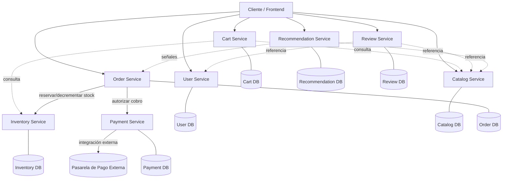

# HITO 2 — Rediseño Arquitectónico de BookSphere en Microservicios


## 5. Paso 1 — Capacidades de negocio de BookSphere

Antes de nombrar servicios, se traduce cada funcionalidad del monolito a **capacidades de negocio** (qué hace el negocio), distinguiéndolas de las funcionalidades puntuales que las componen.

| Capacidad de negocio | Qué representa | Reglas/comportamientos que agrupa | Se relaciona con |
|---|---|---|---|
| **Identidad y Cuentas** | Quién es el usuario y cómo prueba quién es, y cómo gestiona su información personal | Registro, autenticación, gestión de credenciales, edición de perfil | Casi todas (como referencia de identidad) |
| **Catálogo** | Qué libros existen, con qué información descriptiva y a qué precio se ofrecen | Alta/edición de títulos, autores, descripciones, precio de venta | Carrito, Pedidos, Recomendaciones, Reseñas |
| **Inventario** | Cuánta existencia disponible hay de cada libro | Consultar disponibilidad, reservar/decrementar stock, reabastecer | Catálogo (referencia al libro), Pedidos |
| **Carrito de Compras** | Qué está considerando comprar un usuario, antes de confirmar nada | Agregar/quitar libros, modificar cantidades, vigencia temporal del carrito | Catálogo (precio/disponibilidad mostrada), Pedidos (al hacer checkout) |
| **Gestión de Pedidos** | El compromiso de compra ya confirmado y su ciclo de vida | Crear pedido, transicionar estados (confirmado, enviado, cancelado), checkout | Carrito, Inventario, Pagos |
| **Procesamiento de Pagos** | Cobrar de forma segura, integrándose con un proveedor externo | Autorizar cargo, confirmar/  revertir transacción, cumplimiento de seguridad | Pedidos |
| **Recomendaciones** | Sugerir libros relevantes para cada usuario | Analizar historial de navegación/compra, generar sugerencias | Catálogo (qué existe), señales de Pedidos/actividad |
| **Reseñas y Calificaciones** | Opinión y valoración generada por usuarios sobre libros | Publicar reseña, calificar, calcular rating agregado | Catálogo (a qué libro corresponde), Identidad (autor de la reseña) |

### Funcionalidad → Capacidad de negocio → posible límite de servicio

No todas las funcionalidades enumeradas en el escenario mapean 1:1 a una capacidad:

- **"Gestión de inventario"**, mencionada dentro de Catálogo en el escenario original, en realidad es una **capacidad de negocio distinta** a "describir libros": el inventario responde a "¿cuánto stock hay ahora?", una pregunta que cambia con cada pedido, mientras que el catálogo responde a "¿qué es este libro?", una pregunta que cambia rara vez. Se separan como capacidades desde este primer paso — la decisión de si eso implica *servicios* separados se evalúa en el Paso 3.
- **"Autenticación"** y **"gestión de perfiles"**, ambas mencionadas dentro de Gestión de Usuarios, sí comparten la misma capacidad de negocio ("Identidad y Cuentas"): ambas giran en torno al mismo sujeto (el usuario como titular de una cuenta) y no hay evidencia en el escenario de que cambien por razones distintas, tengan distinto ownership o distinto perfil de escalabilidad. Se tratan como una sola capacidad hasta que aparezca evidencia en contra.
- **"Checkout"**, mencionado dentro de Pedidos, es en realidad un **proceso que atraviesa varias capacidades** (Carrito → Pedidos → Inventario → Pagos), no una capacidad en sí misma. Se analiza como flujo de negocio en la sección 16, no como candidato a servicio propio.

---

## 6. Paso 2 — Bounded Contexts: ¿los mismos conceptos significan lo mismo en todas partes?

### `Book`

| Contexto | Qué necesita saber de un `Book` | Naturaleza del dato |
|---|---|---|
| Catálogo | Título, autor(es), descripción, ISBN, precio actual, categoría | Fuente de verdad, cambia con baja frecuencia (salvo precio) |
| Inventario | Identificador del libro, cantidad disponible | Solo una referencia al libro — no necesita título ni descripción |
| Carrito | Identificador, título/portada para mostrar, precio *en el momento de agregarlo* | Una copia de visualización, no la fuente de verdad |
| Pedido | Identificador, título y **precio pagado** (histórico, inmutable) | Una instantánea congelada en el tiempo — el precio del Catálogo puede cambiar después sin afectar pedidos ya realizados |
| Recomendaciones | Identificador, categoría/metadatos para similitud, señales de interacción (vistas, compras) | Una vista analítica derivada, no el modelo transaccional completo |
| Reseñas | Identificador del libro al que se refiere la reseña | Solo una referencia — no necesita ningún otro dato del libro |

**Conclusión:** `Book` **no es un objeto único que todos comparten**. Es un concepto con al menos tres formas distintas: el libro-como-producto-vendible (Catálogo, dueño), el libro-como-existencia (Inventario), y el libro-como-instantánea-histórica (Pedido). Forzar un modelo `Book` único compartido por todos los servicios sería exactamente el tipo de acoplamiento de datos que se busca evitar (ver sección 12).

### `User`

| Contexto | Qué significa "usuario" ahí | Datos relevantes |
|---|---|---|
| Identidad/Auth | El titular de una cuenta que se autentica | Credenciales, roles, estado de la cuenta |
| Pedidos | La parte compradora de una transacción | Identificador de usuario, dirección de envío/facturación (puede ser una instantánea al momento del pedido) |
| Reseñas | El autor de una opinión pública | Identificador de usuario, nombre para mostrar |
| Recomendaciones | Un patrón de comportamiento | Identificador de usuario + historial de interacción — no necesita nombre, email ni dirección |

**Conclusión:** cada contexto necesita **una proyección mínima** de usuario, no el perfil completo. Pedidos, Reseñas y Recomendaciones no deberían tener autoridad para modificar datos de cuenta — solo referencian un `userId` y, cuando lo necesitan, una pequeña porción de datos que pueden mantener como copia local o consultar bajo demanda.

### `Order`

Lo que pertenece genuinamente al contexto de Pedidos: identificador de pedido, líneas de pedido (con instantánea de libro y precio), estado del pedido, referencia al usuario, referencia al resultado del pago, dirección de envío usada.

Lo que **no** debería vivir en Pedidos: el detalle de qué contiene el carrito antes del checkout (pertenece a Carrito), el catálogo completo del libro (pertenece a Catálogo, salvo la instantánea ya mencionada), y el detalle de cómo se procesó el cargo (pertenece a Pagos — Pedidos solo necesita saber si el pago fue autorizado o no, y una referencia a la transacción).

---

## 7. Paso 3 — Evaluación de candidatos

Se evalúan los ocho candidatos que emergen del análisis anterior contra los criterios pedidos. Escala cualitativa: ✅ evidencia clara a favor · ➖ evidencia parcial/condicional · las celdas vacías no indican problema, solo que el criterio no es el argumento decisivo para ese candidato.

| Candidato | Responsabilidad clara | Cohesión interna | Puede mantener bajo acoplamiento | Data ownership propio | Autonomía de evolución | Razón de escalar aparte | Fault isolation útil | Granularidad razonable |
|---|---|---|---|---|---|---|---|---|
| Identidad y Cuentas | ✅ | ✅ (auth+perfil cambian por las mismas razones) | ✅ | ✅ credenciales/perfil | ✅ | ➖ (tráfico de auth es alto pero no diferenciado del resto) | ✅ (su caída no debería impedir navegar el catálogo) | ✅ |
| Catálogo | ✅ | ✅ | ✅ (con instantáneas hacia Pedidos) | ✅ metadatos y precio | ✅ (cambia por catalogación, no por ventas) | ➖ (lectura alta, pero cacheable) | ✅ | ✅ |
| Inventario | ✅ | ✅ (todo gira en torno a disponibilidad) | ➖ (necesita coordinarse con Pedidos en checkout) | ✅ cantidades de stock | ✅ (cambia con cada venta, no con cada edición de catálogo) | ✅ (picos de escritura en checkout/promociones, muy distintos a la lectura de Catálogo) | ✅ (su degradación no debería impedir navegar, solo comprar) | ✅ |
| Carrito | ✅ | ✅ (estado efímero pre-compra) | ✅ | ✅ contenido del carrito | ✅ (vida corta, reglas propias de expiración) | ➖ | ✅ (su caída no debería afectar pedidos ya confirmados) | ✅ |
| Pedidos | ✅ | ✅ (todo gira en torno al ciclo de vida del pedido) | ➖ (orquesta con Inventario y Pagos por diseño) | ✅ pedidos y sus estados | ✅ | ➖ | ✅ (aislar su lógica de checkout del resto) | ✅ |
| Pagos | ✅ (única responsabilidad: cobrar) | ✅ | ✅ (solo conoce monto + referencia de pedido) | ✅ transacciones/resultados de pago | ✅ (reglas de seguridad/cumplimiento propias, integración externa) | ➖ | ✅ (fuerte candidato: su caída no debería tumbar catálogo/carrito) | ✅ |
| Recomendaciones | ✅ | ✅ | ✅ (consumidor, no dueño de datos ajenos) | ✅ modelos/señales derivadas | ✅ (evoluciona con algoritmos, no con reglas de negocio de ventas) | ✅ (carga computacional distinta: batch/ML vs. transaccional) | ✅ (fuerte candidato: no crítico para comprar) | ✅ |
| Reseñas | ✅ | ✅ | ✅ | ✅ reseñas y calificaciones | ✅ (evoluciona por moderación/UGC, no por catálogo) | ➖ | ✅ (fuerte candidato: no crítico para comprar) | ✅ |

**Lectura de la tabla:** los ocho candidatos tienen responsabilidad y cohesión razonables. Las diferencias importantes están en **acoplamiento** (Pedidos e Inventario necesitan coordinación cercana por diseño, no por error) y en **razón para escalar/aislar aparte** (Pagos, Recomendaciones y Reseñas son los casos más claros; Identidad y Carrito son los más débiles en ese criterio específico, aunque se sostienen por los demás).

---

## 8–9. No a la separación mecánica: cuestionando cada límite y planteando alternativas

Antes de fijar la lista final, se cuestionan explícitamente los puntos señalados:

- **¿Catálogo e Inventario deberían ser el mismo servicio?** Tienen ownership de datos distinto (metadatos vs. cantidades) y, sobre todo, **ritmos de cambio y patrones de acceso opuestos**: Catálogo es mayormente lectura con escritura esporádica; Inventario es escritura frecuente y sensible a condiciones de carrera (dos compradores decrementando el mismo stock casi simultáneamente). Esta es una de las separaciones con **mejor justificación no técnica-arbitraria** de todo el ejercicio — no se separan "porque son tablas distintas", sino porque tienen perfiles operacionales genuinamente distintos.
- **¿Autenticación y perfiles deben estar juntos?** No hay evidencia en el escenario de que cambien por razones distintas o tengan ownership en conflicto. Separarlos ahora sería fragmentación sin evidencia (sección 7 del marco conceptual previo) — se mantienen juntos.
- **¿Checkout pertenece completamente a Pedidos?** Pedidos *orquesta* el checkout, pero no *posee* todo lo que el checkout toca (no posee inventario ni pagos). Pedidos es el dueño del proceso y del estado resultante, no de cada paso.
- **¿Pagos merece independencia?** Sí — reglas de seguridad y cumplimiento normativo propias, integración con un proveedor externo, y un perfil de fallas que **no debería** propagarse a "poder seguir navegando o comprando en cola" (ver sección 17).
- **¿Recomendaciones debería ser independiente?** Sí — características computacionales distintas (probablemente procesamiento por lotes o modelos, no transaccional), y tolera inconsistencia eventual sin ningún problema de negocio.
- **¿Reseñas es suficientemente autónoma?** Sí — su única dependencia real es una referencia al libro y al usuario; no participa del flujo crítico de compra.

### Alternativa A — Servicios más gruesos (5 servicios)

| Servicio | Agrupa |
|---|---|
| Identidad y Cuentas | Auth + perfil |
| Catálogo (incluye Inventario) | Metadatos + stock |
| Compras (Carrito + Pedidos) | Carrito y ciclo de vida del pedido |
| Pagos | Procesamiento de pagos |
| Engagement (Recomendaciones + Reseñas) | Sugerencias y contenido generado por usuarios |

**Ventajas:** menor cantidad de servicios, menor costo operacional inicial, menos llamadas de red por operación, más fácil de operar con un equipo pequeño.
**Desventajas:** Catálogo+Inventario mezcla dos perfiles operacionales opuestos (justo lo cuestionado arriba); Carrito+Pedidos mezcla dos ciclos de vida distintos (efímero vs. persistente/auditable); Recomendaciones+Reseñas mezcla cómputo analítico con contenido transaccional de usuario sin relación de negocio real entre ambos.
**Acoplamiento esperado:** bajo *entre* servicios, pero cohesión interna cuestionable *dentro* de varios de ellos.
**Complejidad operacional:** baja.
**Granularidad:** en el límite de "demasiado grueso" para Catálogo+Inventario y Engagement, donde se agrupan responsabilidades sin una razón de negocio compartida real (solo conveniencia de reducir el conteo de servicios).
**Riesgo de Distributed Monolith:** bajo — el riesgo aquí no es distributed monolith, sino **cohesión débil dentro de cada servicio grueso**.

### Alternativa B — Servicios más especializados (9 servicios)

Separar además: Autenticación de Perfil, y mantener los ocho candidatos de la sección 7 como servicios independientes (9 en total).

**Ventajas:** máxima independencia de evolución y ownership granular.
**Desventajas:** Autenticación y Perfil no tienen evidencia de necesitar evolución separada (sección 8) — esta separación específica sería fragmentación sin justificación real, el error descrito en la sección 7 del marco conceptual ("servicios CRUD extremadamente pequeños"). Además, 9 servicios para un dominio de este tamaño aumenta significativamente el costo operacional (más contratos, más despliegues, más superficie de fallas) sin que todos ellos tengan una razón no funcional distinta que lo justifique.
**Acoplamiento esperado:** similar al de la propuesta final, pero con más saltos de red para operaciones que hoy son simples (p. ej., mostrar el perfil de quien escribió una reseña implicaría siempre una llamada extra a Perfil).
**Complejidad operacional:** alta, sin beneficio proporcional.
**Granularidad:** demasiado fina en al menos un punto (Auth/Perfil).
**Riesgo de Distributed Monolith:** bajo en cuanto a acoplamiento de datos, pero alto riesgo de **sobre-fragmentación operacional** (sección 7 del marco conceptual): más contratos y más coordinación de los que la evidencia del dominio justifica.

### Alternativa elegida: intermedia (8 servicios) — justificación

Se elige una posición intermedia entre A y B: **los ocho candidatos de la sección 7, sin separar Auth de Perfil**. Esta alternativa:

- Respeta las separaciones que tienen evidencia real de negocio distinta (Catálogo/Inventario por perfil operacional opuesto; Pagos por seguridad/cumplimiento; Recomendaciones por perfil computacional; Reseñas por ser contenido no crítico independiente).
- Evita las separaciones sin evidencia (Auth/Perfil) que solo añadirían costo operacional.
- Mantiene Carrito y Pedidos separados porque, a diferencia de lo que asume la Alternativa A, tienen ciclos de vida y modelos de datos genuinamente distintos: el Carrito es mutable y desechable, el Pedido es (una vez creado) prácticamente inmutable y auditable.

---

## 10. Paso 5 — Microservicios propuestos (definición final)

### 1. User Service

- **Capacidad de negocio:** Identidad y Cuentas.
- **Responsabilidad principal:** registrar usuarios, autenticar, emitir y validar credenciales, mantener y exponer el perfil (nombre, email, direcciones). **No debe:** conocer el historial de compras ni de navegación (eso vive en Pedidos/Recomendaciones), ni decidir permisos específicos de negocio de otros dominios.
- **Datos bajo ownership:** credenciales, roles, datos de perfil, direcciones registradas.
- **Dependencias principales:** ninguna dependencia funcional fuerte hacia otros servicios; es consumido por casi todos como fuente de identidad (`userId`).
- **Justificación del límite:** SRP claro (gestionar la identidad), cohesión alta entre auth y perfil, sin evidencia de necesidad de separación adicional.

### 2. Catalog Service

- **Capacidad de negocio:** Catálogo.
- **Responsabilidad principal:** mantener título, autores, descripción, categoría y precio de venta de cada libro; exponer búsqueda y consulta. **No debe:** conocer ni gestionar cantidades de stock, ni el contenido de carritos o pedidos.
- **Datos bajo ownership:** metadatos del libro y precio de lista vigente.
- **Dependencias principales:** ninguna dependencia funcional saliente fuerte; es consultado por Carrito, Pedidos (para instantáneas), Recomendaciones y Reseñas.
- **Justificación del límite:** Bounded Context propio (sección 6), fuente autoritativa del concepto "libro como producto", cambia por razones editoriales/comerciales distintas a las de venta.

### 3. Inventory Service

- **Capacidad de negocio:** Inventario.
- **Responsabilidad principal:** mantener la cantidad disponible por libro, reservar/decrementar existencias durante el checkout, reabastecer. **No debe:** describir el libro (título, autor, etc.) ni fijar el precio.
- **Datos bajo ownership:** cantidades de stock, reservas de stock en curso.
- **Dependencias principales:** referencia al identificador de libro (de Catálogo, no su contenido); interactúa con Pedidos durante el checkout.
- **Justificación del límite:** perfil operacional opuesto al de Catálogo (escritura frecuente vs. lectura dominante), necesidad de escalabilidad independiente en picos de checkout/promociones, y aislamiento de fallas (una falla de disponibilidad de Inventario no debería impedir seguir navegando el catálogo).

### 4. Cart Service

- **Capacidad de negocio:** Carrito de Compras.
- **Responsabilidad principal:** mantener el contenido del carrito de un usuario antes del checkout (agregar, quitar, modificar cantidades), con vigencia temporal. **No debe:** decidir disponibilidad definitiva de stock (solo mostrar información de referencia) ni procesar pagos.
- **Datos bajo ownership:** líneas de carrito activas por usuario.
- **Dependencias principales:** consulta a Catálogo (mostrar título/precio) y a Inventario (mostrar disponibilidad referencial, sin reservar aún).
- **Justificación del límite:** ciclo de vida y naturaleza del dato completamente distintos a los de un Pedido (efímero y descartable vs. persistente y auditable); alta cohesión propia (todo gira en torno al estado pre-compra).

### 5. Order Service

- **Capacidad de negocio:** Gestión de Pedidos.
- **Responsabilidad principal:** orquestar el checkout, crear el pedido con una instantánea de sus líneas (libro + precio pagado), gestionar su ciclo de estados (confirmado, enviado, cancelado). **No debe:** procesar el pago directamente (delega a Pagos) ni gestionar el stock directamente (delega a Inventario) ni mantener el catálogo vivo del libro.
- **Datos bajo ownership:** pedidos, sus líneas (con instantánea histórica), su estado y su historial de transición.
- **Dependencias principales:** Carrito (al iniciar checkout), Inventario (reservar/confirmar stock), Pagos (autorizar cobro).
- **Justificación del límite:** responsabilidad de negocio central y claramente distinta de sus vecinos (el *compromiso* de compra, no el catálogo ni el pago en sí); necesita Data Ownership propio para preservar historial inmutable independientemente de que el catálogo cambie después.

### 6. Payment Service

- **Capacidad de negocio:** Procesamiento de Pagos.
- **Responsabilidad principal:** integrarse con la pasarela de pago externa, autorizar/confirmar/revertir cargos asociados a un pedido. **No debe:** conocer el contenido del pedido (libros, cantidades) más allá del monto a cobrar y una referencia; no decide el estado de negocio del pedido, solo informa el resultado del cobro.
- **Datos bajo ownership:** transacciones de pago y su estado (autorizado, capturado, revertido).
- **Dependencias principales:** recibe solicitudes de Pedidos; depende de la pasarela de pago externa.
- **Justificación del límite:** requisitos de seguridad y cumplimiento normativo propios (manejo de datos de pago), integración con un sistema externo que introduce su propio perfil de disponibilidad/latencia, y fuerte necesidad de Fault Isolation (su caída no debería impedir navegar o mantener el carrito).

### 7. Recommendation Service

- **Capacidad de negocio:** Recomendaciones.
- **Responsabilidad principal:** generar sugerencias de libros a partir de historial de navegación y compra. **No debe:** ser fuente de verdad de ningún dato transaccional (ni pedidos, ni catálogo, ni stock) — solo los consume o recibe señales derivadas de ellos.
- **Datos bajo ownership:** modelos/índices de recomendación y señales de comportamiento agregadas.
- **Dependencias principales:** consume señales desde Pedidos/actividad de navegación y referencias de Catálogo; no es dependencia crítica de nadie.
- **Justificación del límite:** perfil computacional distinto (probablemente procesamiento por lotes o de modelos), tolera consistencia eventual sin costo de negocio, y es un candidato ideal de Fault Isolation: no debería ser crítico para completar una compra.

### 8. Review Service

- **Capacidad de negocio:** Reseñas y Calificaciones.
- **Responsabilidad principal:** permitir publicar reseñas y calificaciones sobre un libro, calcular el rating agregado. **No debe:** modificar el catálogo directamente (solo provee el dato de rating para que Catálogo, u otro consumidor, lo muestre) ni gestionar identidad de usuarios más allá de una referencia.
- **Datos bajo ownership:** reseñas, calificaciones y su agregación.
- **Dependencias principales:** referencia a Catálogo (a qué libro pertenece) y a Identidad (autor de la reseña).
- **Justificación del límite:** contenido generado por usuario con reglas propias (p. ej. moderación) no relacionadas con la venta; no participa del flujo crítico de compra, por lo que aislar sus fallas protege al resto del sistema.

---

## 11. Data Ownership: puntos de posible ambigüedad

| Dato | Fuente autoritativa | Por qué |
|---|---|---|
| Información descriptiva del libro (título, autor, descripción) | **Catalog Service** | Es la razón de ser del servicio; nadie más debería poder alterarla |
| Precio de venta actual | **Catalog Service** | Igual que arriba — pero es una instantánea, no una referencia viva, en Pedidos |
| Cantidad de stock | **Inventory Service** | Cambia por razones distintas (ventas) al catálogo (contenido) |
| Datos de usuario (perfil) | **User Service** | Único con autoridad para modificarlos; otros servicios solo guardan un `userId` y, cuando lo necesitan, una copia mínima |
| Historial de compras | **Order Service** (como fuente transaccional); **Recommendation Service** puede mantener una *proyección analítica* derivada, no autoritativa | El historial "oficial" para efectos de negocio/soporte es el de Pedidos; Recomendaciones solo necesita señales, no el registro legal de la compra |
| Información de pago | **Payment Service** | Requisito de seguridad: minimizar dónde vive información sensible de cobro |
| Rating promedio de un libro | **Review Service** calcula y expone el valor; **Catalog Service** puede cachear/mostrar ese valor recibido, pero no es su fuente de verdad | Evita que Catálogo dependa de conocer cada reseña individual para simplemente mostrar un promedio |

**Aclaración:** "database per service" aquí se refiere a **ownership y encapsulamiento lógico de los datos**, no necesariamente a ocho servidores físicos de base de datos separados desde el primer día — esa es una decisión de infraestructura fuera del alcance de este punto.

---

## 12. Evitar modelos compartidos

En lugar de un objeto `Book`, `User` u `Order` único compartido:

- **Pedido** conserva una **instantánea histórica** de los datos del libro relevantes en el momento de la compra (título, precio pagado) — no una referencia viva al modelo actual de Catálogo. Esto significa que si el Catálogo cambia el precio o incluso elimina el libro después, el historial de pedidos permanece íntegro y correcto. También reduce el acoplamiento: Pedidos no necesita que Catálogo esté disponible para mostrar el historial de compras de un usuario.
- **Carrito** mantiene una copia de visualización (título, precio al momento de agregar) más una referencia al `bookId` — suficiente para mostrarlo sin ser dueño del dato.
- **Recomendaciones** y **Reseñas** solo necesitan un `bookId`/`userId` de referencia, no el objeto completo.

No se diseñan aún mecanismos de sincronización (eventos, jobs) — solo se establece que estas instantáneas y referencias, y no un modelo compartido, son el patrón elegido.

---

## 13–14. Diseño inicial de APIs (ejemplos representativos)

| Servicio | Método y ruta | Propósito |
|---|---|---|
| User Service | `POST /users/register` | Registrar una nueva cuenta |
| User Service | `POST /auth/login` | Autenticar y emitir credencial de sesión |
| User Service | `GET /users/{id}/profile` | Consultar perfil |
| User Service | `PATCH /users/{id}/profile` | Actualizar datos editables del perfil |
| Catalog Service | `GET /books` | Buscar/listar libros |
| Catalog Service | `GET /books/{id}` | Consultar detalle de un libro |
| Catalog Service | `POST /books` | Registrar un nuevo título (uso administrativo) |
| Inventory Service | `GET /inventory/{bookId}` | Consultar disponibilidad |
| Inventory Service | `POST /inventory/{bookId}/reserve` | Reservar stock para un intento de checkout (operación de negocio, no un `PATCH` genérico de cantidad) |
| Inventory Service | `POST /inventory/{bookId}/release` | Liberar una reserva no concretada |
| Cart Service | `POST /carts/{userId}/items` | Agregar un libro al carrito |
| Cart Service | `DELETE /carts/{userId}/items/{bookId}` | Quitar un libro del carrito |
| Cart Service | `PATCH /carts/{userId}/items/{bookId}` | Modificar la cantidad de un ítem |
| Order Service | `POST /orders` | Iniciar checkout y crear el pedido a partir del carrito |
| Order Service | `POST /orders/{id}/cancel` | Cancelar un pedido (operación de negocio, valida reglas de estado) |
| Order Service | `GET /orders/{id}` | Consultar el estado de un pedido |
| Payment Service | `POST /payments/authorize` | Autorizar un cargo para un pedido |
| Payment Service | `POST /payments/{id}/refund` | Revertir un cargo ya capturado |
| Recommendation Service | `GET /recommendations/{userId}` | Obtener sugerencias personalizadas |
| Review Service | `POST /books/{bookId}/reviews` | Publicar una reseña/calificación |
| Review Service | `GET /books/{bookId}/reviews` | Consultar reseñas de un libro |
| Review Service | `GET /books/{bookId}/rating` | Consultar el rating agregado |

**Evaluación como contratos:** operaciones como `POST /inventory/{bookId}/reserve` u `/orders/{id}/cancel` se prefieren sobre un `PATCH` genérico de estado porque expresan una **intención de negocio validable** (¿es legal cancelar este pedido en su estado actual?), en lugar de dejar que el consumidor manipule libremente un campo interno — exactamente la distinción tratada en la sección 13 del marco conceptual. Ningún endpoint permite a un servicio modificar directamente datos propiedad de otro (p. ej., Order no expone forma de cambiar el precio de un libro ni el stock salvo a través de la reserva explícita de Inventory).

---

## 15. Comunicación entre servicios

| Interacción | Modo sugerido | Justificación |
|---|---|---|
| Cart Service → Catalog/Inventory (mostrar precio/disponibilidad referencial) | Síncrona | El usuario necesita ver esta información de inmediato mientras navega el carrito |
| Order Service → Inventory Service (reservar stock) | Síncrona | El checkout no puede continuar sin saber si hay stock disponible en ese instante |
| Order Service → Payment Service (autorizar cobro) | Síncrona | El usuario necesita saber de inmediato si el pago fue aceptado para completar el checkout |
| Order Service → Inventory Service (confirmar decremento definitivo tras pago exitoso) | Puede ser asíncrona | El usuario ya recibió confirmación del pedido; el ajuste final de stock puede completarse eventualmente sin bloquear la experiencia |
| Recommendation Service ← señales de Pedidos/actividad | Asíncrona | No hay necesidad de respuesta inmediata; las recomendaciones toleran perfectamente consistencia eventual |
| Review Service → Catalog Service (exponer rating agregado) | Depende de cómo se consuma: si Catálogo solo *muestra* el rating al consultar un libro, puede ser una consulta síncrona bajo demanda, o una actualización asíncrona cacheada — ambas son razonables y la decisión depende de requisitos de frescura que aún no conocemos | No es crítica para ningún flujo de compra |

---

## 16. Validación con flujos de negocio completos

### Navegar por el catálogo
```text
Cliente → Catalog Service
```
Un solo salto. Ningún otro servicio es necesario para navegar — confirma buen aislamiento.

### Agregar al carrito
```text
Cliente → Cart Service → (consulta) Catalog Service, Inventory Service
```
Razonable: dos consultas de referencia, no de escritura cruzada.

### Checkout
```text
Cart Service → Order Service → Inventory Service (reservar) → Payment Service (cobrar) → Order Service (confirmar) → Inventory Service (decrementar definitivo, puede ser async)
```
El orden importa: se reserva stock **antes** de cobrar (para no cobrar algo que no se puede entregar), y se cobra **antes** de confirmar el pedido como definitivo. Si el pago falla, la reserva de Inventario se libera y el pedido queda cancelado — ningún cargo huérfano ni stock retenido indebidamente. Esta secuencia mantiene el número de saltos síncronos acotado (tres) para una operación que, de negocio, genuinamente requiere esa coordinación — no es una señal de límites incorrectos, sino la naturaleza real de un checkout.

### Publicar una reseña
```text
Cliente → Review Service → (referencia) Catalog Service, User Service
```
Un salto principal más referencias livianas — aislado del flujo de compra.

### Generar recomendaciones
```text
Actividad/Compras (asíncrono) → Recommendation Service → Cliente (consulta directa al pedir sugerencias)
```
La generación es asíncrona/desacoplada; solo la *consulta* de sugerencias ya generadas es síncrona hacia el cliente.

**Conclusión de la validación:** ningún flujo requiere una cantidad excesiva de llamadas síncronas encadenadas; el único flujo con varios saltos síncronos (checkout) los requiere por una razón de negocio real (reservar → cobrar → confirmar), no por un límite mal trazado.

---

## 17. Escenarios de falla

| Escenario | ¿Debería seguir funcionando el resto? | Conclusión sobre el límite |
|---|---|---|
| **Recommendation Service falla** | Navegar, agregar al carrito y comprar deberían seguir funcionando con normalidad; solo desaparece la sección de sugerencias | Confirma buen Fault Isolation: Recomendaciones no es dependencia crítica de nadie |
| **Review Service falla** | El checkout debería seguir funcionando; en el peor caso, dejan de mostrarse reseñas o el rating queda desactualizado | Confirma que Reseñas está correctamente fuera del camino crítico de compra |
| **Payment Service falla** | Navegar, usar el carrito y crear un pedido en estado "pendiente de pago" deberían seguir siendo posibles; lo que no puede completarse es la confirmación final del pedido | Es esperado y aceptable que Pedidos dependa de Pagos para *confirmar* — no para existir. Order Service debería poder representar el estado "pendiente" sin que Payment esté disponible |
| **Catalog Service recibe alta carga** | Debería poder escalarse de forma independiente sin necesidad de escalar Inventario, Pedidos o Pagos | Confirma que separar Catálogo de Inventario permite escalar cada uno según su propio patrón de carga |

Estos escenarios no revelaron la necesidad de fusionar ni de separar más servicios de los ya propuestos — se usan como confirmación, no como fuente de cambios adicionales.

---

## 18. Revisión crítica: ¿hay señales de Distributed Monolith?

| Señal a buscar | ¿Aparece en esta propuesta? |
|---|---|
| Servicios que siempre deben desplegarse juntos | No identificada — cada servicio tiene un contrato propio y ningún flujo exige coordinación de despliegue |
| Demasiadas llamadas síncronas | Solo en el checkout, y está justificado por la naturaleza de la operación (sección 16) |
| Acceso a bases de datos ajenas | No — cada servicio expone sus datos solo mediante API (sección 11) |
| Modelos compartidos | Evitados deliberadamente mediante instantáneas y referencias (sección 12) |
| Cambios que afectan múltiples servicios constantemente | No hay evidencia de esto en el escenario; se revisaría si apareciera en la práctica |
| Transacciones distribuidas para operaciones triviales | No — la única coordinación multi-servicio (checkout) corresponde a una operación de negocio genuinamente compleja, no trivial |
| Servicios que no pueden funcionar sin varios servicios disponibles simultáneamente | No — la sección 17 confirma que cada servicio se degrada de forma independiente |
| Contratos excesivamente chatty | No detectado en los flujos analizados |

No se detectaron señales que obliguen a corregir el diseño antes de presentarlo.

---

## 19. Diagrama arquitectónico



---

## 20. Tabla final — Hito 2.1

| Microservicio | Responsabilidad principal | Ejemplos de endpoints |
|---|---|---|
| **User Service** | Registro, autenticación y gestión de perfil de usuarios | `POST /users/register`, `POST /auth/login`, `GET /users/{id}/profile` |
| **Catalog Service** | Gestión de títulos, autores, descripciones y precios de libros | `GET /books`, `GET /books/{id}`, `POST /books` |
| **Inventory Service** | Control de existencias disponibles por libro | `GET /inventory/{bookId}`, `POST /inventory/{bookId}/reserve` |
| **Cart Service** | Gestión del carrito de compras previo al checkout | `POST /carts/{userId}/items`, `DELETE /carts/{userId}/items/{bookId}` |
| **Order Service** | Orquestación del checkout y ciclo de vida del pedido | `POST /orders`, `POST /orders/{id}/cancel`, `GET /orders/{id}` |
| **Payment Service** | Autorización y gestión de cobros vía pasarela externa | `POST /payments/authorize`, `POST /payments/{id}/refund` |
| **Recommendation Service** | Generación de sugerencias personalizadas de libros | `GET /recommendations/{userId}` |
| **Review Service** | Publicación de reseñas y cálculo de calificaciones | `POST /books/{bookId}/reviews`, `GET /books/{bookId}/rating` |

---

## 21. Tabla arquitectónica ampliada

| Microservicio | Capacidad de negocio | Datos bajo ownership | Dependencias principales | Razón para separarlo |
|---|---|---|---|---|
| User Service | Identidad y Cuentas | Credenciales, perfil, direcciones | Ninguna dependencia funcional fuerte | Responsabilidad transversal de identidad, sin evidencia de necesitar dividirse más |
| Catalog Service | Catálogo | Metadatos y precio de libros | Ninguna (es consultado por otros) | Fuente de verdad del "libro como producto"; ritmo de cambio distinto al de ventas |
| Inventory Service | Inventario | Cantidades de stock, reservas | Referencia a Catálogo; interactúa con Order en checkout | Perfil operacional (escritura frecuente, picos) opuesto al de Catálogo |
| Cart Service | Carrito de Compras | Ítems de carrito activos | Consulta a Catalog e Inventory | Ciclo de vida efímero, distinto al del Pedido persistente |
| Order Service | Gestión de Pedidos | Pedidos, líneas con instantánea, estados | Cart, Inventory, Payment | Responsabilidad de negocio central (el compromiso de compra) con historial que debe sobrevivir a cambios del catálogo |
| Payment Service | Procesamiento de Pagos | Transacciones de pago | Pasarela externa; recibe solicitudes de Order | Seguridad/cumplimiento propios, integración externa, fuerte necesidad de aislamiento de fallas |
| Recommendation Service | Recomendaciones | Modelos/señales de comportamiento | Señales desde Order/actividad; referencia a Catalog | Perfil computacional distinto, tolera consistencia eventual, no crítico para comprar |
| Review Service | Reseñas y Calificaciones | Reseñas, calificaciones, rating agregado | Referencia a Catalog y User | Contenido de usuario no crítico para el flujo de compra, con reglas propias (moderación) |

---

## 22. Decisiones y trade-offs principales

### Decisión 1 — Separar Catálogo de Inventario
**Razón:** perfiles de lectura/escritura y de cambio opuestos.
**Beneficio esperado:** escalabilidad independiente y menor riesgo de contención en escrituras de stock durante promociones.
**Trade-off:** cualquier vista que necesite "libro + disponibilidad" junta requiere componer datos de dos servicios en lugar de una sola consulta.

### Decisión 2 — Mantener Autenticación y Perfil juntos en un solo User Service
**Razón:** no hay evidencia en el escenario de ritmos de cambio ni ownership distintos entre ambos.
**Beneficio esperado:** evita fragmentación operacional sin justificación real (menos servicios que mantener por el mismo valor de negocio).
**Trade-off:** si en el futuro Identidad necesita requisitos de seguridad/cumplimiento mucho más estrictos que Perfil, esta decisión debería revisarse — se documenta como supuesto, no como verdad permanente.

### Decisión 3 — Order Service conserva instantáneas históricas en lugar de referenciar el modelo vivo de Catálogo
**Razón:** un pedido ya confirmado no debe cambiar si el catálogo cambia después (precio, disponibilidad del título, etc.).
**Beneficio esperado:** reduce acoplamiento temporal (Order no depende de que Catalog esté disponible para mostrar historial) y preserva la integridad histórica del pedido.
**Trade-off:** duplicación deliberada de datos (título y precio quedan copiados en dos lugares con significados distintos: "precio actual" vs. "precio pagado"), que exige disciplina para no confundirlos.

### Decisión 4 — Aislar Payment Service como límite de seguridad y de fallas
**Razón:** integración con un proveedor externo y reglas de cumplimiento propias de datos de pago.
**Beneficio esperado:** fuerte Fault Isolation — una caída o degradación de la pasarela externa no debería impedir navegar, usar el carrito, ni siquiera crear un pedido en estado pendiente.
**Trade-off:** el checkout pasa a depender de una llamada síncrona a un servicio con una dependencia externa fuera del control del sistema, lo que introduce la necesidad de manejar explícitamente el caso "pago no confirmado a tiempo" en el diseño del estado del pedido.

### Decisión 5 — Recomendaciones y Reseñas quedan completamente fuera del camino crítico de compra
**Razón:** ninguna de las dos es necesaria para completar una venta.
**Beneficio esperado:** su indisponibilidad o degradación nunca debería impedir una compra — fuerte aislamiento de fallas y libertad para tolerar consistencia eventual.
**Trade-off:** exige que el resto del sistema esté diseñado para funcionar correctamente incluso cuando la información que estos servicios proveen (sugerencias, rating) simplemente no está disponible en un momento dado — es decir, deben tratarse como *mejoras opcionales* de la experiencia, nunca como dependencias obligatorias.

---

## Conclusión

1. **Capacidades de negocio principales:** Identidad y Cuentas, Catálogo, Inventario, Carrito, Gestión de Pedidos, Procesamiento de Pagos, Recomendaciones, y Reseñas y Calificaciones (sección 5).
2. **Límites de servicio identificados:** los ocho anteriores, tras separar explícitamente Catálogo de Inventario (perfiles operacionales opuestos) y Carrito de Pedidos (ciclos de vida distintos), y descartar separar Autenticación de Perfil por falta de evidencia (sección 8–9).
3. **Alternativas consideradas:** una versión más gruesa de 5 servicios (riesgo de mezclar responsabilidades sin cohesión real) y una más especializada de 9 servicios (riesgo de fragmentación sin justificación en al menos un punto) (sección 9).
4. **Por qué se eligió la propuesta final:** es la única de las tres que separa únicamente donde hay evidencia real de negocio, cohesión, ownership o necesidad no funcional distinta — ni más grande ni más pequeña de lo que el análisis sostiene.
5–6. **Microservicios resultantes y su responsabilidad exacta:** ver sección 10 y tabla de la sección 20.
7. **Datos que controla cada servicio:** ver sección 11 y tabla de la sección 21.
8. **Cómo se relacionan:** ver diagrama de la sección 19 y análisis de comunicación de la sección 15.
9. **Endpoints principales:** ver sección 13.
10. **Trade-offs introducidos:** ver sección 22 — ninguna separación se presenta como gratuita; todas cambian una propiedad arquitectónica (aislamiento, escalabilidad, integridad histórica, seguridad) a cambio de más coordinación distribuida o duplicación deliberada de datos.

---

## Fuentes utilizadas

Este análisis aplica directamente los conceptos y fuentes ya documentados en la investigación previa (Sam Newman, Chris Richardson, Martin Fowler, Microsoft Azure Architecture Center y AWS Prescriptive Guidance sobre descomposición por capacidad de negocio, Bounded Contexts, ownership de datos y Distributed Monolith). No se introdujeron fuentes nuevas para este ejercicio de aplicación al caso BookSphere.
