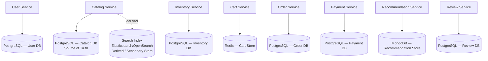

# HITO 2.2 — Diseño de Datos y Persistencia de BookSphere

## 2. Data Ownership por servicio (perspectiva de dominio)

```text
User Service
→ cuenta de usuario (credenciales, estado de la cuenta)
→ perfil (nombre, email, direcciones registradas)
→ roles/permisos

Catalog Service
→ ficha del libro (título, autor(es), descripción, categoría, ISBN)
→ precio de venta vigente
→ historial de cambios de precio (si se decide conservarlo)

Inventory Service
→ cantidad disponible por libro
→ reservas de stock en curso (asociadas a un intento de checkout)
→ movimientos de reabastecimiento

Cart Service
→ contenido del carrito activo de un usuario (líneas, cantidades)
→ vigencia/expiración del carrito

Order Service
→ pedidos y su ciclo de estados (pendiente, confirmado, enviado, cancelado)
→ líneas del pedido, con instantánea histórica de libro y precio pagado
→ dirección de envío usada en ese pedido
→ referencia al resultado del pago (no el detalle del pago en sí)

Payment Service
→ transacciones de pago (autorización, captura, reversión)
→ estado de cada transacción
→ referencia a la pasarela externa (id de transacción del proveedor)

Recommendation Service
→ señales de comportamiento (actividad de navegación, señales derivadas de compras)
→ resultados de recomendación generados por usuario

Review Service
→ reseñas (texto, autor de referencia, libro de referencia)
→ calificaciones individuales
→ rating agregado por libro (calculado a partir de sus propias calificaciones)
```

**Relaciones internas relevantes:** dentro de Order Service, pedido–líneas–estado deben permanecer consistentes entre sí (sección 9); dentro de Inventory Service, cantidad disponible y reservas activas deben permanecer consistentes entre sí para evitar sobreventa.

---

## 3. Una única fuente autoritativa por dato

| Información | Servicio dueño | Quién más la necesita, y cómo |
|---|---|---|
| Ficha del libro (título, autor, descripción) | **Catalog** | Cart, Order y Review solo guardan una referencia (`bookId`) o una copia mínima de visualización |
| Precio vigente | **Catalog** | Order copia el precio *en el momento de la compra* como dato histórico propio — no consulta el precio vigente después |
| Disponibilidad de stock | **Inventory** | Cart consulta bajo demanda (no lo posee); Order reserva/confirma mediante llamadas explícitas, no acceso directo |
| Datos de cuenta/perfil de usuario | **User** | Order, Review y Recommendation solo guardan `userId`; Order además copia la dirección de envío usada, como dato histórico propio, no como copia sincronizada del perfil |
| Historial de actividad de navegación/compra | **Recommendation** posee las señales derivadas; **Order** sigue siendo la fuente legal/transaccional del historial de compras en sí | Recommendation no reemplaza a Order como registro oficial de qué se compró — solo mantiene una proyección analítica derivada |
| Resultado de una transacción de pago | **Payment** | Order solo guarda una referencia al resultado (aprobado/rechazado + id de transacción), nunca el detalle del pago |
| Rating promedio de un libro | **Review** | Catalog puede mostrar una copia cacheada de ese valor, sin ser su fuente de verdad |

---

## 4–5. Database per Service: de un PostgreSQL compartido a ownership descentralizado

El monolito actual tiene un único PostgreSQL donde Usuarios, Catálogo, Carrito, Pedidos, Pagos, Recomendaciones y Reseñas leen y escriben directamente sobre las mismas tablas. Eso es exactamente lo que se elimina: cada servicio pasa a tener su **propio espacio de almacenamiento lógico**, sobre el cual es la única entidad autorizada a escribir. Ningún otro servicio consulta esas tablas directamente — cuando necesita algo, lo pide por API o lo recibe por evento (sección 15).

**Aclaración importante (sección 5):** *Database per Service* es una afirmación sobre **ownership lógico**, no sobre infraestructura física. Existen varios niveles posibles de aislamiento, de menor a mayor separación física:

| Nivel | Qué implica |
|---|---|
| Mismo servidor/cluster, distinto **schema** por servicio, credenciales separadas | Aislamiento lógico ligero; suficiente para garantizar ownership si se aplican permisos correctamente |
| Mismo servidor, **database** separada por servicio | Aislamiento lógico más fuerte, sigue compartiendo el motor físico |
| **Instancia/servidor** independiente por servicio | Aislamiento físico completo; mayor costo operacional |

Para BookSphere, en esta etapa **no es necesario decidir el nivel físico** — eso depende de requisitos de seguridad, disponibilidad, escalabilidad y costo que están fuera del alcance de este hito. Lo que sí se define aquí, y es lo relevante arquitectónicamente, es que **cada servicio es dueño exclusivo de su modelo de datos**, independientemente de dónde termine desplegado físicamente.

---

## 6–8. Selección de persistencia por servicio (criterios aplicados)

A continuación se evalúan solo los criterios relevantes para cada servicio — no se fuerza una evaluación exhaustiva donde no aporta.

### User Service → **Relacional (PostgreSQL)**
Datos bien estructurados (cuenta, perfil, direcciones) con relaciones simples entre sí; necesita integridad referencial y consistencia fuerte al registrar una cuenta (evitar duplicados de email, por ejemplo). No hay patrón de acceso ni volumen que justifique otra cosa.

### Catalog Service → **Relacional (PostgreSQL) como fuente de verdad**, con **índice de búsqueda derivado (Elasticsearch/OpenSearch) como almacén secundario**
Los datos del libro (título, autor, precio) son estructurados y se benefician de integridad relacional como fuente de verdad. **No se asume automáticamente** que Catálogo necesita un motor de búsqueda — solo se justifica si existen necesidades reales de búsqueda full-text, filtrado complejo o ranking sobre el catálogo (mencionadas explícitamente en el escenario como "búsquedas"). En ese caso, el patrón correcto es mantener PostgreSQL como *source of truth* y el índice de búsqueda como una **proyección derivada**, reconstruible en cualquier momento a partir de la fuente de verdad — nunca al revés.

### Inventory Service → **Relacional (PostgreSQL)**
El requisito dominante aquí es **consistencia fuerte y transaccional dentro del propio servicio**: decrementar/reservar stock debe ser una operación atómica que evite sobreventa bajo acceso concurrente (dos compras casi simultáneas del mismo libro). Un motor relacional con transacciones ACID y bloqueo a nivel de fila resuelve esto de forma directa. Se descarta Redis como almacén *principal* aquí — aunque es rápido, la durabilidad de la cantidad de stock es crítica para el negocio (perder ese dato significa vender algo que no existe), y ese nivel de garantía de durabilidad no es el caso de uso principal para el que Redis está optimizado.

### Cart Service → **Key-Value (Redis)**
Encaja con el patrón de acceso descrito: información temporal, acceso casi siempre por clave (`userId`/`cartId`), alta frecuencia de lectura/escritura mientras el usuario navega, y una vigencia natural (TTL) — un carrito abandonado puede expirar sin consecuencia grave de negocio. **Riesgo si fuera la única fuente de persistencia:** Redis, usado en su modo puramente en memoria, puede perder datos ante un reinicio o una política de expiración/evicción agresiva. Para Carrito esto es un riesgo **aceptable dado el bajo costo de negocio de perder un carrito no confirmado** (el usuario simplemente vuelve a agregar los libros) — pero es una decisión consciente, no un descuido: si se necesitara mayor durabilidad, Redis puede configurarse con persistencia (RDB/AOF), sin que eso cambie la naturaleza de la decisión.

### Order Service → **Relacional (PostgreSQL)**
Pedido + líneas + estado necesitan permanecer consistentes entre sí dentro de una misma operación (crear el pedido con sus líneas en el mismo estado inicial de forma atómica) — el caso de uso de libro de texto para transacciones ACID locales. Además, el historial de pedidos exige integridad a largo plazo y consultas relacionales (por usuario, por estado, por fecha).

### Payment Service → **Relacional (PostgreSQL)**
Las transacciones de pago requieren auditoría confiable, estados bien definidos y — crítico para pagos — soporte natural para verificar **idempotencia** (evitar procesar el mismo cobro dos veces), algo que un modelo relacional con restricciones de unicidad resuelve de forma directa. No se propone almacenar datos completos de tarjeta; solo referencias a transacciones de la pasarela externa y su estado, dado que no existe en el escenario un requisito explícito de cumplimiento normativo (PCI-DSS u otro) que justifique diseño adicional en este punto.

### Recommendation Service → **Documental (MongoDB)**
A diferencia de los anteriores, aquí la estructura de los datos **no es estable**: las señales de comportamiento y los resultados de recomendación pueden variar en forma según cómo evolucione el algoritmo/criterio usado, y el acceso predominante es "traer todo el documento de señales/resultados de un usuario", no hacer joins relacionales. Un modelo documental encaja mejor con ese patrón de "esquema flexible + acceso al agregado completo por clave" que uno relacional. No se introduce ninguna tecnología de Machine Learning — solo se decide dónde persisten las señales y los resultados ya calculados, no cómo se calculan.

### Review Service → **Relacional (PostgreSQL)**
Reseña, calificación y su relación con libro/usuario son datos bien estructurados y de tamaño acotado; calcular el rating agregado es una operación de agregación estándar que un motor relacional resuelve bien, y no hay evidencia de necesidad de esquema flexible ni de un volumen que justifique otra tecnología.

**Nota sobre criterios no aplicados:** ningún servicio de BookSphere presenta, según el escenario dado, necesidad de un modelo de grafos, series temporales, ni requisitos de latencia extrema que no cumpla ya PostgreSQL o Redis según el caso — no se inventan esos requisitos.

---

## 7 (retomado). Database per Service vs. Polyglot Persistence

Son dos ideas distintas que conviene no confundir:

- **Database per Service** es sobre **ownership**: cada servicio tiene su propio espacio de datos y nadie más escribe en él — es válido, y de hecho es lo que ocurre aquí, que **varios servicios usen la misma tecnología** (PostgreSQL) sin dejar de tener ownership independiente.
- **Polyglot Persistence** es sobre **elegir la tecnología correcta según la naturaleza del dato** — no es un objetivo en sí mismo, sino una consecuencia cuando las necesidades realmente difieren.

En esta propuesta, **6 de los 8 servicios usan PostgreSQL** (User, Catalog, Inventory, Order, Payment, Review), y solo dos se apartan, cada uno con una razón concreta y distinta: **Cart** por su naturaleza efímera y acceso por clave (Redis), y **Recommendation** por su esquema variable y patrón de acceso al agregado completo (documental). Catalog además incorpora un **almacén secundario derivado** (índice de búsqueda), no una segunda fuente de verdad. Esto es Polyglot Persistence *justificada*, no artificial — y usar PostgreSQL repetidamente en varios servicios **no contradice** la independencia entre ellos, porque la independencia la da el ownership lógico, no la diversidad tecnológica.

---

## 9. Consistencia fuerte dentro del boundary vs. consistencia entre boundaries

**Dentro de un servicio:** cada servicio puede (y debe) usar transacciones ACID locales para mantener consistentes sus propios datos. Ejemplo central: dentro de Order Service, crear un pedido implica que el pedido, sus líneas y su estado inicial se escriban de forma atómica — o todo o nada.

**Entre servicios:** una operación de negocio como el checkout atraviesa varios boundaries (Order → Inventory → Payment). No existe (ni se diseña aquí) una transacción ACID distribuida que abarque los tres. En su lugar, el sistema avanza por pasos, y existe una ventana de tiempo — normalmente corta — durante la cual los distintos servicios reflejan estados que, vistos en conjunto, aún no "coinciden" completamente:

```text
Pedido creado (estado: pendiente)
      ↓  (Inventory reserva stock)
Pago procesado
      ↓  (Payment confirma)
Pedido confirmado (estado: confirmado)
      ↓  (puede ocurrir con una pequeña demora)
Inventario decrementado en firme
```

**Implicación:** durante esa ventana, es posible, por ejemplo, que un pedido ya exista como "pendiente" mientras el pago todavía no se resolvió, o que el pedido ya esté "confirmado" mientras el ajuste definitivo de inventario todavía no se procesó. Esto es consistencia eventual entre servicios, y es **aceptable** en la medida en que cada servicio, individualmente, siempre sepa representar correctamente su propio estado actual (incluyendo estados intermedios como "pendiente"), y no dependamos de que todos los servicios muestren la misma "foto" en el mismo instante.

---

## 10. Dónde es razonable aceptar consistencia eventual (y dónde no)

| Relación | ¿Consistencia eventual aceptable? | Por qué |
|---|---|---|
| Recomendaciones actualizándose tras una compra | Sí | No hay ningún requisito de negocio de que las sugerencias reflejen una compra al instante |
| Rating promedio de un libro tras una nueva reseña | Sí | Ver un rating con unos segundos/minutos de desfase no tiene impacto de negocio significativo |
| Índice de búsqueda del catálogo tras editar un libro | Sí | Es una proyección derivada (sección 6); un breve desfase en la búsqueda es un costo aceptable frente a mantener el índice sincrónicamente en cada escritura |
| Historial usado por sistemas analíticos | Sí | Por definición, el análisis no necesita el dato en tiempo real |
| Reserva de stock antes de cobrar (dentro del flujo de checkout) | **No** — requiere respuesta inmediata | Cobrar sin saber si hay stock real es un riesgo de negocio directo (sección 16 del Hito 2.1) |
| Pedido, líneas y estado inicial dentro de Order Service | **No** — requiere consistencia fuerte local | Es la misma unidad de trabajo, no una relación entre servicios (sección 9) |

---

## 11–12. Duplicación controlada y datos históricos vs. actuales

**Duplicación controlada** (razonable) ≠ **ownership compartido** (a evitar). El caso central en BookSphere:

```text
Catalog Service (Source of Truth)
Book ID · Title · Current Price · ...

Order Service (dominio histórico propio, dentro de sus líneas de pedido)
Book ID · Title at Purchase · Price at Purchase
```

Order **no es dueño** del título ni del precio del libro — solo conserva su propia copia, congelada en el tiempo, de lo que esos datos eran cuando ocurrió la compra. Esto es deliberado y valioso: si mañana Catálogo cambia el precio o incluso descataloga el libro, el historial de pedidos permanece correcto y Order Service no necesita que Catalog Service esté disponible para mostrar el historial de compras de un usuario — reduce una dependencia síncrona innecesaria y protege la integridad histórica, a cambio de aceptar que el mismo dato ("título del libro") existe en dos lugares con significados distintos ("cómo se llama ahora" vs. "cómo se llamaba cuando se compró").

La misma lógica aplica a la dirección de envío usada en un pedido: es una copia histórica dentro de Order, no una referencia viva al perfil actual de User Service.

---

## 13. Datos derivados (Derived Data / Read Model) vs. Source of Truth

| Dato | Tipo | Implicación para persistencia |
|---|---|---|
| Rating promedio de un libro | Derivado (calculado a partir de las calificaciones individuales) | Puede recalcularse; no necesita el mismo nivel de garantía de durabilidad que las calificaciones que lo originan |
| Índice de búsqueda del catálogo | Derivado | Reconstruible desde PostgreSQL en cualquier momento; puede tratarse como desechable/regenerable |
| Resultados de recomendación | Derivado (a partir de señales de comportamiento) | Puede recalcularse periódicamente; no es la fuente legal de nada |
| Estadísticas/reporting | Derivado | Fuera del alcance de este hito, pero seguiría el mismo principio |

La diferencia importa porque **un dato derivado no necesita las mismas garantías de durabilidad y consistencia que su fuente**: si se pierde, se puede regenerar a partir del Source of Truth. Esto es lo que permite, por ejemplo, aceptar Redis o un índice de búsqueda sin la misma preocupación de durabilidad que se exige a Inventory o Order.

---

## 15–16. Cómo los servicios obtienen datos que no poseen

| Necesidad | Mecanismo | Ejemplo |
|---|---|---|
| Información actual, se necesita de inmediato | **API síncrona** | Cart Service consulta a Catalog Service el precio actual al mostrar el carrito |
| Otro servicio puede reaccionar más tarde | **Evento** | `OrderCompleted` (Order Service) → Recommendation Service actualiza señales de comportamiento |
| Se consulta con frecuencia y no conviene depender síncronamente de otro servicio en cada lectura | **Copia local / read model** | Catalog Service mantiene una copia cacheada del rating agregado, actualizada por evento en lugar de consultar a Review Service en cada visualización |

### Eventos de dominio/integración relevantes (conceptuales, sin diseñar el broker)

| Servicio propietario | Evento | Consumidor | Qué actualiza |
|---|---|---|---|
| Order Service | `OrderCompleted` | Recommendation Service | Señales de comportamiento de compra del usuario |
| Payment Service | `PaymentConfirmed` | Order Service | Transición del pedido a "confirmado"; dispara el decremento definitivo hacia Inventory Service |
| Review Service | `RatingUpdated` (tras `ReviewPublished`) | Catalog Service | Copia cacheada del rating promedio para mostrarlo junto al libro |
| Catalog Service | `BookUpdated` | (interno al propio servicio) | Reindexación del motor de búsqueda derivado — no es un evento cruzando boundary de servicio, ya que el índice pertenece al mismo servicio |

---

## 17. Riesgos de la descentralización (no se presenta como gratuita)

- **Duplicación de datos:** título/precio del libro, y potencialmente el rating, existen en más de un lugar — exige disciplina para no confundir "copia histórica" con "fuente de verdad".
- **Consistencia eventual:** ciertas vistas (rating mostrado en Catálogo, recomendaciones) pueden estar momentáneamente desactualizadas.
- **Consultas distribuidas y reporting:** ya no existe un único PostgreSQL donde hacer un `JOIN` entre pedidos, usuarios y libros — un reporte que cruce esa información necesita combinarla desde varios servicios (API composition) o un almacén analítico aparte, fuera del alcance de este hito.
- **Sincronización:** los eventos de la sección 16 introducen la necesidad de manejar fallos de entrega, reintentos y posible desorden de eventos — no se diseña aquí, pero es un costo real a futuro.
- **Debugging:** rastrear una operación de negocio (p. ej., un checkout fallido) ahora implica revisar el estado en varios servicios en lugar de una sola base de datos.
- **Complejidad operacional:** más bases de datos/schemas que respaldar, migrar y monitorear que en el monolito original.
- **Cambios de esquema:** un cambio en Catalog Service ya no puede "arrastrar" automáticamente a los datos históricos de Order Service — son independientes por diseño, lo cual es la ventaja, pero también significa que cada esquema evoluciona (y se versiona) por separado.

**Por qué se aceptan estos costos:** son el precio de la autonomía de servicio descrita en el Hito 2.1 — sin ownership de datos descentralizado, ningún servicio puede desplegarse ni evolucionar realmente de forma independiente (sección 11 y 9 del Hito 2.1), y el sistema termina reproduciendo el mismo acoplamiento del monolito, solo que distribuido por red.

---

## 18. Validación del diseño

- **Ownership:** cada dato listado en la sección 3 tiene exactamente una fuente autoritativa — confirmado.
- **Encapsulamiento:** ningún servicio de la propuesta necesita leer directamente las tablas de otro; toda necesidad de datos ajenos se resuelve por API, evento o copia local — confirmado.
- **Persistencia:** cada tecnología elegida responde a un patrón de datos concreto explicado en la sección 6 (relacional donde hay integridad/transacciones, key-value donde hay efimeridad y acceso por clave, documental donde el esquema es variable), no a preferencia arbitraria — confirmado.
- **Complejidad:** solo se introdujeron dos tecnologías además de PostgreSQL (Redis, MongoDB), cada una con una razón concreta y distinta; el índice de búsqueda de Catálogo se presenta como opcional/derivado, no obligatorio — confirmado, sin sofisticación innecesaria.
- **Consistencia:** documentado explícitamente qué es fuerte/local y qué es eventual (secciones 9–10) — confirmado.
- **Autonomía:** cada servicio puede leer y escribir su propio estado sin depender síncronamente de otro para operaciones internas (solo para el checkout, que por naturaleza de negocio sí requiere coordinación) — confirmado.
- **Duplicación:** en cada caso de dato duplicado (libro, dirección de envío, rating) se identificó explícitamente quién es el Source of Truth — confirmado.

No se detectaron contradicciones que obliguen a modificar los límites de servicio definidos en el Hito 2.1.

---

## 19. Tabla principal — Servicio → Datos → Tipo de DB → Justificación

| Servicio | Datos de su propiedad | Tipo de base de datos | Justificación |
|---|---|---|---|
| **User Service** | Cuenta (credenciales, estado), perfil (nombre, email, direcciones), roles | Relacional — PostgreSQL | Datos estructurados con relaciones simples; requiere integridad (unicidad de email) y consistencia fuerte al crear/editar una cuenta. |
| **Catalog Service** | Ficha del libro, precio vigente | Relacional (PostgreSQL) como fuente de verdad; índice de búsqueda derivado (Elasticsearch/OpenSearch) si se requiere búsqueda full-text/filtrado | El contenido del libro es estructurado y se beneficia de integridad relacional; el índice es una proyección derivada y reconstruible, no una segunda fuente de verdad. |
| **Inventory Service** | Cantidad disponible, reservas activas por libro | Relacional — PostgreSQL | Requiere transacciones ACID y bloqueo a nivel de fila para evitar sobreventa bajo acceso concurrente; la durabilidad del stock es crítica para el negocio. |
| **Cart Service** | Ítems del carrito activo por usuario, vigencia | Key-Value — Redis | Datos temporales, acceso casi siempre por clave (`userId`), alta frecuencia de lectura/escritura, TTL natural; pérdida de un carrito abandonado es un riesgo de negocio bajo y aceptado. |
| **Order Service** | Pedidos, líneas con instantánea histórica, estado, dirección usada | Relacional — PostgreSQL | Pedido, líneas y estado deben escribirse de forma atómica y consistente; el historial exige integridad y consultas relacionales a largo plazo. |
| **Payment Service** | Transacciones de pago, su estado, referencia a la pasarela externa | Relacional — PostgreSQL | Necesita auditoría confiable y soporte natural de restricciones de unicidad para garantizar idempotencia en el procesamiento de cobros. |
| **Recommendation Service** | Señales de comportamiento, resultados de recomendación por usuario | Documental — MongoDB | Esquema variable según cómo evoluciona el criterio/algoritmo usado; acceso predominante es traer el documento completo de un usuario, no hacer joins relacionales. |
| **Review Service** | Reseñas, calificaciones, rating agregado por libro | Relacional — PostgreSQL | Datos estructurados y de tamaño acotado; el cálculo del rating agregado es una agregación estándar bien soportada por SQL. |

---

## 20. Tabla de ownership compartido/derivado

| Información | Source of Truth | Servicios que la necesitan | Cómo la obtienen |
|---|---|---|---|
| Ficha del libro (título, autor, descripción) | Catalog Service | Cart, Order, Review, Recommendation | Referencia (`bookId`) + consulta API cuando necesitan mostrarla; Order la copia como histórico al momento de la compra |
| Precio del libro | Catalog Service | Cart (precio vigente al mostrar), Order (precio pagado, histórico) | Cart consulta el precio actual vía API; Order lo congela como dato propio en el momento del checkout |
| Datos de usuario (perfil) | User Service | Order (dirección usada), Review (autor de referencia), Recommendation (señales por `userId`) | Referencia `userId`; Order copia la dirección usada como histórico propio |
| Historial de compras | Order Service (registro transaccional) | Recommendation Service (proyección analítica) | Evento `OrderCompleted` alimenta las señales de Recommendation; Order sigue siendo la fuente oficial |
| Resultado de un pago | Payment Service | Order Service | Referencia al resultado (aprobado/rechazado + id de transacción), nunca el detalle completo |
| Rating promedio de un libro | Review Service | Catalog Service (para mostrarlo junto al libro) | Copia cacheada, actualizada vía evento `RatingUpdated` |

---

## 21. Tabla de consistencia

| Flujo / información | Tipo de consistencia | Razón |
|---|---|---|
| Pedido + líneas + estado inicial (dentro de Order Service) | Fuerte / local | Misma unidad de trabajo, transacción ACID dentro de un solo servicio |
| Reserva de stock antes de confirmar el pago (Order ↔ Inventory) | Fuerte, en el sentido de que se exige respuesta síncrona inmediata | El checkout no puede continuar sin saber si hay stock real en ese instante |
| Confirmación del pedido tras el pago (Payment → Order) | Eventual (ventana corta) | El pedido puede existir brevemente como "pendiente" mientras se resuelve el pago, sin que eso sea un problema de negocio |
| Decremento definitivo de inventario tras un pedido confirmado | Eventual | El usuario ya recibió confirmación; el ajuste final puede completarse con una demora aceptable |
| Rating agregado mostrado en Catálogo | Eventual | Es una copia derivada; un breve desfase no tiene impacto de negocio |
| Índice de búsqueda del catálogo | Eventual | Proyección derivada, reconstruible; no es la fuente de verdad |
| Señales/resultados de Recommendation tras una compra | Eventual | No existe requisito de negocio de reflejar la compra al instante |

---

## 22. Diagrama



*Nota:* seis almacenes están etiquetados "PostgreSQL", pero se representan como recursos **lógicamente independientes** — cada uno con su propio ownership y schema — aunque en la práctica pudieran ejecutarse sobre infraestructura física compartida (sección 5). `SearchIdx` se distingue explícitamente como derivado, no como una segunda fuente de verdad de Catalog Service.

---

## 23. Justificación arquitectónica final

**Database per Service:** se eliminó el acceso directo al PostgreSQL único del monolito. Cada uno de los 8 servicios tiene ahora su propio espacio de datos, y ningún servicio consulta ni escribe directamente sobre las tablas de otro — toda interacción pasa por API o eventos (secciones 4, 15).

**Data Ownership:** cada servicio controla exclusivamente el estado que le corresponde (sección 2), y para cada dato que aparece en más de un lugar existe una única fuente autoritativa identificada sin ambigüedad (secciones 3 y 20).

**Consistencia eventual:** aparece específicamente en las relaciones *entre* servicios que no requieren respuesta inmediata (confirmación de pedido tras el pago, decremento final de inventario, rating mostrado en catálogo, recomendaciones, índice de búsqueda) — nunca dentro del boundary de un solo servicio, donde se mantiene consistencia fuerte vía transacciones locales (secciones 9–10, 21). Es aceptable en esos casos porque ninguno de ellos representa una garantía que el negocio realmente exija al instante.

**Polyglot Persistence:** **sí fue necesaria, pero de forma acotada** — solo en dos de ocho servicios (Cart con Redis, Recommendation con MongoDB), cada uno justificado por un patrón de datos y de acceso genuinamente distinto al resto, más un almacén derivado opcional en Catálogo. Que **seis servicios compartan PostgreSQL como tecnología no contradice su independencia como microservicios**: la independencia de un microservicio la da el ownership lógico de sus datos y la ausencia de acceso cruzado a tablas ajenas — no la diversidad de motores de base de datos. Usar la misma tecnología en varios servicios es, de hecho, la opción más simple operacionalmente cuando no existe una razón real para apartarse de ella, y evita el costo de una arquitectura polyglot artificial (sección 7).
