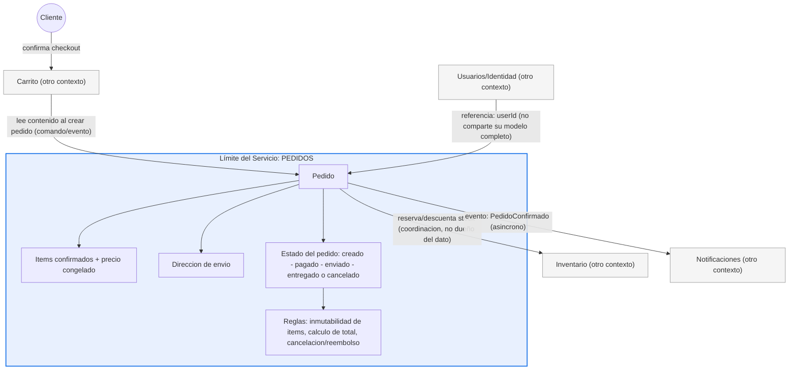

# QuickCart — Descomposición del Dominio en Microservicios

## 1. Descomposición del dominio

### 1.1 Capacidades de negocio

QuickCart se organiza en torno a seis capacidades de negocio, cada una respondiendo a una pregunta que ningún otro puede responder por ella:

| Capacidad | Pregunta de negocio que responde |
|---|---|
| Usuarios / Identidad | ¿Quién eres? |
| Catálogo | ¿Qué es este producto? |
| Inventario | ¿Cuánto hay disponible? |
| Carrito | ¿Qué estás considerando comprar ahora mismo? |
| Pedidos | ¿Qué compraste, formalmente? |
| Notificaciones | ¿Qué te avisamos? |

### 1.2 Criterios utilizados para definir los límites

La descomposición se apoyó, en orden de peso, en:

1. **Capacidad de negocio** — punto de partida para agrupar responsabilidades.
2. **Ritmo de cambio** — qué evoluciona junto vs. qué evoluciona por razones distintas.
3. **Ciclo de vida** — entidades efímeras/mutables vs. entidades inmutables/auditables.
4. **Consistencia** — qué reglas exigen consistencia fuerte dentro de un único límite transaccional.
5. **Propiedad de datos** — un solo dueño de escritura por dato.
6. **Escalabilidad** — perfiles de carga (lectura masiva cacheable vs. escritura crítica concurrente).
7. **Acoplamiento y cohesión** — minimizar lo que dos servicios necesitan "hablarse" para operar.
8. **Independencia/autonomía** — ¿puede un equipo pequeño desplegar esto sin coordinarse con otro?

Explícitamente **no** se usó como criterio "una tabla = un servicio": ese enfoque produce límites inestables (cambian con cada refactor de esquema) y desconectados del valor de negocio real.

### 1.3 Microservicios propuestos

| Servicio | Responsabilidad principal | Qué NO hace | Justificación |
|---|---|---|---|
| **Usuarios/Identidad** | Gestiona el registro, autenticación y datos de identidad del cliente (credenciales, perfil, direcciones). | No gestiona pedidos, pagos, ni el historial de compras del cliente — solo su identidad y datos de contacto. | Requisitos de seguridad y compliance muy distintos al resto del dominio; cambia por razones (políticas de auth, privacidad) que no tienen relación con catálogo o inventario. |
| **Catálogo** | Gestiona la información descriptiva de los productos (nombre, descripción, categoría, imágenes, precio de lista) y su búsqueda/navegación. | No administra las cantidades físicas disponibles para venta ni el precio final de compra confirmado. | Cambia por decisiones de presentación/marketing, con un volumen de lectura alto y de escritura bajo — un perfil de carga opuesto al de Inventario. |
| **Inventario** | Gestiona la cantidad disponible de cada producto y las reservas de stock durante el proceso de compra. | No gestiona la descripción ni la presentación del producto — solo su disponibilidad numérica. | Requiere consistencia fuerte y alta frecuencia de escritura (cada venta lo modifica); su necesidad de evitar condiciones de carrera es un requisito de escalabilidad/consistencia propio. |
| **Carrito** | Gestiona la selección temporal y mutable de productos de un cliente antes de confirmar una compra. | No crea pedidos, no procesa pagos, no reserva stock de forma definitiva — solo mantiene el estado provisional. | Es efímero, mutable y desechable (la mayoría se abandonan); un ciclo de vida y unas reglas de consistencia completamente distintos a los de un pedido confirmado. |
| **Pedidos** | Gestiona la creación, estado y seguimiento de una compra confirmada, desde su creación hasta la entrega o cancelación. | No gestiona el stock físico ni envía las notificaciones directamente — coordina esos procesos mediante eventos. | Es el registro inmutable y auditable de una transacción; reglas de consistencia mucho más estrictas que el carrito, con su propio ciclo de vida. |
| **Notificaciones** | Gestiona el envío de comunicaciones al cliente (ej. confirmación de pedido) a partir de eventos del sistema. | No conoce las reglas de negocio de pedidos, inventario o pagos — solo recibe el evento mínimo necesario para componer el mensaje. | Depende de un proveedor externo con sus propios fallos/latencias; cambia por razones ajenas (plantillas, canal de envío) al resto del dominio. |

### 1.4 Justificación de los principales límites

Cada servicio se sostiene sobre un criterio distinguible de sus vecinos, no sobre intuición:

- **Usuarios** se separa de todo lo demás por requisitos de seguridad/compliance únicos.
- **Catálogo** e **Inventario** se separan por ritmo de cambio (marketing vs. transaccional) y por perfiles de escalabilidad opuestos (lectura cacheable vs. escritura crítica concurrente) — ver 1.5.
- **Carrito** y **Pedidos** se separan por ciclo de vida (efímero/mutable vs. inmutable/auditable) y por necesidad de consistencia (flexible vs. estricta) — ver 1.5.
- **Notificaciones** se separa por aislar una dependencia externa poco confiable del flujo transaccional crítico de Pedidos — ver 1.5.

Los datos fluyen entre servicios por **referencia** (ej. `userId`), por **lectura puntual** (Carrito lee Catálogo/Inventario) o por **eventos asíncronos** (Pedidos → Notificaciones), nunca por acceso directo a la base de datos de otro servicio.

### 1.5 Decisiones arquitectónicas discutibles

**Carrito vs. Pedidos:** aunque comparten estructura superficial (ítems + cantidades + total), tienen ciclos de vida radicalmente distintos (el carrito se abandona constantemente; el pedido es un compromiso formal e inmutable), reglas de negocio distintas (flexibilidad vs. congelamiento de datos), ritmos de cambio distintos (UX vs. lógica transaccional) y necesidades de escalabilidad opuestas (alta escritura descartable vs. durabilidad y auditoría). **Se mantienen como dos servicios independientes.** El checkout se modela como una lectura puntual del Carrito en el momento de crear el Pedido, sin acoplamiento posterior.

**Catálogo vs. Inventario:** aunque ambos "hablan de productos", uno responde qué es el producto (presentación) y otro cuánto hay (operación). Cambian por razones distintas, tienen reglas de naturaleza distinta (editorial vs. aritmética/concurrente) y perfiles de escalabilidad opuestos. **Se mantienen como dos servicios independientes**, conectados por una señal liviana y asíncrona (`disponible: true/false`) que Catálogo expone sin necesitar conocer la cantidad exacta.

**Envío de Correos:** se evaluó vivir dentro de Pedidos (Alternativa A) frente a un servicio independiente de Notificaciones (Alternativa B). El argumento decisivo fue de **resiliencia**: un proveedor externo de correo es intrínsecamente menos confiable que la infraestructura propia, y ese punto débil no debe poder afectar la disponibilidad del flujo transaccional más crítico del negocio. A esto se suma la reutilización proyectada (más tipos de eventos a notificar en el futuro). **Se recomienda un servicio independiente**, con la salvedad de que en un proyecto mucho más pequeño y sin visión de plataforma, mantenerlo dentro de Pedidos sería una decisión igualmente razonable.

### 1.6 Anti-patrón potencial

El mayor riesgo identificado para esta propuesta es el **Distributed Monolith**, específicamente en la frontera **Pedidos ↔ Inventario ↔ Carrito**. Los límites de dominio en sí están bien trazados (ver 1.5), pero el riesgo aparece en la *implementación* del flujo de checkout: si Pedidos llama síncronamente a Inventario y depende de su disponibilidad en tiempo real para completar cada operación crítica, los tres servicios quedarían acoplados en la práctica aunque estén separados en el papel — perdiendo la autonomía de despliegue y operación que motivó la descomposición.

Otros anti-patrones evaluados y descartados en esta propuesta:
- **God Service:** no aparece — cada servicio tiene una capacidad de negocio nombrable en una sola frase.
- **Shared Database:** no aparece — cada servicio es dueño exclusivo de sus datos; no hay escritura compartida sobre el mismo esquema.
- **Chatty Services:** riesgo menor identificado entre Carrito e Inventario si se valida disponibilidad de forma síncrona en cada interacción del carrito, en vez de usar el flag liviano de Catálogo y reservar la consulta estricta para el checkout.

### 1.7 Límite de servicio

Diagrama del límite del servicio **Pedidos**, por ser el que concentra más fronteras relevantes con otros contextos:

**Lectura del límite:** todo lo que necesita consistencia inmediata y control total vive dentro del recuadro (el pedido, sus ítems confirmados, dirección de envío, estado y reglas de inmutabilidad). Todo lo externo se referencia (`userId`), se coordina (reserva de stock en Inventario, sin poseer el dato) o se notifica vía evento asíncrono (Notificaciones) — nunca se posee ni se replica.

### 1.8 Conclusión

La propuesta logra:

- **Separación clara de responsabilidades:** cada servicio responde una única pregunta de negocio que ningún otro puede responder por él.
- **Alta cohesión:** dentro de cada servicio, todo lo agrupado cambia por las mismas razones y colabora en el mismo propósito (verificado explícitamente en Carrito/Pedidos y Catálogo/Inventario).
- **Bajo acoplamiento:** la comunicación entre servicios se da por referencia, lectura puntual o eventos asíncronos — nunca por acceso compartido a datos.
- **Autonomía:** cada servicio puede evolucionar, desplegarse y escalar de forma independiente, con perfiles de carga y necesidades de consistencia propios.
- **Límites alineados con el dominio:** ningún límite se trazó por conveniencia técnica ni por estructura de tablas — todos derivan de capacidad de negocio, ritmo de cambio, ciclo de vida y propiedad de datos.
- **Capacidad de evolución independiente:** el diseño anticipa crecimiento (más tipos de notificación, más reglas de inventario) sin requerir repensar los límites actuales — el único riesgo pendiente de vigilar es la disciplina de comunicación asíncrona entre Pedidos, Inventario y Carrito para no derivar en un Distributed Monolith.

Monolito distribuido = microservicios separados físicamente, pero acoplados lógicamente.

