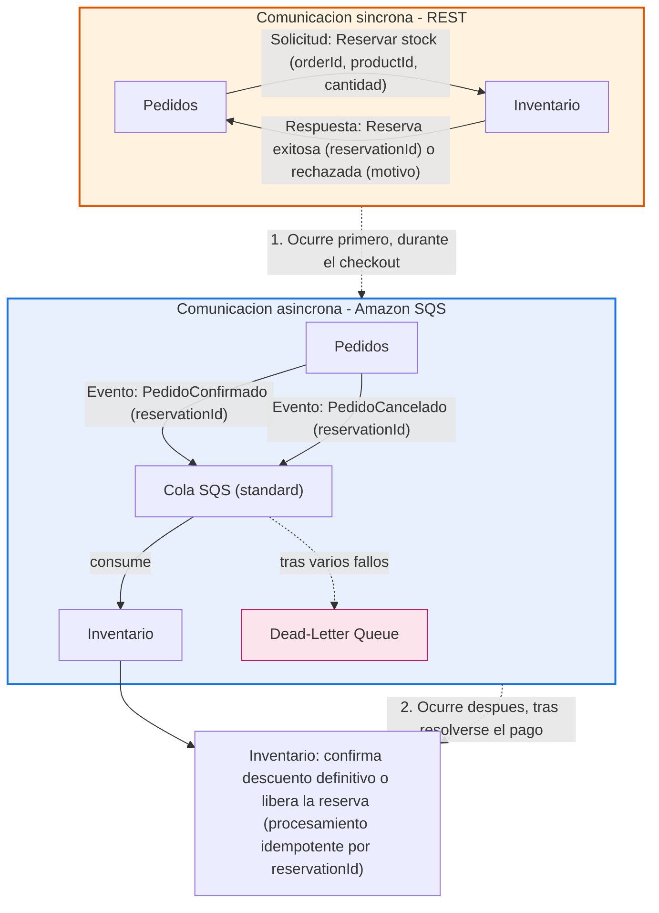

# QuickCart — Diseño de la interacción Pedidos ↔ Inventario

## 2. Diseño de APIs y comunicación entre servicios

### 2.1 Servicios seleccionados

Se seleccionaron **Pedidos** e **Inventario** por tener la interacción crítica más exigente del dominio: cuando un usuario confirma el checkout, el sistema necesita comprobar y reservar stock disponible en tiempo real. Según lo establecido en el Hito 1, Pedidos no modifica directamente los datos de Inventario, e Inventario mantiene la autoridad exclusiva sobre las reglas relacionadas con el stock — esta interacción es, por tanto, el punto donde la propiedad de datos entre ambos servicios se pone a prueba de forma más directa.

### 2.2 Interacciones identificadas

| Interacción | Emisor | Receptor | Tipo | Propósito |
|---|---|---|---|---|
| Reservar stock | Pedidos | Inventario | Solicitud síncrona (REST) | Apartar cantidades de producto para un pedido en proceso de pago |
| Resultado de la reserva | Inventario | Pedidos | Respuesta síncrona (REST) | Informar éxito (con ID de reserva) o rechazo (con motivo) |
| Pedido confirmado | Pedidos | Inventario | Evento asíncrono (SQS) | Anunciar que el pago se completó, para convertir la reserva en descuento definitivo |
| Pedido cancelado | Pedidos | Inventario | Evento asíncrono (SQS) | Anunciar que el pedido no se concretó, para liberar la reserva |

### 2.3 Datos intercambiados

| Interacción | Datos principales |
|---|---|
| Solicitud de reserva | ID del pedido, ID de producto, cantidad (por cada línea) |
| Respuesta de la reserva | Resultado (éxito/rechazo), ID de la reserva (si éxito), motivo (si rechazo) |
| Pedido confirmado | ID de la reserva |
| Pedido cancelado | ID de la reserva |

En ningún caso viaja información de negocio ajena a esta interacción (precios, datos del cliente, direcciones, estructura interna de bases de datos). El ID de reserva funciona como clave de correlación entre los tres momentos de la interacción y como base para el procesamiento idempotente.

### 2.4 Estrategia de comunicación

**Diseño híbrido**, según la naturaleza de cada interacción:

- **Reserva de stock → síncrona (REST).** El usuario está esperando activamente una respuesta durante el checkout; no hay una decisión útil que Pedidos pueda tomar sin conocer de inmediato si hay stock disponible. La sincronía aquí no es una elección técnica arbitraria, sino un reflejo de una dependencia real de negocio. Se descartó gRPC para esta interacción porque el volumen esperado no justifica su complejidad adicional frente a REST; podría reconsiderarse si el tráfico de checkout creciera significativamente.
- **Confirmación/cancelación → asíncrona (eventos vía Amazon SQS).** Pedidos ya tomó su decisión (el pago se resolvió) antes de notificar a Inventario — forzar una respuesta síncrona aquí solo añadiría acoplamiento de disponibilidad sin ningún beneficio de negocio a cambio.

Es importante distinguir: la sincronía en la reserva da **inmediatez de respuesta**, no por sí sola **consistencia bajo concurrencia** — esa consistencia depende de que Inventario procese las reservas de forma atómica internamente, independientemente del mecanismo de comunicación usado para solicitarlas.

### 2.5 Acoplamiento

- **Temporal:** alto en la reserva (Pedidos espera la respuesta de Inventario en ese instante); prácticamente nulo en confirmación/cancelación (Pedidos publica y continúa).
- **De disponibilidad:** la reserva depende de que Inventario esté arriba en el momento del checkout; la confirmación/cancelación depende de que SQS esté disponible, no de Inventario directamente — la disponibilidad requerida se trasladó del servicio al broker, que al ser gestionado por AWS tiene su propia garantía de alta disponibilidad.
- **De comunicación:** ambos servicios dependen del contrato REST (para la reserva) y del esquema de eventos en SQS (para confirmación/cancelación) — cualquier cambio en esos contratos requiere coordinación, pero ninguno de los dos servicios conoce la estructura interna del otro.
- **De datos:** minimizado — solo viajan identificadores de referencia (`orderId`, `productId`, `reservationId`), nunca estructuras internas de las bases de datos de ninguno de los dos servicios.

La asincronía introducida en confirmación/cancelación reduce el acoplamiento temporal y de disponibilidad directa, pero no elimina el acoplamiento por completo: lo traslada hacia el broker y hacia el contrato de eventos, y añade una nueva forma de acoplamiento semántico — ambos servicios deben aceptar y modelar explícitamente una ventana de consistencia eventual entre la confirmación del pago y el descuento definitivo del stock.

### 2.6 Backpressure y comportamiento bajo carga

Si Pedidos publica eventos de confirmación/cancelación a un ritmo mayor del que Inventario puede procesar (por ejemplo, durante un pico de ventas), el desbalance se traduce en una cola creciente en SQS: los mensajes se acumulan mientras esperan turno, la latencia de procesamiento aumenta con el tamaño de la cola, y si el desbalance se sostiene en el tiempo, el efecto de negocio es que las reservas de stock permanecen más tiempo del real en estado "reservado" — degradando la precisión de la disponibilidad mostrada al cliente, sin bloquear el checkout en sí (que es síncrono e independiente de esta cola).

La mitigación estructural es el escalado de consumidores (más instancias de Inventario procesando en paralelo) y límites de concurrencia bien calibrados; los retries con backoff ayudan a no agravar una saturación existente, pero no sustituyen la necesidad de que la capacidad de consumo pueda crecer junto con el pico de producción.

### 2.7 Tecnología/vendor seleccionado

**Amazon SQS (cola estándar)**, elegido sobre RabbitMQ y Kafka por ajustarse mejor al perfil real de esta interacción: volumen moderado (un evento por pedido confirmado o cancelado, no streaming de alta frecuencia), sin necesidad de replay de eventos ni múltiples consumidores del mismo stream, y con preferencia por mínima complejidad operativa. Se descartó Kafka por estar sobredimensionado para este caso (su fortaleza es event sourcing y streaming de altísimo volumen, que QuickCart no necesita todavía en esta interacción). Se optó por cola estándar en vez de FIFO porque no existe una necesidad de orden estricto entre eventos de pedidos distintos.

Características relevantes: throughput prácticamente ilimitado en modo estándar, retención de mensajes de hasta 14 días (amortigua caídas momentáneas del consumidor), infraestructura completamente gestionada por AWS (sin necesidad de operar clusters propios), y un nivel gratuito permanente de 1 millón de solicitudes mensuales. El costo esperado para el volumen de esta interacción específica es bajo (del orden de unos pocos dólares a decenas de dólares mensuales con buenas prácticas de batching), muy por debajo de los escenarios de alto costo que solo aplican a tráfico de streaming masivo. La entrega "al menos una vez" propia de las colas estándar exige que Inventario procese los eventos de forma idempotente.

### 2.8 Fallo del vendor

Si SQS falla, **solo se ve afectada la parte asíncrona** de la interacción — la reserva síncrona de stock durante el checkout no depende de SQS y sigue funcionando con normalidad. Lo que deja de funcionar es la propagación de los eventos de confirmación/cancelación: las reservas correspondientes a pedidos resueltos durante la caída quedan "colgadas", ni convertidas en descuento definitivo ni liberadas. El efecto dominó no es una caída visible inmediata, sino una degradación progresiva y silenciosa: el stock reservado crece artificialmente con el tiempo, lo que puede llevar a mostrar productos como agotados cuando en realidad no lo están — afectando indirectamente la disponibilidad mostrada en Carrito y Catálogo. Una interrupción breve (segundos o minutos) es prácticamente inofensiva, dado que los mensajes quedan retenidos hasta 14 días y se procesan al recuperarse el servicio; el riesgo real depende de la duración sostenida de la caída.

### 2.9 Estrategias de resiliencia

- **Idempotencia** (por `reservationId`): evita que una entrega duplicada de SQS descuente stock dos veces para el mismo pedido.
- **Retención de mensajes (colas durables):** una caída momentánea del consumidor (Inventario) no pierde eventos — quedan esperando en la cola hasta ser procesados.
- **Dead-letter queue:** aísla mensajes que fallan repetidamente al procesarse, dando visibilidad para investigar casos anómalos en vez de reintentos silenciosos indefinidos.
- **Retries con backoff creciente:** da margen de recuperación a Inventario ante fallos transitorios, sin agravar una posible saturación existente.
- **Timeout y circuit breaker** (en la parte síncrona): evitan que el checkout quede esperando indefinidamente o que cada intento individual pague el costo completo de un timeout cuando Inventario está caído.

No se incluyen mecanismos propios de redundancia o replicación del broker, dado que esa responsabilidad de alta disponibilidad ya la asume AWS al ser SQS un servicio gestionado.

### 2.10 Diagrama de comunicación

### 2.11 Conclusión

El diseño híbrido logra un equilibrio deliberado entre las fuerzas en tensión de esta interacción:

- **Acoplamiento:** minimizado donde no aporta valor de negocio (confirmación/cancelación asíncrona), aceptado conscientemente donde sí lo aporta (reserva síncrona, porque el checkout depende de una respuesta inmediata).
- **Disponibilidad:** el checkout no depende de la disponibilidad de SQS; una caída del broker degrada la precisión del inventario de forma progresiva, no bloquea la operación crítica de compra.
- **Consistencia:** fuerte donde es indispensable (la reserva, con atomicidad interna en Inventario); eventual donde es aceptable (la conversión de reserva a descuento definitivo).
- **Rendimiento:** el usuario obtiene respuesta inmediata en el paso que le importa (checkout); el procesamiento de confirmación/cancelación no compite por ese tiempo de respuesta.
- **Escalabilidad:** la parte asíncrona puede absorber picos de carga mediante la cola como amortiguador y el escalado de consumidores, sin propagar presión hacia el checkout síncrono.
- **Complejidad:** se mantuvo acotada al elegir REST sobre gRPC y SQS gestionado sobre alternativas autogestionadas, reservando mayor sofisticación tecnológica para el momento en que el volumen real lo justifique.

La revisión crítica no encontró errores estructurales en la frontera síncrono/asíncrono ni en la tecnología elegida — los hallazgos fueron refinamientos de robustez (validación de estado en Inventario, observabilidad de la profundidad de cola, calibración de retries) que fortalecen la implementación sin requerir replantear el diseño.
