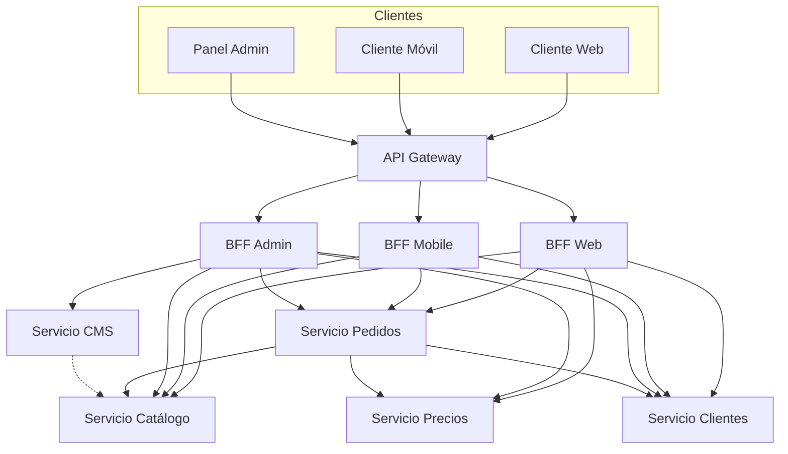

# Hito 1 — Arquitectura Inicial de ShopStream

## Sección 1 — Fronteras de servicio y responsabilidades

Se evaluaron los 4 contextos de negocio de ShopStream. Solo **Pedidos** se subdivide; los demás se mantienen como un único servicio, con justificación explícita en ambos sentidos (subdividir y no subdividir son decisiones, y ambas requieren heurística).

| Servicio | Contexto padre | Responsabilidad | Tipo de subdominio | Heurística(s) aplicada(s) |
|---|---|---|---|---|
| Catálogo | Catálogo | Información de productos, inventario y búsqueda | Núcleo | **Límites transaccionales**: stock y datos de producto deben leerse/escribirse de forma consistente en el mismo límite (evita inconsistencia entre "producto existe" y "producto en stock") |
| CMS | CMS | Contenido enriquecido: descripciones extendidas, banners, contenido editorial asociado a productos | Soporte | **Velocidad de cambio**: el contenido editorial lo actualiza el equipo de marketing a un ritmo independiente del catálogo transaccional + **Estructura de equipo (Ley de Conway)**: equipo de contenido/marketing separado del equipo de producto/inventario |
| Pedidos | Pedidos (subdividido) | Creación del pedido y ciclo de vida (Pendiente → Confirmado → Enviado); Aggregate Root del pedido | Núcleo | **Límites transaccionales**: el estado del pedido debe cambiar de forma atómica e inmediatamente consistente |
| Precios | Pedidos (subdividido) | Cálculo de precio final, descuentos y promociones aplicadas a un pedido | Soporte | **Velocidad de cambio**: las reglas de precios/promociones cambian con mucha más frecuencia (campañas de marketing) que la lógica de ciclo de vida del pedido — separarlas evita releases acoplados |
| Clientes | Clientes | Perfiles de usuario, autenticación y direcciones | Núcleo | **Límites transaccionales**: perfil, auth y direcciones se actualizan juntos en el flujo de alta/edición de cuenta, con el mismo ritmo de cambio — no se justifica separarlos en este alcance |

**Anti-patrones evitados:**
- Ningún servicio se definió por tabla de base de datos (la subdivisión de Pedidos sigue capacidad de negocio, no esquema).
- Ninguno es un servicio CRUD anémico (cada uno encapsula comportamiento: cálculo de precio, transición de estado, autenticación).
- No hay divisiones por capa técnica (todas las fronteras siguen capacidades de negocio).

**Lista corta final de servicios (5):**
1. **Catálogo** — información de producto, inventario y búsqueda.
2. **CMS** — contenido enriquecido asociado al catálogo.
3. **Pedidos** — creación y ciclo de vida del pedido.
4. **Precios** — cálculo de precios, descuentos y promociones.
5. **Clientes** — perfiles, autenticación y direcciones.

---

## Sección 2 — Decisión de interacción cliente-sistema (BFF vs. API Gateway)

**Supuesto declarado** (no definido en el escenario original): ShopStream atiende 3 canales de cliente con necesidades de datos muy distintas — **Web** (catálogo completo + checkout), **Móvil** (vistas ligeras, ancho de banda limitado) y **Panel Admin** (gestión de CMS, precios y pedidos por parte del staff).

| Opción | Ventaja clave | Trade-off | Encaja con ShopStream porque... |
|---|---|---|---|
| Solo API Gateway | Simplicidad operativa: un único punto de entrada y contrato | Clientes con necesidades muy distintas comparten el mismo contrato → over-fetching en móvil o under-fetching en admin | Los 3 canales tienen necesidades de datos tan distintas que un contrato único generaría ineficiencia en al menos uno de ellos |
| Solo BFF | Cada cliente recibe exactamente los datos que necesita, con agregación propia | Duplicación de lógica transversal (auth, rate limiting) en cada BFF si no se disciplina con librerías comunes | Sin gateway compartido, ShopStream repetiría la autenticación en 3 lugares, generando inconsistencias |
| BFF detrás de API Gateway | Combina preocupaciones transversales centralizadas (auth, SSL, rate limiting) con contratos personalizados por canal | Una capa adicional de despliegue y operación | ShopStream necesita autenticación/SSL centralizados **y** respuestas personalizadas por canal — el patrón combinado cubre ambas necesidades sin duplicar lo transversal |

**Decisión final:** se adopta **BFF detrás de un API Gateway**: el Gateway centraliza autenticación, SSL y rate limiting; tres BFFs (Web, Mobile, Admin) personalizan la agregación de datos para cada canal — trade-off aceptado: una capa adicional de despliegue, justificada por evitar la duplicación de lógica transversal que tendría la opción "solo BFF".

---

## Sección 3 — Diagrama arquitectónico v1

**Comunicaciones principales entre servicios:**

| Origen | Destino | Tipo (sync/async) | Protocolo | Motivo |
|---|---|---|---|---|
| BFF Web / BFF Mobile / BFF Admin | Catálogo | Síncrona | REST | Los BFFs necesitan datos de producto en tiempo real para renderizar catálogo/búsqueda |
| BFF Admin | CMS | Síncrona | REST | El panel admin edita contenido directamente y necesita confirmación inmediata |
| BFF Web / BFF Mobile / BFF Admin | Pedidos | Síncrona | REST | Creación y consulta de pedidos requiere respuesta inmediata al cliente |
| BFF Web / BFF Admin | Precios | Síncrona | REST | El checkout necesita el precio final antes de confirmar el pedido |
| Todos los BFFs | Clientes | Síncrona | REST | Autenticación/perfil se valida en el momento de la solicitud |
| Pedidos | Catálogo | Síncrona | REST | Al crear un pedido, Pedidos valida disponibilidad de stock en tiempo real |
| Pedidos | Precios | Síncrona | REST | Pedidos solicita el cálculo de precio final antes de confirmar el pedido |
| Pedidos | Clientes | Síncrona | REST | Pedidos valida los datos del cliente (dirección de envío) al crear el pedido |
| CMS | Catálogo | Asíncrona | Eventos (cola de mensajes) | El contenido editorial no requiere consistencia inmediata con el catálogo; se propaga por evento cuando CMS publica cambios |
