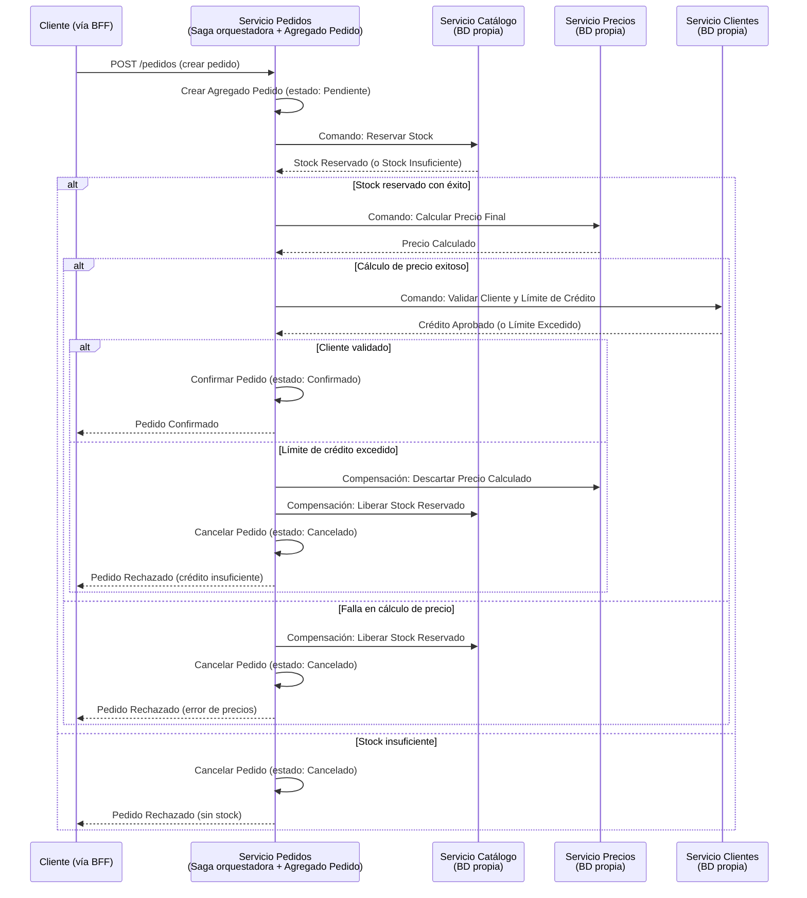
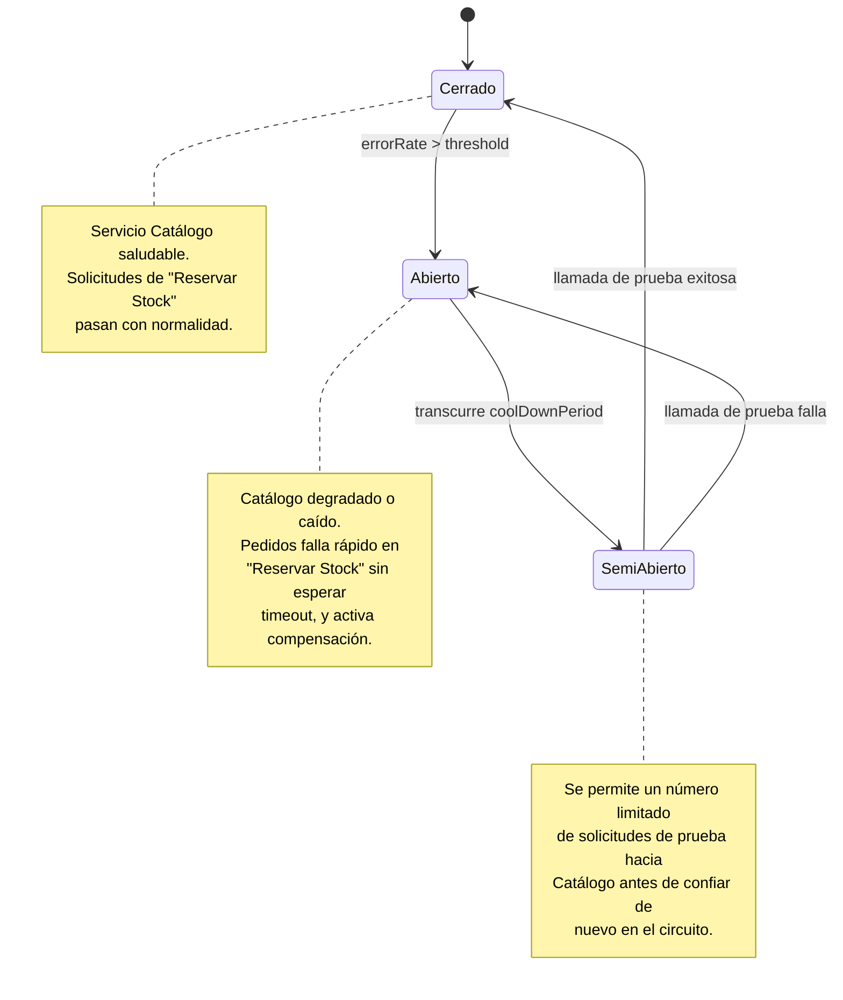

# Hito 2 — Comportamiento distribuido y DDD

## Sección 1 — Flujo "Realizar Pedido" y elección de SAGA

**Base de Datos por Servicio:** Pedidos, Catálogo, Precios y Clientes acceden exclusivamente a su propia base de datos; ningún paso del flujo realiza una consulta cruzada directa a la base de datos de otro servicio — toda interacción ocurre vía comando/respuesta.

| Aspecto | Coreografía | Orquestación |
|---|---|---|
| Estructura | Basada en eventos, descentralizada | Coordinador centralizado (la Saga en el Servicio de Pedidos) |
| Facilidad de depuración | Más difícil de depurar (el flujo está implícito entre varios manejadores de eventos) | Más fácil de monitorear (todo el flujo pasa por un único punto) |
| Acoplamiento | Menor acoplamiento entre servicios | Introduce acoplamiento explícito con el orquestador |

**Decisión final:** se elige **Orquestación**. El flujo de "Realizar Pedido" tiene 3 validaciones secuenciales estrictamente dependientes (stock → precio → crédito) donde cada paso depende del éxito del anterior; el trade-off de "más fácil de monitorear" pesa más que el acoplamiento introducido, dado que este es el flujo de negocio más crítico de ShopStream y necesita ser auditable end-to-end desde un único punto (la Saga).

---

## Sección 2 — Resiliencia: Retry y Circuit Breaker

| Llamada (origen→destino) | Patrón aplicado | Justificación (idempotencia/criticidad) |
|---|---|---|
| Pedidos → Catálogo (Reservar Stock) | Circuit Breaker + Retry (con clave de idempotencia) | Llamada crítica para la consistencia del inventario; se vuelve idempotente asociando cada intento a un ID de reserva, lo que permite reintentar sin duplicar la reserva; Circuit Breaker evita saturar Catálogo si está degradado |
| Pedidos → Precios (Calcular Precio Final) | Retry con backoff exponencial | Operación de solo lectura/cálculo, naturalmente idempotente (recalcular no tiene efectos secundarios); no requiere Circuit Breaker porque una falla aquí no compromete el estado de otros servicios |
| Pedidos → Clientes (Validar Cliente y Crédito) | Circuit Breaker + Retry | Llamada crítica para aprobar/rechazar el pedido; la validación es idempotente (consultar el límite de crédito no lo modifica), pero Clientes es un servicio de alto tráfico (usado también para autenticación) por lo que necesita Circuit Breaker para aislar fallos |
| Pedidos → Catálogo (Compensación: Liberar Stock) | Retry con backoff exponencial | Transacción compensatoria; debe garantizarse que se ejecute, por lo que se reintenta agresivamente; es idempotente si se asocia al mismo ID de reserva (liberar dos veces la misma reserva no cambia el resultado) |

---

## Sección 3 — Agregado Pedido

| Elemento | Tipo (Raíz/Entidad/Objeto de Valor) | Atributos clave |
|---|---|---|
| `Pedido` | Raíz (Aggregate Root) | `pedidoId`, `clienteId`, `fechaPedido`, `estado` (Pendiente/Confirmado/Enviado/Cancelado) |
| `ArtículoPedido` | Entidad | `productoId`, `cantidad`, `precioUnitario` |
| `DirecciónEnvío` | Entidad | `direccionId`, `calle`, `ciudad`, `codigoPostal`, `pais` |
| `Dinero` | Objeto de Valor | `monto`, `moneda` |

**Invariante:** el monto total del `Pedido` (suma de `ArtículoPedido.precioUnitario × cantidad`) no puede exceder el límite de crédito aprobado del cliente en el momento de la confirmación — esta regla se hace cumplir dentro del método `confirmar()` de la Entidad Raíz `Pedido`, no por ningún sistema externo.

---

## Sección 4 — Context Map: relación Catálogo–CMS

| Patrón candidato | Característica distintiva | ¿Encaja con Catálogo–CMS? |
|---|---|---|
| Cliente-Proveedor (Customer-Supplier) | Relación genérica upstream/downstream; el downstream se adapta a los cambios del upstream | Parcialmente: CMS es upstream y Catálogo downstream, pero esta categoría no captura el mecanismo de integración específico ya definido (eventos) |
| Conformista (Conformist) | El downstream adopta el modelo del upstream sin traducción ni negociación | No aplica bien: Catálogo no necesita adoptar el modelo interno de CMS, solo consumir contenido publicado de forma desacoplada |
| Lenguaje Publicado (Published Language) | Formato de intercambio estandarizado y bien documentado (ej. esquema de eventos) usado entre contextos | Sí: en el Hito 1 ya se definió que CMS → Catálogo se comunica de forma asíncrona vía eventos; esto es exactamente un lenguaje publicado (esquema de evento estandarizado de contenido) |

**Patrón elegido: Lenguaje Publicado (Published Language).** La relación Catálogo–CMS ya quedó establecida en el Hito 1 como una comunicación asíncrona basada en eventos (CMS publica cambios de contenido, Catálogo los consume). Esta es precisamente la característica distintiva del patrón Lenguaje Publicado: un esquema de evento estandarizado y documentado, que permite a Catálogo evolucionar independientemente de CMS mientras ambos respeten el contrato del evento.
