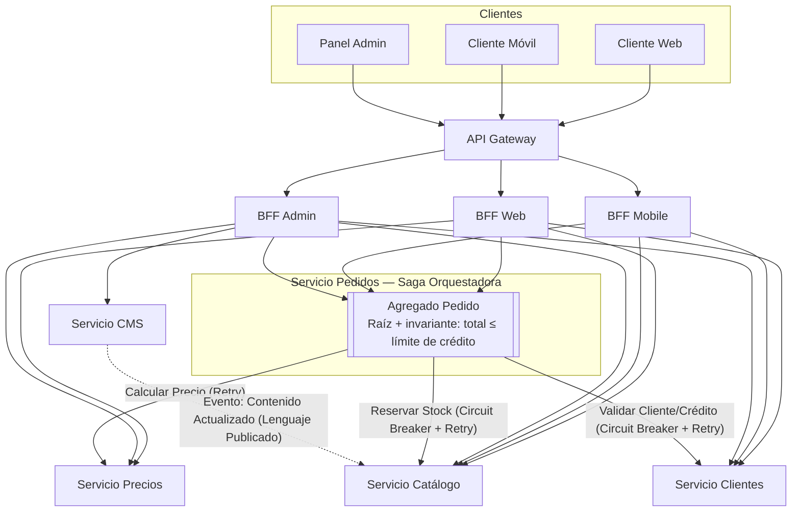

# Hito 3 — Síntesis, operación y defensa

## Sección 1 — Revisión de consistencia y diagrama final

| Elemento verificado | Estado | Resolución aplicada |
|---|---|---|
| Nombres de servicios (Catálogo, CMS, Pedidos, Precios, Clientes) | OK | Los 5 servicios se usan de forma consistente en Hito 1 y Hito 2, sin nombres nuevos ni renombrados |
| Capa de entrada (BFF/Gateway) | OK | El flujo del Hito 2 respeta que el cliente entra vía BFF, consistente con la decisión del Hito 1 |
| Naturaleza de la llamada Pedidos→Catálogo | **Inconsistencia** | El Hito 1 la describía como "validar disponibilidad de stock" (lectura); el Hito 2 la usa como "Reservar Stock" (escritura, compensable). Se resuelve homologando la descripción a "Reservar Stock", ya que es la operación necesaria para que la compensación de la Saga (liberar stock) tenga sentido |
| Tipo de SAGA | OK | La orquestación elegida en el Hito 2 no contradice ninguna decisión del Hito 1 (el Hito 1 no definía SAGA) |
| Ubicación de Retry/Circuit Breaker | OK | Definidos en el Hito 2 sobre las mismas llamadas síncronas ya identificadas en el diagrama v1 del Hito 1 |
| Comunicación CMS↔Catálogo | OK | Definida como asíncrona por eventos en el Hito 1 y reforzada como patrón "Lenguaje Publicado" en el Context Map del Hito 2 |

---

## Sección 2 — Tabla de decisiones arquitectónicas

| Decisión | Opciones consideradas | Elección | Justificación | Trade-off aceptado |
|---|---|---|---|---|
| Subdivisión de Pedidos | Un único servicio Pedidos vs. subdividir en Pedidos + Precios | Pedidos + Precios | Las reglas de precios/promociones cambian con mucha más frecuencia que el ciclo de vida del pedido (heurística de velocidad de cambio) | Un llamado síncrono adicional (Pedidos→Precios) en el flujo de checkout |
| Interacción cliente-sistema | Solo API Gateway / Solo BFF / BFF detrás de Gateway | BFF detrás de API Gateway | Centraliza auth/SSL/rate limiting en el Gateway y permite personalizar datos por canal (Web/Mobile/Admin) en cada BFF | Una capa adicional de despliegue y operación |
| Tipo de SAGA | Coreografía vs. Orquestación | Orquestación | El flujo tiene 3 validaciones estrictamente secuenciales (stock→precio→crédito); se prioriza fácil monitoreo sobre menor acoplamiento | Acoplamiento explícito de los 3 servicios con el orquestador (Servicio Pedidos) |
| Resiliencia en Reservar Stock y Validar Cliente | Retry solo / Circuit Breaker solo / Ambos / Ninguno | Circuit Breaker + Retry | Son llamadas críticas para el resultado del pedido; deben fallar rápido si el servicio remoto está degradado, y reintentar de forma segura vía idempotencia | Mayor complejidad de implementación (claves de idempotencia) |
| Relación Catálogo–CMS | Cliente-Proveedor / Conformista / Lenguaje Publicado | Lenguaje Publicado | El mecanismo de integración ya definido (eventos asíncronos) es exactamente un esquema de evento estandarizado | Catálogo depende de que CMS mantenga el contrato del evento estable en el tiempo |

---

## Sección 3 — Impacto de 12-Factor App en el Servicio de Pedidos

| Factor 12-Factor | Definición breve | Aplicación concreta al Servicio de Pedidos de ShopStream |
|---|---|---|
| **6. Procesos** (stateless) | La app debe ejecutarse como procesos sin estado; cualquier estado persistente va en un servicio de respaldo | Pedidos actúa como orquestador de la Saga y debe mantener el estado de cada Saga en curso (paso actual, compensaciones pendientes) en su propia base de datos, no en memoria del proceso — así cualquier instancia de Pedidos puede retomar una Saga interrumpida sin perder progreso |
| **8. Concurrencia** | Escalar horizontalmente vía múltiples instancias del proceso, no solo escalando verticalmente | Pedidos concentra las 3 llamadas críticas del checkout (Catálogo, Precios, Clientes) para los 3 canales de cliente, por lo que es el candidato más probable a cuello de botella; debe ejecutarse como múltiples instancias sin estado detrás de un balanceador para escalar con el volumen de pedidos |

---

## Sección 4 — Reflexión sobre el uso de IA

| Hito | Qué se le pidió al agente | Qué produjo | Aporte concreto al hito |
|---|---|---|---|
| Hito 1 | Aplicar heurísticas DDD para descomponer ShopStream en servicios y decidir el patrón de interacción cliente-sistema, vía un prompt RACE autocontenido | Tabla de 5 servicios con heurísticas justificadas, decisión BFF+Gateway con tabla comparativa, y diagrama v1 con tabla de comunicaciones | Estableció la base estructural (servicios y capa de entrada) sobre la que se apoyaron los Hitos 2 y 3 |
| Hito 2 | Diseñar el flujo distribuido de "Realizar Pedido", elegir tipo de SAGA, ubicar Retry/Circuit Breaker, y modelar el agregado Pedido + Context Map Catálogo-CMS | Diagrama de secuencia con compensaciones, tabla de resiliencia por llamada, definición del agregado con invariante, y elección justificada de patrón de Context Map | Tradujo la arquitectura estática del Hito 1 en comportamiento distribuido concreto, sin contradecir las decisiones previas |
| Hito 3 | Revisar consistencia entre Hitos 1-2, consolidar decisiones en tabla ADR, aplicar 12-Factor a Pedidos, y documentar el uso de IA | Tabla de verificación (detectó una discrepancia real en la descripción de la llamada Pedidos→Catálogo), diagrama final consolidado, tabla de decisiones, tabla 12-Factor, y este resumen | Cerró el ciclo de diseño detectando y corrigiendo una inconsistencia real entre hitos, y consolidó todo en un entregable único y defendible |

**Reflexión:** el agente fue más autónomo en tareas de aplicación directa de patrones conocidos (SAGA, Circuit Breaker, Context Map), donde el conocimiento de referencia embebido en cada prompt bastó para justificar decisiones sin intervención adicional. Necesitó declarar supuestos explícitos donde el escenario no daba información (ej. los canales de cliente de ShopStream, ausentes en el enunciado original). La revisión de consistencia del Hito 3 mostró que, sin una instrucción explícita de auto-verificación cruzada entre hitos, la discrepancia entre "validar stock" (Hito 1) y "reservar stock" (Hito 2) no se habría detectado por sí sola.

---

## Sección 5 — Entregable consolidado

**Índice del laboratorio:**
1. [Hito 1 — Descomposición y arquitectura base](./hito1.md)
2. [Hito 2 — Comportamiento distribuido y DDD](./hito2.md)
3. [Hito 3 — Síntesis, operación y defensa](./hito3.md) *(este documento)*

**Resumen ejecutivo:** ShopStream se descompone en 5 microservicios (Catálogo, CMS, Pedidos, Precios, Clientes), expuestos a 3 canales de cliente vía BFF detrás de un API Gateway. El flujo de creación de pedido se coordina mediante una Saga orquestada por el Servicio de Pedidos, con Circuit Breaker y Retry en las llamadas críticas a Catálogo y Clientes. El agregado Pedido garantiza que ningún pedido supere el límite de crédito del cliente, y la relación Catálogo–CMS se integra mediante Lenguaje Publicado sobre eventos asíncronos. La arquitectura prioriza autonomía de despliegue por servicio y consistencia eventual entre contextos por sobre consistencia inmediata global.
